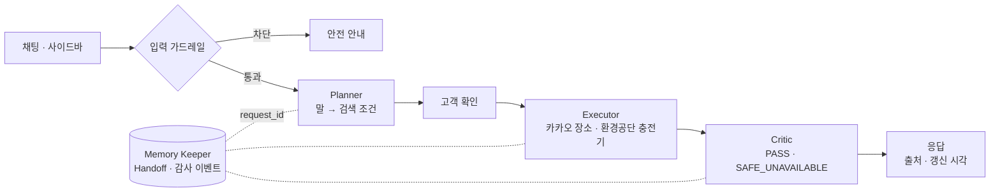
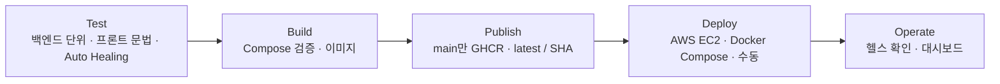

# ChargePin ⚡

> **묻는 대로, 확인된 만큼.**
> 서울 전기차 충전소를 자연어로 찾고, 확인된 정보만 보여 주는 멀티 에이전트 서비스

엔코아 AI캠퍼스 AI 어플리케이션 2기 · 교과목 3 「멀티 에이전트 협업 및 서비스 운영」 프로젝트

---

## 무엇을 해결하나

운전 중인 고객은 “서울 근처 급속 충전소”처럼 말합니다. ChargePin은 이 말을 **검색 조건**으로 바꾸고, 고객이 조건을 확인한 뒤에만 공공 데이터를 조회합니다. 상태를 확인할 수 없는 충전기는 “충전 가능”으로 단정하지 않습니다.

| 고객의 말 | ChargePin의 처리 |
|---|---|
| 범위를 말하지 않음 | 검색 범위 1 km, 급속·완속 전체를 기본값으로 |
| “서울”, “강남”처럼 넓은 지역 | 카카오 장소 상위 2곳을 후보로 보여 주고 선택 |
| “2 km로, 급속만” | 직전에 확인한 장소는 유지하고 조건만 변경 |
| 1 · 2 · 3 km 밖의 범위 | 검색하지 않고 가능한 범위를 안내 |
| 시스템 지침 무시, 키 요청, 권한 변경 | 입력 가드레일이 Planner 이전에 차단 |

## 아키텍처



- **Orchestrator는 에이전트가 아니라 코드**입니다. 순서와 권한을 코드가 지킵니다.
- 모든 단계는 `request_id` 하나로 이어져, 결과가 왜 나왔는지 처음부터 다시 따라갈 수 있습니다.

### 에이전트 권한

| Agent | 할 수 있는 일 | 할 수 없는 일 |
|---|---|---|
| Planner | 말 → 검색 조건 초안, 확인 질문 (단순한 문장은 규칙, 필요할 때만 gpt-4o-mini · 스키마 고정. 호출 실패 시 검색 중단) | 외부 API 호출, 검색 결과 생성 |
| Executor | 카카오 장소 · 환경공단 충전기 조회, 결과 정규화 | 품질 판정, 근거 없는 합성 |
| Critic | 최신성 · 상태 검증, PASS / SAFE_UNAVAILABLE 판정 | API 호출, 결과 수정 |
| Memory Keeper | Handoff · 감사 이벤트 · 대화 조건 저장 | 검색, 판정, 외부 호출 |

## 가드레일

막은 것과 통과시킨 것을 모두 기록합니다. 판정은 코드로, 해석만 LLM으로.

| 계층 | 통제 | 판정 방식 |
|---|---|---|
| 입력 | 지침 무시 · 비밀 정보 요청 · 타인 데이터 · 권한 변경 4개 범주 차단, 차단 원문 미보존 | 결정적 규칙, Planner 이전 |
| 행동 | Planner에는 도구가 없고 Executor만 허용된 API 호출 | 구조로 차단 |
| 출력 | 확인되지 않은 충전 상태는 단정하지 않음 | Critic PASS / SAFE_UNAVAILABLE |
| 접근 | 운영 API 관리자 전용, 대시보드 역할 제한 | 서버 403 재검증 |

정책은 `Backend/app/agents.py`의 코드(Policy as Code)로 관리하고, 저장소 리뷰와 테스트를 거쳐 이미지로 만들어집니다.

## 운영 대시보드

메뉴 이름을 운영자의 질문으로 정했습니다. 모든 값에는 기준(현재 세션 · 코드 기준 · 관리표 기록 · GitHub 실시간 · 연결 대기)을 붙이고, 없는 수치는 만들지 않습니다.

| 메뉴 | 운영자의 질문 |
|---|---|
| 운영 개요 | 지금 상태는? 무엇부터 조치하나? |
| 에이전트 처리 | 요청이 Planner → Executor → Critic을 어떻게 지났나? |
| 가드레일 | 무엇이 막히고 무엇이 통과했나? 오류는 요청 측(4xx)인가 서버 측(5xx)인가? |
| 안정성·힐링 | 의존성 상태는? 장애 유형별로 어떻게 대응하나? |
| 배포 파이프라인 | 어느 게이트에서 멈췄나? 무엇이 수동인가? |
| 컴플라이언스 | 평가 기준별로 무엇이 증빙되었나? (상급 관리자 CSV 내보내기) |

설계 문서: [`Frontend/design/dashboard_compliance_design.md`](Frontend/design/dashboard_compliance_design.md)

## 배포와 CI/CD



- 앞 단계가 실패하면 `needs`로 연결된 뒤 단계는 실행되지 않습니다.
- 프론트는 Compose 서비스 이름 `backend`로 백엔드를 찾고, 백엔드가 healthy일 때만 기동합니다.
- API 키는 `.env`로 백엔드에만 주입하고, 프론트에는 지도 JavaScript 키만 전달합니다.

## 감지와 복구

| 장애 유형 | 감지 신호 | 대응 |
|---|---|---|
| 프로세스 중단 | 컨테이너 헬스체크 실패 | Watchdog 재시작 (시험 1회 8.48초) |
| 일시 오류 | 5xx · 429 · 응답 지연 | 시간 제한 · 재시도 안내(503) · 관리자 재처리(최대 2회) |
| 기능 불능 | LLM 호출 실패 · 제공처 인증 만료 | 검색 중단 후 재입력 안내 · SAFE_UNAVAILABLE |
| 데이터 지연 | 충전 상태 갱신 지연 | ‘정보 지연’ 표시, 단정하지 않음 |

## 컴플라이언스 자가 점검 (2026-11-08 기준)

평가 기준 P3-1 · P3-2 · P3-3과 에이전트 가드레일을 18개 점검 항목으로 나눴습니다. 평가 결과가 아닌 팀 자가 점검입니다.

| 판정 | 의미 | 항목 수 |
|---|---|---|
| 충족 | 구현 + 실행 증빙 | 1 |
| 구현 | 코드 · 문서로 구현, 실행 증빙 대기 | 8 |
| 부분 | 일부 구현 · 일부 증빙 | 5 |
| 미착수 | 구현 또는 증빙 없음 | 4 |

대시보드에서는 헬스 체크, 세션 판정, CI 결과 같은 실시간 신호가 있을 때 ‘구현’ 항목만 ‘충족’으로 올립니다. 항목 원본: [`Frontend/compliance_reference.json`](Frontend/compliance_reference.json)

## 실행

```powershell
Copy-Item .env.example .env
docker compose up --build
```

- 프론트: `http://localhost:8501`
- 백엔드 문서: `http://localhost:8000/docs`
- 상태 확인: `http://localhost:8000/healthz`

로컬 실행, 환경 변수 설명은 기존 [README](README.md)의 실행 절을 따릅니다.

## 테스트

```powershell
cd Backend;  py -m pytest -q
cd Frontend; py -m pytest -q
cd ..;      py -m pytest -q tests/ops
```

## 다음 단계

- 증빙 채우기: 필수 장애시험 12회, CI 실패 차단 실증, 실패 알림 수신
- 운영 확장: Docker Compose Health Check·Watchdog 로그 연동, EC2 자동 배포와 이미지 기반 롤백, 서버 범위 지표
- 생활에 더 가까운 말: ‘밤에도 여는 곳’, ‘주차 무료인 곳’처럼 이미 받아 오는 이용 시간 · 주차 정보까지 조건으로

---

Team ChargePin · 2026
