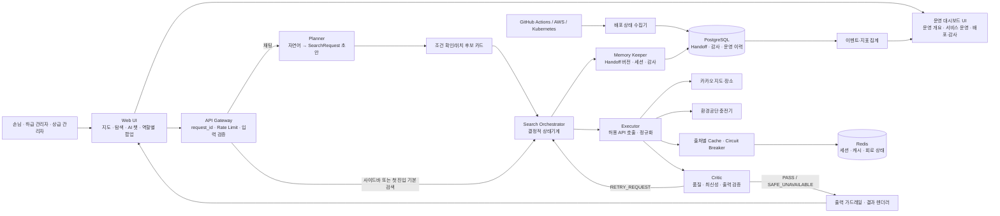
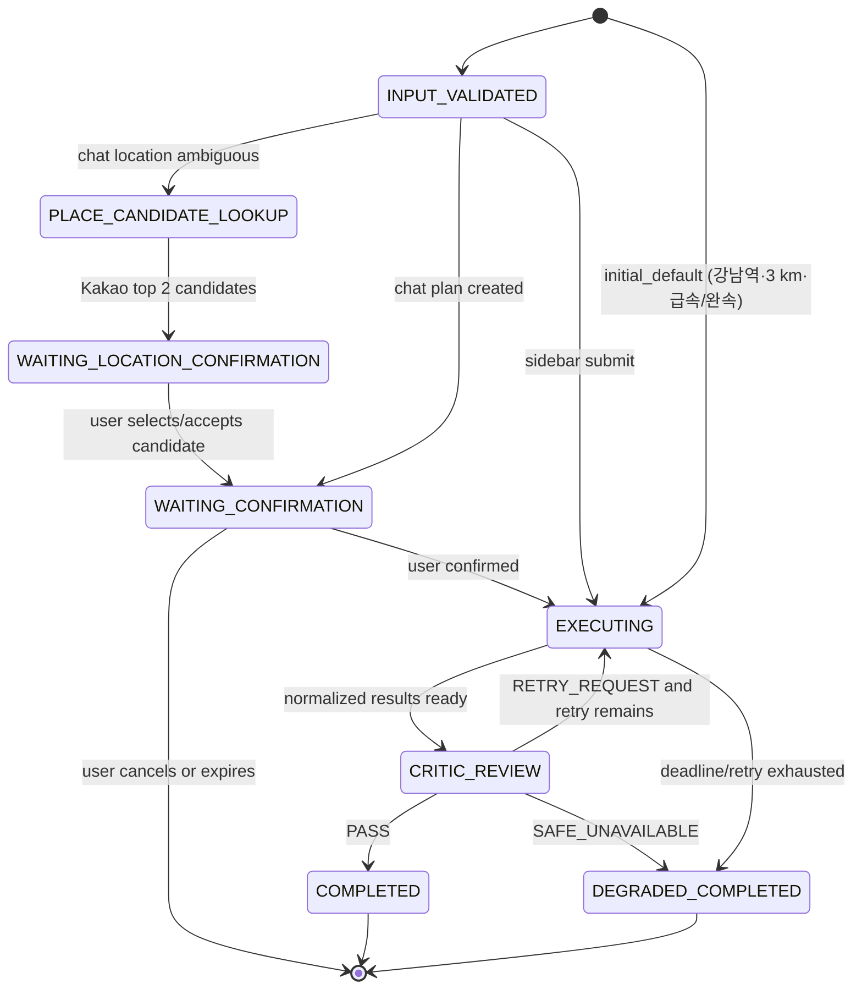
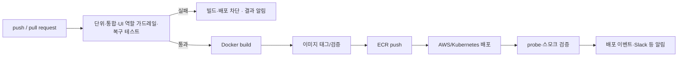

# P3-1 멀티 에이전트 아키텍처 설계서

> 프로젝트: 서울 전기차 충전 자리 안내 서비스  
> 버전: 1.0  
> 작성일: 2026-11-04 (KST)  
> 최종 수정: 2026-11-05 (KST)  
> 기준 기획안: `docs/PRD_1.0.md`

## 1. 설계 목적과 범위

이 설계서는 PRD의 기능·수용 기준을 서비스 경계, 에이전트 책임, API/Handoff 계약, 권한, 운영 규칙으로 구체화한다.

| 구분 | 확정 범위 |
|---|---|
| 사용자 기능 | 서울 중심 지도·사이드바·LLM 채팅으로 충전소와 충전 가능 자리를 조회한다. 주차장은 독립 검색 대상이 아니며, 반경은 1/3/5 km이고 5 km를 넘길 수 없다. |
| 첫 진입 기본값 | `탐색` 탭에서 강남역 주변 3 km, 급속·완속 전체 조건을 즉시 검색하고 사용자는 결과 상단에서 조건을 수정할 수 있다. |
| 장소 후보 | 카카오 지도/장소 API는 지도와 충전소 후보 검색에만 사용한다. 실시간 충전 상태의 근거가 아니다. |
| 충전 상태 | 환경공단 API의 충전기 상태·갱신 시각·시설 유형·이용 가능 시간·주차 무료 여부를 사용한다. |
| 충전 가능 수 | 충전소 ID별로 유효한 충전기 상태를 묶어 `충전 가능 n/전체 m`으로 표시한다. |
| 불확실성 | stale, 누락, 음수, `충전 가능 대수 > 전체 충전기 수`이면 가용성을 추정하지 않고 `확인 불가/정보 지연`으로 표시한다. |
| 후속 구현 | Kubernetes·Circuit Breaker·자동 복구는 P3-2, Test API·CI/CD 배포 게이트는 P3-3에서 구현·검증한다. |

### 설계 원칙

1. Planner는 자연어를 조건으로 바꾸고, 실제 결과는 Executor만 찾는다.
2. 카카오 장소 후보와 환경공단 충전 상태의 출처·의미를 섞지 않는다.
3. Executor가 성공했다고 해서 최신·정상이라고 선언하지 않는다. Critic이 독립 검증한다.
4. 입력·출력·인계 형식은 서버 검증 계약으로 강제한다.
5. 재시도·캐시·Circuit Breaker는 요청과 출처별 한도를 가진다.
6. 첫 접속 서비스 키는 백엔드가 짧은 역할 세션으로 교환하고 검색 API는 세션을 요구한다. 역할별 차단 버튼은 여전히 UI 시연 가드레일이며 작업/API 호출을 시작하지 않는다. Executor의 출처 도구 허용목록은 별도로 강제한다.

## 2. 전체 논리 아키텍처



`Search Orchestrator`는 다섯 번째 에이전트가 아니다. 네 논리 에이전트의 호출 순서, 전체 deadline, 재시도 한도를 결정적으로 적용하는 코드 상태기계다.

## 3. 컴포넌트와 네 논리 에이전트

### 3.1 서비스 컴포넌트 경계

| 컴포넌트 | 책임 | 금지 사항 |
|---|---|---|
| Web UI | 서비스 키 입력, 지도·필터·채팅·조건 확인·안전한 충전소 카드·마커 팝업 표시, 역할별 안내 팝업 | 충전 가능 수·출처·최신성을 임의로 생성, 서비스 키 보관/표시, 차단 버튼에서 작업/API 호출 시작 |
| API Gateway | 서비스 키 비교·짧은 세션 발급, `request_id` 발급, 스키마 검증, rate limit | API 키·원본 payload 노출, 품질 판정 대체 |
| Search Orchestrator | 상태 전이, timeout/deadline, 재시도 한도, 역할 호출 순서 | 외부 출처 API 호출, 품질 판정 |
| Provider Adapter | 출처별 인증, timeout, 오류 분류, 응답 정규화 | 다른 출처 데이터로 상태 추정 |
| UI 역할 규칙 | 손님/하급/상급 관리자의 버튼 노출·팝업·시연 상태 전이 | 실제 운영 권한 변경·정책 변경 API 호출 |
| 운영 대시보드 | 집계·감사·배포 상태를 읽기 전용으로 표시 | 검색, 정책 변경, 외부 시스템 변경 |

### 3.2 네 논리 에이전트 역할

| 역할 | 하는 일 | 입력 | 출력 | 허용 | 금지 |
|---|---|---|---|---|---|
| Planner | 자연어를 검색 조건으로 해석하고 빠진 조건을 묻고 확인 카드를 만든다. | 가드레일 통과 메시지, 최소 세션 문맥 | `SearchRequestDraft`, 추가 질문, 확인 문구 | 구조화된 자연어 해석 | 카카오/환경공단 호출, 실제 결과 생성, 상태 단정 |
| Executor | 확정된 조건 또는 첫 진입 기본 조건으로 충전소·충전기 데이터를 조회·정규화한다. 실제 결과를 찾는 역할이다. | 확정/기본 SearchRequest, 실행 계획, 허용 도구 | `SourceSnapshot[]`, 정규화 결과, 출처/갱신 시각, 오류 분류 | 허용목록 API 호출, 병렬 수집, Cache 조회 | 정책 변경, 최종 품질 판정, 재시도 한도 변경, 근거 없는 합성 |
| Critic | 결과를 독립 검증해 통과·재시도·안전 응답을 결정한다. | 정규화 결과, 실행 계획, 품질 정책, 시도 상태 | `PASS`, `RETRY_REQUEST`, `SAFE_UNAVAILABLE`, 품질 발견 목록 | 수치·최신성·출처·출력 계약 검사, 재시도 요청 | API 호출, 데이터 수정/생성, 재시도 직접 실행 |
| Memory Keeper | 세션, Handoff 버전, 중간 결과, 재시도, 감사 이력을 보존한다. | 단계별 Handoff, 세션/운영 이벤트 | Handoff 버전, 세션 참조, 재시도/감사 이력 | 상태 저장·조회, 버전·해시 연결 | 검색, 품질 판정, 권한 변경, 외부 API 호출 |

외부 데이터 API는 카카오·환경공단 같은 검색 대상 출처를 의미한다. Planner/Critic이 모델 호출을 하더라도 모델은 이 출처 도구, 운영 도구, 비밀값에 접근할 수 없다.

### 3.3 Handoff 칸 소유권

| Handoff 영역 | 쓰기 역할 | 읽기 역할 |
|---|---|---|
| `search_request_draft` | Planner | UI, Orchestrator |
| `confirmation` | UI/API Gateway | Orchestrator, Executor, 감사 |
| `execution_plan` | Orchestrator | Executor, Critic, 감사 |
| `source_snapshots`, `normalized_results` | Executor | Critic, 출력 계층, 감사 |
| `quality_findings`, `critic_decision` | Critic | Orchestrator, 출력 계층, 감사 |
| `session_ref`, `retry_history`, `audit_events` | Memory Keeper | UI/운영 projection |

## 4. 검색 흐름과 상태 전이



### 4.1 자연어 채팅

1. Gateway가 세션 식별, 요청 제한, 인젝션·스키마 검사를 하고 `request_id`를 만든다.
2. Planner가 자연어를 `SearchRequestDraft`로 구조화한다. 조건이 부족하면 질문만 돌려준다.
3. 위치명이 모호하면 Executor가 카카오 장소 후보만 조회해 서울 범위의 상위 2개를 이름·유형·주소와 함께 반환한다. 예를 들어 `서울`이면 1순위 서울시청을 `서울시청 주변 3 km에서 급속·완속 충전소를 찾을까요?`라고 제안한다. 이 단계에서는 환경공단 충전기 상태를 호출하지 않는다.
4. UI가 지역·중심·반경·충전기 타입을 조건 카드로 보여 준다. 사용자가 1순위를 수락하거나 다른 후보를 지정한 뒤 조건을 확인하면 Gateway가 `user_confirmed=true`를 기록한다.
5. Orchestrator가 실행 계획을 고정하고 Executor → Critic을 진행한다.
6. 결과 또는 안전 응답은 출력 가드레일을 통과한 뒤 UI에 보인다.

### 4.2 사이드바 직접 검색

사이드바의 지역, 지도 중심, 충전기 타입, 1/3/5 km 반경은 Gateway가 같은 계약으로 재검증한다. `origin="sidebar"`, `user_confirmed=true`로 즉시 Orchestrator에 진입한다. Planner는 거치지 않지만 이후의 Executor·Critic·Memory Keeper·출력 경로는 채팅과 같다. 첫 진입은 `origin="initial_default"`로 강남역 주변 3 km와 급속·완속 전체를 즉시 실행하며, 사용자는 결과 상단에서 조건을 수정할 수 있다.

### 4.3 중복·취소

- 같은 사용자·동일 조건의 짧은 시간 내 중복 제출은 `idempotency_key`로 하나의 실행으로 합친다.
- 확인 대기 채팅 계획은 만료 또는 취소할 수 있고, 취소된 요청은 Executor로 전달하지 않는다.
- 이미 시작된 호출은 취소 토큰을 전달한다. 늦게 온 결과는 사용자 카드가 아니라 감사 이력에만 보존한다.

## 5. API 계약

`POST /v1/auth/login`은 서비스 키를 비교해 짧은 Bearer 세션과 역할 코드만 반환한다. 검색·채팅 API는 이 세션을 요구하며, 서비스 키 원문은 어떤 응답에도 없다. 역할별 UI 차단은 버튼 클릭 시 안내 팝업만 표시하고 실제 운영 API를 호출하지 않는다.

### 5.1 사용자 API

| API | 목적 | 핵심 규칙 |
|---|---|---|
| `POST /v1/auth/login` | 서비스 키 로그인 | 키 원문을 저장·반환하지 않고 역할 코드와 짧은 Bearer 세션만 반환 |
| `POST /v1/chat/plan` | 자연어 → 조건 확인 카드 | 출처 API를 호출하지 않고 조건 초안 또는 추가 질문만 반환 |
| `POST /v1/search/{request_id}/confirm` | 채팅 조건 확정 | 원 요청 사용자와 `WAITING_CONFIRMATION` 상태가 일치할 때만 실행 |
| `POST /v1/search` | 사이드바 직접 검색 | 반경·지역·타입을 서버에서 검증한 후 실행 |
| `POST /v1/search/default` | 첫 진입 기본 검색 | 강남역 주변 3 km·급속/완속 전체의 서버 고정 조건만 실행하며 요청 본문으로 중심·반경을 바꾸지 못함 |
| `GET /v1/search/{request_id}` | 비동기 결과/상태 조회 | 타 사용자 Handoff·원본 응답을 노출하지 않음 |

#### `POST /v1/search` 요청 예시

```json
{
  "origin": "sidebar",
  "center": {"lat": 37.498, "lng": 127.027, "source": "map"},
  "region_filters": ["서울특별시 강남구"],
  "connector_types": ["DC_FAST", "AC_SLOW"],
  "radius_km": 3,
  "intent": "find_charger"
}
```

서버는 `request_id`, `requested_at`, `user_confirmed`, `request_schema_version`, 적용 정책 버전을 추가한다. `radius_km`가 1/3/5 이외면 `400 INVALID_SEARCH_REQUEST`를 반환하고 Executor를 호출하지 않는다.

#### 안전한 결과 DTO 예시

```json
{
  "request_id": "uuid",
  "status": "completed",
  "results": [{
    "facility_id": "provider-scoped-id",
    "facility_kind": "charger_station",
    "name": "서울역 전기차 충전소",
    "availability": {
      "state": "AVAILABLE",
      "available_chargers": 2,
      "total_chargers": 5,
      "label": "충전 가능 2/5"
    },
    "source": "KECO_EV",
    "reported_at": "2026-11-04T10:00:00+09:00",
    "fetched_at": "2026-11-04T10:00:03+09:00"
  }]
}
```

`availability.state`는 `AVAILABLE`, `DELAYED`, `UNAVAILABLE`, `CANDIDATE_ONLY` 중 하나다. 뒤의 세 상태에는 `available_chargers`·`total_chargers`를 넣지 않는다.

### 5.2 역할별 UI 시연 규칙

| UI 행동 | 손님 | 하급 관리자 | 상급 관리자 | 처리 |
|---|---|---|---|---|
| 운영 대시보드 진입 | 불가 | 가능 | 가능 | 손님은 블러 배경의 `관리자 전용 화면입니다.` 팝업을 보고 대시보드 데이터를 요청하지 않는다. |
| 재처리·캐시 갱신 버튼 | 불가 | 가능 | 가능 | 현재는 시연 상태만 바꾸며 실제 운영 API를 호출하지 않는다. |
| 재시도 횟수 1/2/3회 정책 | 불가 | 불가 | 가능 | 상급 전용 버튼을 하급 관리자가 누르면 `상급 관리자 전용 기능입니다.` 팝업을 보인다. |
| 손님/하급 관리자 역할 전이 | 불가 | 불가 | 가능 | 현재는 프런트 시연 상태만 바꾸며, 상급 관리자 자신의 역할을 바꾸는 전이는 제공하지 않는다. |

## 6. SearchRequest, 출처 정규화, Handoff

### 6.1 SearchRequest 계약

| 필드 | 검증 | 설명 |
|---|---|---|
| `request_id` | UUID, 서버 생성 | 전체 추적 키 |
| `origin` | `chat` / `sidebar` / `initial_default` | 입력 경로 |
| `requested_at` | timezone 포함 ISO-8601 | 요청 시각 |
| `center` | 서울 서비스 범위의 좌표 | 지도 중심/선택 위치 |
| `region_filters` | 서울 행정 구역 목록 또는 빈 목록 | 지역 제한 |
| `connector_types` | 허용 enum 목록 | 충전기 타입 |
| `radius_km` | `1`, `3`, `5` | 최대 5 km |
| `intent` | `find_charger` 고정 | 검색 대상은 충전소·충전 자리만 허용 |
| `user_confirmed` | 서버 기록 Boolean | 채팅의 실행 허가 |
| `policy_version` | 문자열 | 재현 가능한 정책 적용 |

### 6.2 출처별 정규화

| 출처 | 필수 필드 | 표시 가능 | 표시 금지 |
|---|---|---|---|
| 카카오 | 장소 ID, 이름, 주소/좌표, 후보 검색 시각 | 지도·장소 후보 | 실시간 충전 가능 상태 |
| 환경공단 | `statId`, `chgerId`, 타입, `stat`, `statUpdDt`, `delYn`, `kind`, `kindDetail`, `useTime`, `parkingFree`, `limitYn`, `limitDetail` | 충전 가능 수/전체 수, 충전 상태·시각, 검증된 부가 정보 | 카카오 후보로 추론한 상태, 외부인 이용 여부, 요금 금액, 근거 없는 이용 제한시간 |

모든 `SourceSnapshot`에는 `provider`, `provider_record_id`, `reported_at`, `fetched_at`, `normalization_version`, `fetch_status`, `raw_payload_ref`가 있다. 원본 payload는 접근 제어 저장소의 참조로만 다루고 UI·로그에 그대로 넣지 않는다.

### 6.3 Handoff 필수 계약

| 영역 | 필수 필드 | 작성 주체 |
|---|---|---|
| 추적 | `request_id`, `trace_id`, `handoff_version`, `created_at` | Orchestrator/Memory Keeper |
| 사용자 문맥 | `ui_role`, `session_ref`, `origin`, `raw_input_ref` | Gateway |
| 검색 조건 | `search_request`, `confirmation` | Planner/사이드바 어댑터/UI |
| 실행 | `execution_plan`, `deadline_at`, `policy_version` | Orchestrator |
| 외부 데이터 | `source_snapshots`, `normalized_results`, `provider_errors` | Executor |
| 품질 | `quality_findings`, `critic_decision` | Critic |
| 재시도 | `attempt_no`, `retry_history`, `remaining_attempts` | Orchestrator/Memory Keeper |
| 감사 | `audit_events`, `intermediate_refs`, `result_hash` | Memory Keeper/UI 역할 규칙 |

Executor 시작 전에는 유효한 SearchRequest·확인 상태·실행 계획·세션 참조가 모두 필요하다. Critic 시작 전에는 모든 출처 결과에 `reported_at` 또는 오류/누락 사유가 있어야 한다. 사용자 응답 전에는 Critic 결정과 카드별 출처·시각 또는 안전 사유가 있어야 한다.

## 7. 데이터 품질, 재시도, 캐시, Circuit Breaker

### 7.1 Critic 품질 판정

| 조건 | Critic 결정 | 사용자 표시 |
|---|---|---|
| `total_chargers <= 0`, `available_chargers < 0`, `available_chargers > total_chargers` | `SAFE_UNAVAILABLE` | `충전 가능 n/m` 미표시, `확인 불가` |
| `statUpdDt` 누락/파싱 불가 | `SAFE_UNAVAILABLE` | `갱신 시각 확인 불가` |
| freshness 한도 초과 | `SAFE_UNAVAILABLE` | `정보 지연` + 마지막 보고 시각 |
| 환경공단 상태 코드가 공식 해석표에 없거나 상태 누락 | `SAFE_UNAVAILABLE` for charger state | 장소 후보는 가능, 충전 상태는 확인 불가 |
| 카카오 후보만 존재 | `PASS` with `CANDIDATE_ONLY` | 장소 후보만 표시 |
| 시설 동일성 근거 부족 | `PASS` with split facilities | 인근 시설을 별도 카드로 표시 |

충전 가능 대수는 수치가 유효할 때만 `statId`별로 삭제되지 않은 고유 `chgerId`를 묶고, 공식 상태 코드 해석표상 `충전 가능`인 충전기 수를 세어 계산한다. 상태 코드 해석표 버전도 Handoff와 감사 이력에 기록한다.

### 7.2 재시도 결정표

| 상황 | 재시도 | 처리 |
|---|---:|---|
| timeout, 연결 실패, HTTP 408/429/5xx | 가능 | 전체 deadline과 정책 한도 안에서 해당 출처만 지수 백오프 재호출 |
| HTTP 401/403, provider 계약 오류 | 불가 | 해당 출처 `UNAVAILABLE`, 운영 알림 |
| stale, 갱신 시각 누락, invalid_count | 불가 | 반복 호출로 신선해지지 않으므로 즉시 안전 응답 |
| 입력 스키마/가드레일 오류 | 불가 | 4xx/차단 이벤트, Executor 미호출 |
| Planner 구조화 출력/LLM 오류 | 자동 검색 불가 | 외부 조회 없이 조건 재질문, `llm_plan_error` 기록 |
| 비치명 이력 DB 실패 | 제한적 재기록 | 검색은 `degraded`로 유지, 감사 필수 운영 행동은 중지 |

상급 관리자 시연의 `retry_attempt_limit`은 최초 실행 뒤의 추가 재시도 횟수다. 값은 1/2/3 중 하나다. Critic은 요청만 하고 Orchestrator만 실행한다. 현재 UI에서는 이 값을 실제 운영 정책에 쓰지 않는다.

### 7.3 Cache/Circuit Breaker

| 항목 | 설계 |
|---|---|
| 캐시 키 | `provider + normalized_center/geohash + radius + connector_type + intent + schema_version` |
| 캐시 값 | 정규화 결과, 원래 `reported_at`, `fetched_at`, source snapshot 참조, freshness 상태 |
| 캐시 폴백 | API 실패/Circuit Open 시 후보로만 사용. freshness 검사를 다시 통과하지 못하면 `DELAYED` |
| Circuit 범위 | 카카오·환경공단별 독립 상태. 한 출처 Open이 다른 출처를 막지 않음 |
| 상태 | `CLOSED → OPEN → HALF_OPEN → CLOSED`, 모든 전이는 이벤트 기록 |
| 정책값 | timeout, freshness, TTL, 실패 임계치, cooldown은 `PolicyConfig` 버전으로 관리하고 P3-2 실험 후 확정 |

## 8. 가드레일, UI 역할 규칙, 보안

### 8.1 방어 관문

| 관문 | 검사 | 실패 처리 |
|---|---|---|
| 스키마 | 반경 enum, 서울 범위, 허용 타입, 중심점 | 400, Executor 미호출 |
| 요청 제한 | 사용자/세션/IP별 rate limit, idempotency | 429 또는 기존 요청 참조 |
| 인젝션 1차 | 정규화 후 위험 패턴, 시스템/도구 지시, 관리자 기능 요구 | 즉시 차단, 규칙 ID만 기록 |
| 인젝션 2차 | 모호한 입력만 구조화 분류 | 차단 또는 Planner 전달 |
| 도구 권한 | Executor 서비스 계정의 출처 허용목록 | 호출 차단·보안 이벤트 |
| 출력 계약 | 상태·출처·시각·시설 구분·비밀 노출 검사 | 안전 문구 치환 또는 결과 차단 |
| UI 역할 규칙 | 손님/하급/상급 역할에 따른 대시보드·상급 전용 버튼 | 안내 팝업·블러 처리, 해당 작업/API 호출 미시작 |

API 응답도 신뢰할 수 없는 데이터다. 원문에 있는 지시문을 실행하지 않고 정규화 스키마 필드만 사용한다.

### 8.2 사람 역할 UI 가드레일

| 역할 | 조회/채팅 | 대시보드 | 재처리/캐시 갱신 | 재시도 정책 1/2/3회 | 역할 전이 | API 키 원문 |
|---|---:|---:|---:|---:|---:|---:|
| 손님 | 예 | 팝업 차단 | 불가 | 불가 | 불가 | 불가 |
| 하급 관리자 | 예 | 가능 | 시연 UI 가능 | 상급 전용 팝업 | 상급 전용 팝업 | 불가 |
| 상급 관리자 | 예 | 가능 | 시연 UI 가능 | 시연 UI 가능 | `손님→하급/상급`, `하급→손님` 시연 UI 가능 | 불가 |

검색·채팅 API의 로그인 세션은 서버 경계지만, 이 표는 제출용 프런트엔드 시연의 운영 버튼 동작 기준이다. 손님이 대시보드 버튼을 누르면 `관리자 전용 화면입니다.` 팝업과 블러 처리를 하고, 하급 관리자가 상급 전용 버튼을 누르면 `상급 관리자 전용 기능입니다.` 팝업만 표시한다. 어느 차단 행동도 운영 API나 정책 변경을 호출하지 않는다.

### 8.3 시크릿·개인정보

- 키·Authorization 헤더·세션 토큰은 Secret Manager/런타임 시크릿 주입 영역에만 둔다. Docker 이미지, Handoff, 로그, DB projection, UI에는 원문을 두지 않는다.
- 위치·대화·원본 API payload는 최소 범위로 분리 보관하고 분석 이벤트에는 `session_ref`, 해시, 규칙 ID, 참조만 기록한다.
- 정확한 보존 기간과 위치 정밀도는 구현 전 확정해야 하는 미결정 사항이다.

## 9. 저장소와 운영 관측

### 9.1 저장소 경계

| 저장소/테이블 | 내용 | 실패 시 처리 |
|---|---|---|
| `search_requests` | 조건, 상태, actor 참조, 정책 버전 | 상태 재조회 저하 |
| `handoff_versions` | 버전, 단계, sanitized state, 해시 | 필수 감사 실패 시 운영 작업 중지 |
| `source_snapshots` | 출처 식별자·시각·정규화 결과·원본 참조 | 결과 근거 재현 저하 |
| `retry_history` | 시도·사유·대기·결과 | 실행 중지로 무한 재시도 방지 |
| `policy_versions` | freshness/timeout/TTL/회로/재시도 정책 | 마지막 검증 정책을 읽기 전용 유지 |
| `audit_events` | 권한·차단·운영 행동·역할 변경 | 감사 필수 행동 중지 |
| `deployment_events` | CI job, 이미지 버전, 배포 결과 | 검색 영향 없음 |
| Redis | 세션, Cache, Circuit, rate limit counter | 캐시/세션 저하, 정책 내 원본 호출 |

PostgreSQL은 영속 이력, Redis는 짧은 수명의 세션·캐시·회로 상태를 맡는다. 이력 저장이 느리거나 실패해도 일반 검색은 `degraded`로 계속할 수 있지만, 권한 변경·운영 재처리처럼 감사가 필수인 행동은 영속 기록 실패 시 실행하지 않는다.

### 9.2 구조화 이벤트와 메트릭

```json
{
  "ts": "2026-11-04T10:00:00+09:00",
  "event": "agent_stage_completed",
  "request_id": "uuid",
  "trace_id": "trace-id",
  "handoff_version": 4,
  "ui_role": "GUEST",
  "stage": "executor",
  "status": "ok",
  "duration_ms": 120,
  "attempt_no": 1,
  "policy_version": "2026-11-04.1"
}
```

| 오류 영역 | 필수 분류 | 대시보드 지표 |
|---|---|---|
| API | provider, HTTP class, timeout, circuit state | 출처별 성공률·지연·오류·마지막 성공 |
| DB | store, operation, critical 여부 | DB 오류·degraded·영속 실패 |
| LLM | model, phase, error class, tokens | Planner 오류·지연·토큰 |
| 프롬프트/가드레일 | guard stage, rule ID, action | 차단 수·규칙별 추이 |
| UI 역할 가드레일 | UI 역할, 버튼, 팝업 종류, 차단 여부 | 역할별 팝업·시연 운영 행동 |
| 배포 | workflow run, image version, environment, decision | Actions/test/build/deploy·차단 사유 |

대시보드는 외부 API, 에이전트 성공·재시도, 데이터 품질, 가드레일, Cache/Circuit 복구, API/DB/LLM/프롬프트 오류, GitHub Actions/AWS/Kubernetes 배포 상태를 모두 읽기 전용 projection으로 보여 준다. 배포 상태는 서명 검증된 webhook 또는 읽기 전용 상태 수집기가 `deployment_events`에 저장한다.

### 9.3 Health 모델

| 상태 | 의미 |
|---|---|
| `ok` | 핵심 API·필수 시크릿·안전한 요청 처리 경로가 준비됨 |
| `degraded` | 이력 DB/캐시/대시보드 등 비치명 기능 저하, 안전한 검색은 가능 |
| `down` | 필수 보안 설정 또는 핵심 요청 처리 불가 |

P3-2에서 liveness는 프로세스 생존만 빠르게 확인하고, readiness는 서비스가 안전한 요청을 처리할 수 있는지 짧은 timeout으로 확인한다.

## 10. 배포, 테스트, P3-2/P3-3 연계

### 10.1 컨테이너와 AWS

- API 서비스, Web UI, 운영 대시보드는 독립 Docker 이미지로 만든다.
- 이미지에는 `.env`와 키를 넣지 않고 런타임 시크릿 참조를 사용한다.
- ECR 등 AWS 레지스트리에 commit SHA와 릴리스 버전으로 이미지를 추적한다.
- P3-2에서 Kubernetes Pod/Deployment, Service, 디스커버리·로드밸런싱, health probe, Auto Healing을 구현한다.

### 10.2 CI/CD 게이트



P3-3에서는 테스트 통과 뒤에만 build→Docker→AWS/Kubernetes가 진행되며, 배포·스모크 실패도 다음 승격을 중단하고 `deployment_blocked` 이벤트를 남긴다.

### 10.3 Test API와 Test Checker

| 시나리오 | Test API 조건 | Checker 기대 결과 |
|---|---|---|
| `normal` | 유효 시각·정상 상태 코드·`충전 가능 대수 ≤ 전체 충전기 수` | `PASS`, `충전 가능 n/m`, 출처·시각 포함 |
| `stale` | freshness 초과 `reported_at` | `SAFE_UNAVAILABLE`, 정보 지연 |
| `invalid_count` | 음수 또는 충전 가능 대수가 전체 충전기 수 초과 | `충전 가능 n/m` 미표시, 확인 불가 |
| `timeout` | adapter timeout/5xx/429 | 한도 내 재시도, 소진 시 출처별 안전 응답 |
| `llm_error` | Planner 구조화 출력/모델 호출 실패 | 외부 검색 미실행, 조건 재질문/안전 오류 |
| `boom_1_no_results` | `/boom/1=NO_RESULTS` | 적용 조건과 `조건에 맞는 충전소를 찾지 못했습니다.` 표시 |
| `boom_2_delayed` | `/boom/2=DATA_DELAYED` | `정보 지연` 안전 문구·시나리오 로그 |
| `boom_3_rate_limited` | `/boom/3=RATE_LIMITED` | 요청 제한 문구·시나리오 로그 |
| `boom_4_auth_expired` | `/boom/4=PROVIDER_AUTH_EXPIRED` | 제공자 인증 만료 문구·시나리오 로그 |
| `boom_5_ai_unavailable` | `/boom/5=AI_CHAT_UNAVAILABLE` | AI 챗 연결 실패 문구·시나리오 로그 |
| `ui_role_blocked` | 손님의 대시보드, 하급 관리자의 상급 전용 버튼 | 안내 팝업, 작업/API 호출 없음 |
| `guardrail_blocked` | 인젝션·관리자 기능 요구 | 도구 호출 없음, 차단 이벤트 |

## 11. PRD 추적성과 P3-1 완료 기준

| PRD 요구군 | 대응 섹션 |
|---|---|
| 사용자 검색·채팅 | 4, 5, 6 |
| 데이터 품질·폴백 | 6.2, 7 |
| 네 역할·Handoff | 2, 3, 6.3 |
| 가드레일·UI 역할·운영 | 5.2, 8, 9 |
| 장애 격리·추적·시크릿·테스트 | 7, 8.3, 9, 10 |

- [ ] 채팅 계획과 사이드바 검색이 동일한 SearchRequest 계약으로 합류한다.
- [ ] Planner는 조건 구조화만 하고 실제 외부 결과 조회는 Executor만 한다.
- [ ] Executor/Critic/Memory Keeper의 입력·출력·권한·금지 행동이 분리됐다.
- [ ] Handoff에 요청 ID, 사용자 역할, SearchRequest, 실행 계획, API 결과, 출처·갱신 시각, 재시도, Critic 판정이 있다.
- [ ] 충전 가능 대수/전체 충전기 수·충전 상태·장소 후보의 출처와 표시 금지가 명확하다.
- [ ] stale/invalid_count/timeout/LLM 오류의 결정표와 안전 응답이 있다.
- [ ] 손님/하급 관리자/상급 관리자 UI 가드레일, API 키 비공개가 정의됐다.
- [ ] API/DB/LLM/프롬프트/UI 역할 가드레일/배포 이벤트와 대시보드 projection이 정의됐다.
- [ ] API 계약, Cache/Circuit Breaker, rate limit, health 상태가 정의됐다.

## 12. 미결정 사항

1. 실제 카카오·환경공단 필드, 안정 식별자, 인증, 호출 한도, 갱신 주기, 약관.
2. 서울 서비스 범위, 시설 병합 좌표 오차, 이름·주소 정규화 사전.
3. 출처별 freshness/timeout/TTL/실패 임계치/cooldown과 rate limit 수치.
4. 인증 공급자와 token claim 구조, 위치·대화·원본 payload·감사 로그 보존 기간.
5. AWS/Kubernetes 환경명, 롤백 방식, GitHub webhook 검증, 알림 채널.

확정 전에는 실시간성·응답 시간·가용성 수치를 임의로 약속하지 않는다.

## 13. 수업 실습 패턴 반영

| 실습 | 반영 패턴 | 적용 위치 |
|---|---|---|
| Day02 역할분리·데이터계약·Handoff | 역할 카드, Pydantic 계약, 인계 | 3, 6 |
| Day12~15 보안 실습 | 입력/출력 가드레일, 도구 권한, UI 역할 규칙, 감사 | 8 |
| day09 logging lab | JSON 구조화 로그, 요청/LLM 지연 | 9.2 |
| day10 healing lab | 유한 재시도, health, 감시 | 7.2, 9.3 |
| day11 dashboard lab | 로그/DB 이력/대시보드 분리, degraded | 9 |
| day06~08 Docker/AWS/CI | 컨테이너, 시크릿 외부 주입, test→build 게이트 | 10 |
| Day17 Planning/Tracing | Planning, 상태 전이, trace, 체크포인트 | 3~4 |
