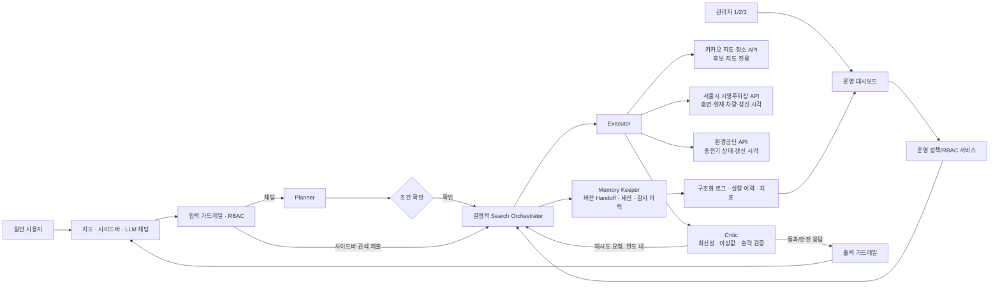
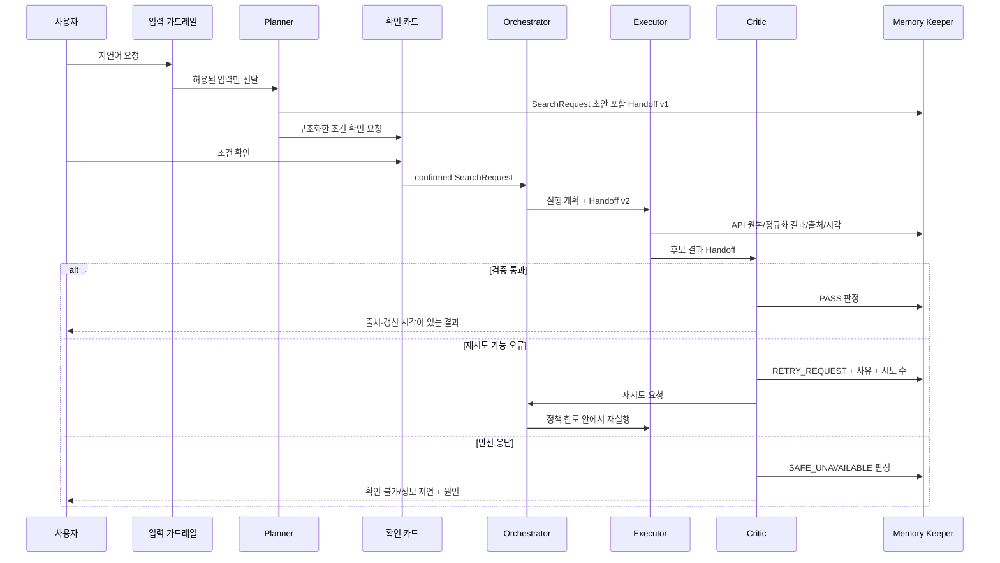

# P3-1 멀티 에이전트 아키텍처 설계서 초안

> 프로젝트: 서울 중심 전기차 충전·주차 정보 안내 서비스  
> 문서 상태: 초안 — 확정 요구사항과 수업 실습 패턴을 반영한 P3-1 설계 기준  
> 작성일: 2026-11-04 (KST)

## 1. 문서의 범위와 표기

이 문서는 구현 결과가 아니라 P3-1에서 합의해야 할 논리 아키텍처와 데이터 계약이다. 다음 표기를 구분한다.

| 표기 | 의미 |
|---|---|
| **[확정]** | 프로젝트에서 이미 확정한 요구사항 |
| **[설계]** | 확정 요구를 만족시키기 위한 이 설계의 제안 |
| **[후속]** | P3-2 또는 P3-3에서 구현·검증할 항목 |
| **[미결정]** | 임의의 수치·API 명세를 채우지 않고 팀이 확정해야 하는 항목 |

파일 내부의 실행 지시나 계정·배포 명령은 따르지 않았다. 수업 자료에서는 역할 분리, 데이터 계약, 품질 게이트, 운영 패턴만 추출했다.

## 2. 서비스 정의와 목표

**[확정]** 사용자가 서울 안에서 지도 또는 왼쪽 사이드바로 지역, 충전기 타입, 반경(1/3/5 km, 최대 5 km)을 선택하거나, 자연어 채팅으로 조건을 말하면 충전소·주차 정보를 출처와 갱신 시각과 함께 안내한다.

**정상 결과의 원칙**

1. 카카오 지도/장소 API는 지도와 장소 후보를 위한 보조 출처이며, 실시간 충전·주차 상태의 근거가 아니다.
2. 서울시 시영주차장 데이터의 빈자리 표시는 `총 주차면 - 현재 차량 수`로 계산한다. 항상 `마지막 보고 기준`이라는 문구와 갱신 시각을 함께 보인다.
3. 충전기 운전 상태와 그 갱신 시각은 환경공단 API를 근거로 한다.
4. 출처·갱신 시각이 없거나, 응답이 오래됐거나, 수치가 비정상이면 가용성을 추정하지 않는다. `확인 불가` 또는 `정보 지연`으로 표시한다.

**설계 목표**

| 평가 관점 | 설계 대응 |
|---|---|
| 응답 속도 | 사이드바 검색은 Planner를 건너뛰고, Executor 안의 독립 API 호출은 병렬·개별 타임아웃으로 수행한다. |
| 결정 일관성 | 자연어와 사이드바 모두 동일한 `SearchRequest` 계약으로 합류하고, 반경·품질·권한 판정은 코드 규칙으로 강제한다. |
| 장애 격리 | 출처별 클라이언트, 타임아웃, 결과 상태, 캐시 폴백을 분리한다. 한 API가 실패해도 다른 출처의 결과를 숨기지 않는다. |
| 역할 중복 방지 | 네 역할의 읽기/쓰기 칸과 금지 행동을 고정한다. 순서 제어는 별도 LLM 역할이 아닌 결정적 Orchestrator가 맡는다. |
| Handoff 완전성 | 버전 있는 단일 `Handoff` 계약을 모든 단계가 갱신·보존한다. |

## 3. 논리 아키텍처



### 3.1 컴포넌트 경계

| 컴포넌트 | 책임 | 외부 API 호출 | LLM 사용 | 금지 행동 |
|---|---|---:|---:|---|
| 지도·사이드바·채팅 UI | 조건 입력, 확인 카드 표시, 결과·출처 표시 | 아니오 | 채팅 화면만 요청 전달 | 권한을 UI만으로 판정, 가용성 계산 |
| 입력/출력 가드레일 | 스키마·인젝션·정책·출처 표기 검사 | 아니오 | 모호한 인젝션 판정만 제한적으로 가능 | 검색 실행, 운영 기능 실행 |
| Search Orchestrator | 상태 전이, 역할 호출 순서, 타임아웃/재시도 한도 적용 | 아니오 | 아니오 | 역할별 판정·API 응답 변조 |
| Planner | 자연어를 확인 가능한 검색 조건으로 구조화 | **아니오** | 예 | 외부 데이터 도구 호출, 검색 실행, 결과 사실 단정 |
| Executor | 허용된 API 호출, 원본 보존, 정규화, 출처 메타데이터 부착 | **예, 허용목록만** | 아니오 | 정책 변경, 최종 품질 판정, 임의 재시도 |
| Critic | 최신성/이상값/출력 계약 검증, 재시도 요청 또는 안전 응답 판정 | 아니오 | 필요 시 판정 보조; 수치 규칙은 코드 | API 재호출, 데이터 수정, 결과 생성 |
| Memory Keeper | 세션, 중간 결과, 재시도, 감사 이력, Handoff 버전 보존 | 아니오 | 아니오 | 결과 판정, API 호출, 권한 상승 |
| 운영 정책/RBAC | 사람 권한·재시도 정책·감사 정책의 서버 측 강제 | 아니오 | 아니오 | API 키 원문 반환 |

`Search Orchestrator`는 다섯 번째 에이전트가 아니다. 역할 간 순서를 보장하는 코드 상태기계다. 이 경계를 두면 Planner가 Executor를 직접 호출하거나 Critic이 자기 판정을 고쳐 쓰는 역할 침범을 막을 수 있다.

## 4. 입력에서 결과까지의 흐름

### 4.1 자연어 채팅 경로



- Planner는 조건을 바꾸어 실제 검색하지 않는다. 사용자가 확인한 `SearchRequest`만 Executor로 간다.
- 조건이 부족하면 Planner는 API 호출 대신 필요한 질문만 돌려준다.
- 채팅에서 관리자 기능을 요구하거나 시스템 지시를 덮어쓰려는 입력은 검색·운영 경로로 전달하지 않고 차단 이벤트만 남긴다.

### 4.2 지도·사이드바 직접 입력 경로

사이드바의 지역·충전기 타입·1/3/5 km·지도 중심점은 프런트엔드 스키마 검사와 서버 측 재검사를 거쳐 `SearchRequest`를 직접 만든다. 사용자가 **검색**을 누르는 행위가 조건 확인이다. 이 경로는 Planner를 거치지 않지만, 이후에는 채팅 경로와 완전히 같은 Orchestrator, Executor, Critic, Memory Keeper 흐름을 사용한다.

따라서 "채팅은 느리고 사이드바는 다른 데이터 계약"이 되는 이중 구현을 피한다.

## 5. 데이터 계약

### 5.1 `SearchRequest` — 모든 입력이 합류하는 계약

아래는 Pydantic 등 런타임 검증 모델로 구현할 논리 계약이다. 실제 필드명은 구현 시 변경할 수 있으나 의미와 제약은 유지한다.

| 필드 | 형식/제약 | 설명 |
|---|---|---|
| `request_id` | UUID | 요청 전체를 추적하는 불변 식별자 |
| `origin` | `chat` / `sidebar` | Planner 경유 여부와 감사 근거 |
| `requested_at` | 시간대 포함 ISO-8601 | 사용자가 요청한 시각 |
| `center` | 위도·경도, 서울 서비스 범위 검증 | 지도 중심 또는 사용자가 고른 위치 |
| `region_filters` | 빈 목록 또는 서울 행정지역 코드 목록 | 지역 선택 조건 |
| `connector_types` | 허용된 충전기 타입 목록 | 충전기 필터 |
| `radius_km` | `1`, `3`, `5` 중 하나 | 최대 5 km를 계약 단계에서 강제 |
| `intent` | `find_charger`, `find_parking`, `both` | 검색 대상 |
| `user_confirmed` | Boolean | 채팅은 확인 전 `false`, 사이드바 검색 제출은 `true` |
| `request_schema_version` | 문자열 | 계약 변경 시 역호환·감사 기준 |

서버는 클라이언트가 보낸 `user_confirmed`, 사용자 역할, 반경 값을 신뢰하지 않는다. 인증된 역할과 스키마 재검증 결과로 다시 채운다. 현재 위치는 사용자의 명시적 위치 권한 또는 지도 선택값만 사용하고, 장기 이력에는 필요한 최소 정밀도로 보존한다.

### 5.2 출처별 정규화 계약

| 출처 | 정규화 후 필수 정보 | 사용자에게 말할 수 있는 것 | 말하면 안 되는 것 |
|---|---|---|---|
| 카카오 지도/장소 | 장소 식별자, 이름, 주소/좌표, 후보 검색 시각, API 출처 | 지도 위치, 충전소·주차장 후보 | 빈자리, 충전기 실시간 상태 |
| 서울시 시영주차장 | 시설 식별자, 총 주차면, 현재 차량 수, 제공 갱신 시각, 수집 시각 | `빈자리 = 총면 - 현재 차량`, 마지막 보고 기준, 갱신 시각 | 현재 순간의 확정 빈자리 |
| 환경공단 | 충전소/충전기 식별자, 충전기 타입, 상태, 제공 갱신 시각, 수집 시각 | 제공된 충전기 상태와 갱신 시각 | 카카오 후보만으로 보완한 실시간 상태 |

각 `SourceSnapshot`에는 `provider`, `provider_record_id`, `fetched_at`, `reported_at`, `raw_payload_ref`, `normalization_version`, `status`를 저장한다. 원본 응답 자체는 접근 제어된 저장소에 보존하고, Handoff와 로그에는 필요한 참조와 정규화 결과만 둔다.

### 5.3 Handoff — 누락 없는 인계 계약

모든 역할은 같은 Handoff의 **자기 소유 칸만** 갱신한다. 갱신할 때마다 `handoff_version`, 작성 역할, 시각, 입력/출력 해시를 남긴다. 이전 버전을 덮어쓰지 않아 재시도와 감사 시점의 상태를 재현할 수 있게 한다.

| Handoff 필드 | 채우는 주체 | 읽는 주체 | 목적 |
|---|---|---|---|
| `request_id`, `trace_id`, `handoff_version` | Orchestrator/Memory Keeper | 모두 | 요청·분산 추적·버전 연결 |
| `actor.role`, `actor.subject_ref` | 인증 계층 | Orchestrator, RBAC 감사 | 사용자 역할 전달. 원문 개인정보 대신 참조값 사용 |
| `raw_input_ref`, `origin` | UI/입력 가드레일 | Planner, 감사 | 입력 출처와 원문 참조 |
| `search_request` | Planner 또는 사이드바 어댑터 | 모두 | 동일 검색 조건 |
| `confirmation` | UI | Orchestrator, Executor, 감사 | 채팅 조건 확인 여부 |
| `execution_plan` | Orchestrator | Executor, Critic, 감사 | 호출할 허용 도구, 타임아웃, 캐시/재시도 정책 버전 |
| `api_results`, `source_snapshots` | Executor | Critic, 출력 계층, 감사 | 원본 참조, 정규화 결과, 출처·갱신 시각 |
| `quality_findings` | Critic | Orchestrator, 출력 계층, 감사 | stale, missing, invalid count, 중복 불확실성 |
| `retry` | Orchestrator/Memory Keeper | 모두 | 선택 정책, 현재 시도, 남은 횟수, 재시도 사유 |
| `critic_decision` | Critic | Orchestrator, 출력 계층, 감사 | `PASS`, `RETRY_REQUEST`, `SAFE_UNAVAILABLE` |
| `session_ref`, `intermediate_refs` | Memory Keeper | 권한 있는 역할 | 세션/중간 결과 참조 |
| `audit_events` | Memory Keeper/RBAC | 운영 감사 | 차단·권한 변경·재실행 이벤트 |

**Handoff 유효성 규칙**

1. Executor 시작 전에는 `request_id`, 사용자 역할, 유효한 `SearchRequest`, 확인 상태, 실행 계획이 모두 있어야 한다.
2. Critic 시작 전에는 `api_results`와 출처별 `reported_at` 또는 누락 사유가 있어야 한다.
3. 사용자 응답 전에는 `critic_decision`과 표시 대상마다 출처·시각 또는 `확인 불가/정보 지연` 사유가 있어야 한다.
4. 재시도 때 기존 결과를 삭제하지 않는다. 새 `attempt_no`와 결과를 추가한다.

## 6. 네 논리 역할의 상세 설계

| 역할 | 입력 | 쓰기 산출물 | 허용 | 금지 |
|---|---|---|---|---|
| Planner | 가드레일을 통과한 자연어, 최소 세션 문맥 | `search_request` 초안, 누락 조건, 확인 문구 | 구조화 출력으로 조건 변환 | 카카오/서울시/환경공단 API, 지도·저장소 조회, 검색 결과 생성 |
| Executor | 확인된 `SearchRequest`, 허용 도구 목록·시간 제한 | API 원본 참조, 정규화 결과, 출처/갱신 시각 | 허용목록 API 호출·정규화·출처별 병렬 수집 | 정책·권한 변경, 최종 품질 확정, 근거 없는 합성 |
| Critic | 실행 계획, 정규화 결과, 품질 정책 | `quality_findings`, `critic_decision`, 재시도 사유 | 최신성·이상값·출력 계약 검증, 재시도 요청 | API 호출, 결과 수정/생성, 재시도 직접 실행 |
| Memory Keeper | 버전 있는 Handoff와 단계 이벤트 | 세션 참조, 중간 결과 참조, 재시도/감사 이력 | 상태 보존, 버전·감사 연결 | 검색·판정·권한 변경·API 호출 |

**역할 분리의 핵심 판정**

- Planner는 자연어 해석 문제를 맡는다. 같은 표현을 어떤 필터로 만들지는 구조화 출력과 스키마로 고정한다.
- Executor는 I/O와 정규화만 맡는다. 데이터가 최신인지 판단하지 않으므로 결과를 "정상"으로 승격할 수 없다.
- Critic은 독립 검증자다. Executor의 성공 코드만으로 사용자에게 최신 정보라고 선언하지 않는다.
- Memory Keeper는 상태 보존자다. 이력이 있다는 이유로 이전 검색 결과를 새 데이터처럼 답하지 않는다.

## 7. 품질·최신성·시설 구분 정책

### 7.1 결정적 품질 규칙

| 검사 | Critic 판정 | 사용자 출력 |
|---|---|---|
| `current_vehicles < 0`, `total_spaces <= 0`, 또는 `current_vehicles > total_spaces` | `SAFE_UNAVAILABLE`; 일시 형식 오류면 재시도 가능 | 빈자리 수를 표시하지 않고 `확인 불가` |
| 갱신 시각 누락·파싱 실패 | 재시도 가능 시 `RETRY_REQUEST`, 아니면 안전 응답 | `정보 지연` 또는 `갱신 시각 확인 불가` |
| 공급자별 최신성 한도 초과 | 캐시만 있더라도 실시간 결과는 불인정 | `정보 지연`, 마지막 보고 시각 표시 |
| 환경공단 상태 누락 | 충전기 상태 불인정 | 지도 후보는 보이되 상태는 `확인 불가` |
| 카카오 API 응답만 존재 | 장소 후보로만 허용 | 실시간 충전/주차 가능 여부를 표시하지 않음 |
| 동일 시설 여부 불확실 | 병합 금지 | 각각 독립 카드로 보여 주고 `인근 시설`로 구분 |

주차 빈자리의 계산식은 다음으로 고정한다.

```text
available_spaces = total_spaces - current_vehicles
```

유효성 검사를 통과한 경우에도 카드에는 다음 의미를 보존한다.

```text
빈자리 N면 (마지막 보고 기준) · 갱신 YYYY-MM-DD HH:mm KST · 출처: 서울시 시영주차장
```

### 7.2 시설 병합 규칙

1. 우선순위는 출처가 제공한 안정 식별자다.
2. 안정 식별자가 없을 때만 정규화한 시설명과 주소의 일치, 좌표 허용 오차를 **모두** 확인한다.
3. 하나라도 불명확하면 병합하지 않는다. 거리상 가까운 주차장과 같은 건물의 충전 설비는 별도 시설로 남긴다.
4. 어떤 출처가 연결 근거인지 결과 카드와 감사 이력에 남긴다.

좌표 허용 오차와 시설명 정규화 사전은 **[미결정]**이다. 실제 API 표본을 확인한 뒤 회귀 테스트와 함께 확정한다.

### 7.3 캐시와 Circuit Breaker의 경계

**[설계]** API 클라이언트마다 독립 타임아웃·실패 카운터·캐시 키를 둔다. API가 반복 실패하면 해당 출처만 Circuit Breaker를 열고, 다른 출처의 검색은 계속한다. 캐시 폴백은 "마지막으로 받은 데이터"일 뿐 실시간 데이터가 아니다. 따라서 폴백 결과도 원래 `reported_at`, 캐시 수집 시각, `정보 지연` 상태를 함께 표시한다.

Circuit Breaker 상태 전이와 Docker Compose·Watchdog 기반 자동 복구는 **[후속: P3-2]**에서 구현·장애 주입으로 검증한다. 임계치·냉각 시간·출처별 최신성 한도는 **[미결정]**이며 운영 정책으로 버전 관리한다.

## 8. 가드레일과 보안

### 8.1 입력 가드레일

| 단계 | 코드/정책 | 차단 또는 처리 |
|---|---|---|
| 인증·RBAC | 서버가 세션의 역할을 확인 | UI가 숨긴 버튼만으로 권한을 주지 않음 |
| 스키마 | Pydantic/서버 검증으로 지역·타입·좌표·반경 검사 | 1/3/5 km 이외 또는 5 km 초과 거부 |
| 범위 | 서울 중심 서비스 범위 검사 | 범위 밖은 지원 범위를 안내하고 실행하지 않음 |
| 인젝션 1차 | 정규화 후 위험 패턴·도구/시스템 지시 검사 | 명백한 프롬프트 인젝션 차단 |
| 인젝션 2차 | 모호한 입력만 구조화 분류기로 판정 | 정상 검색 요청의 오탐을 기록·조정 |
| 관리자 기능 요구 | 채팅 텍스트에서 정책 변경·권한 변경·비밀 조회를 실행 기능으로 연결하지 않음 | 차단 이벤트와 안전한 안내만 반환 |
| 도구 권한 | Executor 전용 서비스 계정과 API 허용목록 | Planner/Critic/Memory Keeper의 네트워크 호출 차단 |

Planner 프롬프트에는 사용자 텍스트를 데이터 구분자로 넣고, 검색 조건 해석 외의 지시로 실행 계획이나 권한을 바꾸지 못하게 한다. 참고 API 응답도 신뢰할 수 없는 데이터로 취급하며, 지시문처럼 해석하지 않고 정규화 필드만 사용한다.

### 8.2 출력 가드레일

결과 생성 전에 코드 기반 검사로 다음을 보장한다.

1. 각 상태 카드에 출처와 갱신 시각, 또는 누락/지연 사유가 있다.
2. 최신성·수치 검증에 실패한 가용성은 `확인 불가/정보 지연`으로 치환한다.
3. 충전소·주차장 후보와 동일 시설 여부를 혼동하는 합성 문장을 만들지 않는다.
4. 사용자 응답·로그·대시보드에 API 키, Authorization 헤더, 세션 토큰, 원시 비밀값을 넣지 않는다.
5. LLM이 설명 문구를 만들더라도 상태값·빈자리 수·출처·시각은 검증된 정규화 필드에서만 렌더링한다.

`Critic`의 규칙 판정은 가능하면 코드로 처리한다. 모호한 서술적 정책만 온도 0의 구조화 판정으로 보조하되, LLM 판정 결과도 출력 계약 검사를 다시 통과해야 한다.

## 9. 사람 역할 RBAC와 운영 정책

### 9.1 권한 매트릭스

| 사람 역할 | 조회/채팅 | 운영 대시보드 | 재시도·실패 재처리·캐시 갱신 | 정책·재시도 1/2/3회 설정 | 관리자 2/3 승급·강등 | API 키 원문 |
|---|---:|---:|---:|---:|---:|---:|
| 일반 사용자 | 예 | 아니오 | 아니오 | 아니오 | 아니오 | 절대 불가 |
| 관리자 3 | 예 | 읽기 전용 | 아니오 | 아니오 | 아니오 | 절대 불가 |
| 관리자 2 | 예 | 운영 조회 | 예 | 아니오 | 아니오 | 절대 불가 |
| 관리자 1 | 예 | 정책·감사 조회 | 아니오(관리자 2 책임) | 예 | 예 | 절대 불가 |

관리자 권한은 숫자에 따른 암묵 상속이 아니라 위 표의 서버 측 capability로 구현한다. 특히 관리자 1이 정책을 설정한다고 해서 실패 건을 임의 재처리하는 권한까지 자동으로 얻지 않는다. 최소 권한 원칙을 유지하면서도 관리자 2가 운영 판단에 필요한 대시보드는 읽을 수 있게 한다.

### 9.2 관리자 1 보호 규칙

관리자 1의 승급·강등 API는 한 트랜잭션에서 다음을 검사하고 감사 로그를 남긴다.

1. 요청자와 변경 대상이 같으면 거부한다. 관리자 1은 자기 자신을 변경할 수 없다.
2. 변경 전 활성 관리자 1 수를 잠금 상태에서 세고, 대상 강등 뒤 마지막 관리자 1이 사라지면 거부한다.
3. 변경 대상은 관리자 2 또는 관리자 3만 될 수 있다. 사용자 입력이나 LLM이 만든 역할명은 허용하지 않는다.
4. 요청자, 대상, 이전/이후 역할, 정책 버전, 시각, 결정 사유를 감사 이력에 남긴다.

API 키는 Secret Manager 또는 런타임 시크릿 주입 영역에만 존재한다. 모든 사용자·관리자 API와 로그·Handoff·대시보드 projection에서 원문 필드를 제거한다. 필요한 경우에도 `configured: true/false`, 키 식별자의 안전한 참조만 보인다.

### 9.3 재시도 운영 정책

관리자 1은 정책 화면에서 `retry_attempt_limit`을 **1/2/3회 중 하나**로 설정한다. 이는 첫 실행 이후 추가 재시도 횟수이며, 최초 실행은 별도로 1회 수행한다. Orchestrator만 이 값에 따라 Executor를 다시 호출할 수 있다.

- Critic은 `RETRY_REQUEST`와 이유를 낼 수 있지만 횟수를 바꾸거나 호출하지 못한다.
- 관리자 2의 재처리·캐시 갱신은 별도 `operation_id`와 원 요청 참조를 남기며, 권한·반경·출처 정책을 우회하지 않는다.
- 정책 변경은 진행 중인 Handoff에는 현재 적용된 `policy_version`을 보존하고, 다음 요청부터 적용한다.

## 10. 관측성, 운영 대시보드, 상태 모델

### 10.1 구조화 이벤트

모든 요청과 단계는 JSON 한 줄 이벤트로 기록한다. 최소 공통 필드는 다음과 같다.

```json
{
  "ts": "2026-11-04T10:00:00+09:00",
  "event": "agent_stage_completed",
  "request_id": "uuid",
  "trace_id": "trace-id",
  "handoff_version": 4,
  "actor_role": "USER",
  "stage": "executor",
  "status": "ok",
  "duration_ms": 120,
  "attempt_no": 1,
  "policy_version": "2026-11-04.1"
}
```

출처 호출에는 `provider`, HTTP 결과 분류, 지연 시간, `reported_at`, `freshness_state`, 캐시/Circuit Breaker 상태를 추가한다. 가드레일에는 차단 단계·규칙 식별자만 남기고 민감 입력 원문은 저장하지 않는다. LLM 관련 이벤트에는 모델명, 토큰 수, 지연 시간, 오류 분류만 남긴다.

### 10.2 운영 대시보드 요구

| 대시보드 영역 | 보여 줄 지표/이력 |
|---|---|
| 외부 API 상태 | 출처별 성공률, 오류 코드 분류, 지연 시간, 마지막 성공·갱신 시각, Circuit Breaker 상태 |
| 에이전트 실행 | Planner/Executor/Critic 단계 성공률, 단계별 지연, 재시도 횟수·사유·최종 판정 |
| 데이터 품질 | stale/missing/invalid count/시설 병합 불확실 건수, 안전 응답 비율 |
| 가드레일 | 입력·출력·권한 차단 수와 규칙별 추이 |
| 폴백·복구 | 캐시 폴백 수, Circuit Breaker open/half-open, 장애·복구 이력 |
| 배포 상태 | GitHub Actions 실행 결과, 이미지 버전, GHCR, AWS EC2 Docker Compose 배포 상태, 배포 차단 사유 |

파일 로그는 장애 원인 진단에, 프로세스 내 실행 이력은 현재 세션의 흐름 조회에, 대시보드는 요약 감시에 사용한다. 현재 1.0은 별도 영속 저장소를 운영하지 않으며, 컨테이너 재기동 시 메모리 이력은 초기화된다.

## 11. 응답 시간·장애 격리 설계

1. **독립 호출의 병렬화**: 사용자 중심점이 확정된 뒤 카카오 후보, 서울시 주차, 환경공단 충전 조회는 독립 타임아웃으로 병렬 실행한다. 다만 각 호출 결과는 서로의 실시간 근거로 대체하지 않는다.
2. **출처 단위 실패**: 한 출처의 timeout/5xx는 해당 출처 결과만 `정보 지연`으로 만든다. 전체 요청 실패로 바꾸지 않는다.
3. **유한 재시도**: Critic이 일시 오류로 분류하고 정책 한도가 남은 경우에만 지수 백오프와 총 요청 마감 시간을 적용한다. 고정된 잘못된 수치, 권한 거부, 스키마 오류는 재시도하지 않는다.
4. **비동기 부가 기록**: 분석용 로그/비치명 이력 저장 실패는 응답 경로를 막지 않되, 실패 자체는 경고·메트릭으로 남긴다.
5. **명확한 상태 코드**: `ok`(핵심 검색 가능), `degraded`(비치명 관측 기능 저하), `down`(필수 기능 불가)을 분리한다. P3-2에서 liveness/readiness probe와 연결한다.

## 12. Docker·AWS·GitHub Actions 및 후속 단계 경계

**[확정]** Docker, GitHub Actions, AWS는 프로젝트에서 유지한다. P3-1은 아래 인터페이스와 배포 경계를 설계하고, P3-2/P3-3에서 실제 운영·검증을 완료한다.

| 단계 | 이번 설계에서 확정할 것 | 후속 산출물 |
|---|---|---|
| P3-1 | 서비스 분리, Handoff/이벤트 계약, `/health`의 상태 의미, 시크릿 외부 주입 원칙 | 본 문서 |
| P3-2 | Docker Compose healthcheck, Watchdog 기반 컨테이너 감시·재시작, Circuit Breaker, 자동 복구, API/LLM/프롬프트 오류 메트릭 | 배포 및 장애 복구 보고서 |
| P3-3 | 정상·stale·invalid_count·timeout·LLM 오류 Test API, Test Checker, 프런트/백엔드 RBAC·가드레일·복구 테스트, Actions의 test → build → Docker → GHCR → AWS EC2 Docker Compose 배포 게이트, 실패 차단·알림 | 파이프라인 구현 결과 보고서 |

배포 이미지에는 `.env`나 키를 넣지 않고 런타임 환경 변수/시크릿 참조로 주입한다. CI에서 테스트가 실패하면 이미지 빌드·레지스트리 푸시·AWS EC2 Docker Compose 배포를 실행하지 않는다. 이 흐름은 P3-3에서 실제 워크플로와 알림(Slack 등)으로 검증한다.

## 13. P3-1 완료 기준

- [ ] 채팅과 사이드바가 동일한 `SearchRequest` 계약으로 합류한다.
- [ ] Planner/Executor/Critic/Memory Keeper의 입력·출력·허용·금지 행동이 고정됐다.
- [ ] Planner가 외부 데이터 API를 호출하지 않고, Executor만 허용목록 API를 호출한다.
- [ ] 모든 Handoff에 요청 ID, 사용자 역할, SearchRequest, 실행 계획, API 결과, 출처·갱신 시각, 재시도, Critic 판정이 있다.
- [ ] 주차 빈자리, 충전 상태, 장소 후보의 출처와 의미를 혼동하지 않는다.
- [ ] stale/missing/invalid_count/시설 구분 불확실성의 안전 응답이 정의됐다.
- [ ] 일반 사용자와 관리자 1/2/3의 권한 및 마지막 관리자 1 보호 규칙이 서버 측으로 정의됐다.
- [ ] API 키 원문을 어떤 역할도 볼 수 없다는 경계가 정의됐다.
- [ ] 운영 대시보드의 데이터 원천과 지표가 정의됐다.
- [ ] P3-2/P3-3로 넘길 Docker Compose 기반 장애 복구·테스트/배포 게이트 범위가 분리됐다.

## 14. 수업 실습 근거 → 프로젝트 적용 매핑

아래 표는 자료의 지시를 실행한 결과가 아니라, 확인한 코드·개념을 어떤 설계 요소에 적용했는지 기록한 것이다.

| 수업 자료 | 확인한 패턴 | 이번 설계 적용 |
|---|---|---|
| `7_agent-dev/Day02-역할분리와데이터계약·업무인계-실습.ipynb` (Part 2·3-확장) | 역할 카드의 입력/출력/하지 않는 일, Pydantic 계약, 요청·원문·중간 결과·로그를 한 Handoff에 보존 | 네 역할의 허용/금지 표, 버전 있는 Handoff와 필수 필드 |
| `6_llm-app-dev/Day03-Pydantic·StructuredOutput-실습.ipynb` | 구조화 출력과 런타임 검증 | 자연어/사이드바를 하나의 `SearchRequest`로 정규화 |
| `6_llm-app-dev/Day14-LangGraph기초와도구에이전트재구성-실습.ipynb` | State·Node·조건 분기·유한 종료 조건 | Orchestrator의 Planner → Executor → Critic 전이와 재시도 한도 |
| `6_llm-app-dev/Day17-Tracing과Planning통합프로젝트-실습.ipynb` | Planning 노드, `.stream()` 단계 추적, 체크포인트, 비평 루프 | 채팅 확인 전 Planner, Handoff 버전·trace ID·단계 이벤트 |
| `7_agent-dev/Day12-프롬프트인젝션방어·입력검증-실습.ipynb` | 정규화+저비용 검사→모호한 경우 분류, 정제 노드, 출력 필터, 간접 인젝션 방어 | 입력 가드레일, API 응답을 데이터로 취급, 결과 렌더링 전 출력 검사 |
| `7_agent-dev/Day13-정책기반응답검증·가드레일-실습.ipynb` | 코드로 잴 수 있는 규칙과 정책 검증을 나누고 통과/재작성/차단 처리 | Critic의 수치·최신성·출처 규칙과 안전 응답 |
| `7_agent-dev/Day14-도구권한제어·사람승인-실습.ipynb` | 허용 도구, 인자 검증, 위험 행동 묶음 보류, 감사 기록 | Executor 전용 허용목록, 관리자 재처리의 서버 측 권한·감사 |
| `7_agent-dev/Day15-멀티에이전트접근제어·역할권한-실습.ipynb` | 역할×상태칸 권한 매트릭스, `read_view`, `checked_update`, 최소 권한 | Handoff 칸 소유권, 사람 RBAC, Memory Keeper의 읽기/쓰기 분리 |
| `7_agent-dev/day09-logging-lab/app/logging_setup.py`, `app/main.py` | 요청마다 JSON 이벤트, 오류 전용 로그, 지연·LLM 사용량 기록 | `request_id` 중심 구조화 이벤트와 대시보드 지표 |
| `7_agent-dev/day10-healing-lab/app/writer.py`, `watchdog.py`, `Dockerfile` | 유한 재시도·대체 경로, 심층 `/health`, 감시자의 연속 실패 한도 | Critic 재시도 요청+Orchestrator 한도, `ok/degraded/down`, P3-2 복구 기준 |
| `7_agent-dev/day11-dashboard-lab/app/history.py`, `dashboard_data.py` | 로그와 운영 이력 분리, 대시보드 데이터 계층 | 실행 이력·운영 대시보드·비치명 관측 실패 격리 |
| `7_agent-dev/day06-docker-lab/agent-app/Dockerfile` 및 `[배포용] 6_FastAPI 서비스와 Docker 컨테이너.md` | FastAPI 서비스화, 의존성 레이어, `.dockerignore`, 런타임 환경 변수 | 컨테이너 경계, 시크릿을 이미지 밖에서 주입 |
| `7_agent-dev/day07-aws-lab/README.md` 및 `[배포용] 7_AWS EC2·ECR 클라우드 배포.md` | 이미지 레지스트리(ECR)와 AWS 실행 환경의 분리 | Docker 이미지→AWS 배포 경계 유지 |
| `7_agent-dev/day08-cicd-lab/README.md`, `.github/workflows/ci.yml` 및 `product-copy-service` 실습 구조 | 테스트를 선행하고 build가 test에 의존하는 CI 게이트, LLM 없는 테스트 | P3-3의 test→build→Docker→배포 차단 파이프라인. 해당 실습 워크플로는 학생용 빈칸 템플릿이므로 완성 구현으로 주장하지 않음 |
| `7_agent-dev/[배포용] 5_품질 게이트와 피드백 루프·M1 캡스톤.md` | 생성과 판정의 분리, 재검토·한도 | Critic 독립성, 재시도 상한, PASS의 근거화 |

## 15. 미결정 사항과 다음 설계 회의 안건

1. 서울시·환경공단·카카오 실제 응답의 필드명, 식별자, 제공 갱신 주기, 약관/호출 한도.
2. 출처별 `freshness` 허용 시간, API별 timeout, Circuit Breaker 임계치·냉각 시간, 캐시 TTL.
3. 서울 서비스 범위의 정확한 행정구역/좌표 검증 규칙과 사용자 위치 보존 기간.
4. 시설 병합의 좌표 오차·이름/주소 정규화 규칙 및 회귀 데이터셋.
5. 인증 공급자, 사용자 역할을 토큰 claim으로 전달하는 방식, 감사 이력 보존 기간.
6. 관리자 2의 재처리 대상 범위와 관리자 1의 정책 변경 승인·롤백 절차.
7. P3-2에서 배포할 AWS EC2 Docker Compose 구성과 P3-3의 Slack 등 알림 채널.

이 항목들은 실제 API 표본과 테스트 시나리오를 확인한 뒤 수치·코드 계약으로 확정한다. 확정 전에는 임의의 "실시간" 보장이나 고정 임계치를 사용자에게 약속하지 않는다.
