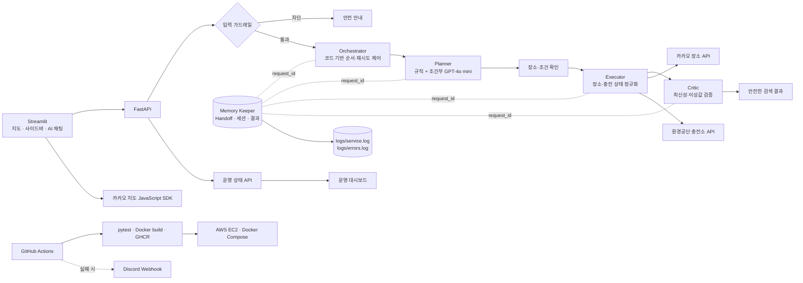
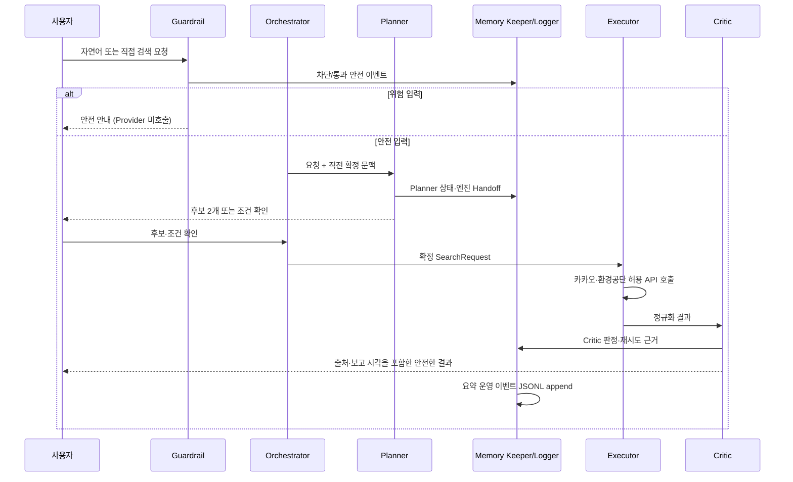
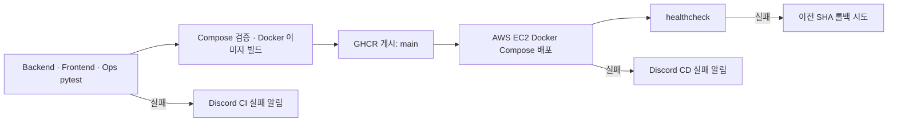

# ChargePin P3-1 멀티 에이전트 아키텍처 설계서 1.2

- 문서 버전: 1.2
- 작성일: 2026-11-09
- 구현 기준: FastAPI·Streamlit·Docker Compose·GitHub Actions `main`
- 1.1 대비 반영: JSON 구조화 운영 로그, Compose 로그 볼륨, Discord CI/CD 실패 알림

## 1. 설계 목표와 경계

ChargePin은 카카오의 **서울 장소 후보**와 환경공단의 **충전기 상태**를 분리해 수집하고, 근거가 확인된 정보만 사용자에게 보여 준다. 자연어 해석, 외부 조회, 품질 검증, 상태 보관을 서로 다른 논리 역할로 나눠 결정 일관성과 장애 격리를 확보한다.

| 원칙 | 구현 방식 |
| --- | --- |
| 최소 권한 | Planner는 제공처 도구가 없고 Executor만 카카오·환경공단 API를 호출한다. |
| 안전한 실패 | Critic이 지연·누락·이상값을 `SAFE_UNAVAILABLE`로 낮춰 확인되지 않은 상태를 단정하지 않는다. |
| 빠른 기본 경로 | 명확한 장소·수치·타입은 규칙으로 처리하고, 문맥형 요청만 GPT-4o mini를 호출한다. |
| 추적성 | `request_id`가 Handoff·재시도·Critic 판정·운영 이벤트를 연결한다. |
| 안전한 영속 로그 | Handoff/세션은 메모리, 익명화된 운영 이벤트는 호스트 파일 로그로 분리한다. |

Kubernetes, PostgreSQL, Redis는 사용하지 않는다. Handoff·세션·대시보드의 요청 집계는 백엔드 프로세스 범위이고, 재기동 후에도 확인해야 하는 안전한 운영 이벤트만 `logs` 볼륨에 보존한다.

## 2. 전체 구조

Orchestrator는 별도 에이전트가 아니라 FastAPI 내부 코드다. 순서, 도구 권한, 재시도 한도, Handoff 기록을 강제하며 Planner·Executor·Critic이 서로의 권한을 넘지 못하게 한다.

## 3. 컴포넌트와 책임

| 컴포넌트 | 책임 | 금지·제한 |
| --- | --- | --- |
| Streamlit | 로그인, 지도·검색·채팅, 결과·대시보드 표시, 역할별 UI 제어 | 환경공단·OpenAI·서비스 키 접근 금지 |
| FastAPI | 인증, 스키마 검증, Orchestrator·운영 API 제공 | 임의 상태 생성 금지 |
| Input Guardrail | 지침 무시·비밀 요청·타인 정보·권한 변경 분류 및 차단 이벤트 생성 | 원문·비밀값 저장 금지 |
| Planner | 자연어를 SearchRequest 초안으로 변환, 후보·조건 확인 질문 | 제공처 API 호출·결과 생성 금지 |
| Executor | 카카오 후보 조회, 서울 범위 필터, 환경공단 조회·정규화 | 품질 판정·근거 없는 합성 금지 |
| Critic | 최신성·수량·출처·상태 검증, PASS/SAFE_UNAVAILABLE 판정 | 제공처 재호출·결과 수정 금지 |
| Memory Keeper | Handoff, 세션 문맥, 중간 결과, 재시도·감사 이벤트 관리 | 검색·품질 판정·외부 호출 금지 |
| Structured Logger | Memory Keeper가 만든 안전한 이벤트를 JSONL로 append, 오류 파일 분리 | 채팅 원문·키·토큰·Provider 원문 응답 기록 금지 |
| Operations Snapshot | 현재 프로세스 요청 집계, Compose health, Watchdog JSONL 조회 | Docker socket·시크릿·원문 메시지 노출 금지 |

## 4. 검색·에이전트 시퀀스

### Planner 경로

| 입력 | 처리 |
| --- | --- |
| `사당역`, `서울역 2km 급속` | 규칙 빠른 경로로 SearchRequest 초안 생성 |
| `서울`, `강남` | Executor가 카카오 서울 후보 최대 2개 조회, 1순위 후보를 제안 |
| `그 조건에서 급속만`, `두 키로로 변경` | GPT-4o mini가 직전 확정 조건을 참조해 구조화 결과만 반환 |
| `10km` | Planner 전에 규칙으로 거부, 외부 호출 없음 |
| 비밀·권한·지침 요청 | Guardrail이 Planner 전에 차단, 원문 미기록 |

화면 표기 범위 1·2·3 km는 실제 SearchRequest 반경 0.5·1.0·1.5 km로 변환한다.

## 5. Handoff·메모리·로그 계약

| 정보 | 보관 위치 | 기록 주체 | 재기동 후 |
| --- | --- | --- | --- |
| `request_id`, SearchRequest, 후보, 실행 계획 | Memory Keeper 메모리 Handoff | Orchestrator / Planner | 초기화 |
| 출처·최종 보고 시각, 정규화 결과 | Memory Keeper 메모리 Handoff·결과 | Executor | 초기화 |
| Critic 판정·품질 발견·재시도 이력 | Memory Keeper 메모리 Handoff | Critic / Orchestrator | 초기화 |
| 세션별 직전 확정 조건 | Memory Keeper 메모리 | Orchestrator | 초기화 |
| Handoff 전이·감사·결과 요약·재시도·가드레일·오류 | `logs/service.log` | Structured Logger | 유지 |
| 오류 수준 운영 이벤트 | `logs/errors.log` | Structured Logger | 유지 |

로그 한 줄은 JSON 한 이벤트이며 `timestamp_utc`, `level`, `event_type`, `status`, 선택적 `request_id`와 안전한 메타데이터만 포함한다. 로그 모듈은 `raw_input`, `message`, `prompt`, `query`, `content`, `token`, `secret`, `password`, `authorization`, `service_key`, `api_key` 성격의 필드를 저장 전에 제거한다. 파일 I/O 실패는 검색 응답을 실패시키지 않는다.

개발·운영 Compose는 `./logs:/app/logs` 볼륨을 마운트한다. 따라서 컨테이너 교체 후에도 호스트의 로그 파일이 유지되며, 로그 파일은 `.gitignore`로 저장소에 올리지 않는다.

## 6. 오류·재시도·복구

| 상황 | Orchestrator 처리 | 기록·표시 |
| --- | --- | --- |
| API timeout·연결 오류·429·5xx | 0.25초·0.5초 대기, 자동 최대 2회 재시도 | retry history·운영 이벤트, 최종 실패 시 안전 안내 |
| 401/403 인증·응답 형식 오류 | 자동 재시도하지 않음 | 안전한 원인 범주만 표시 |
| Executor 예외 | 일시 오류는 자동 최대 2회 재시도, 지속 오류는 `SAFE_UNAVAILABLE` 종료 | `retry`·`agent_error` 오류 로그 |
| LLM 호출·스키마 오류 | 일시 오류는 자동 최대 2회 재시도, 지속 오류는 Executor 호출 없이 `NEEDS_INPUT` 종료 | Planner retry·실패 이벤트·재입력 안내 |
| stale·invalid_count | Critic이 상태를 낮춤 | 정보 지연/확인 불가·Critic 판정 |
| frontend unhealthy 연속 관측 | 별도 Watchdog 정책이 재시작을 시도 | `ops/logs/autoheal.jsonl`과 Healing Snapshot |
| 새 배포 healthcheck 실패 | 이전 성공 SHA로 롤백 시도 | CD 실행 로그·Discord 실패 알림 |

수동 재처리는 관리자 요청당 최대 2회다. 자동 재시도와 수동 재처리는 분리해 기록한다.

## 7. 배포·CI/CD·알림

- `ci.yml`의 테스트 또는 Docker 이미지 단계가 실패하면 downstream build/publish가 진행되지 않는다.
- `notify-failure` job은 `ALERT_WEBHOOK_URL` GitHub Secret이 있을 때 Discord `content` 웹훅을 호출한다. Secret이 없으면 메시지 전송만 skip한다.
- `cd.yml`은 CD 검증 또는 AWS SSM 배포 실패 시 동일 Secret으로 배포 실패 링크를 전송한다.
- 알림에는 브랜치·실행자·GitHub Actions 실행 URL 같은 공개 운영 메타데이터만 담고 웹훅 URL·API 키는 담지 않는다.
- 실제 검증에서는 `feature/discord-alert-test`에서 임시 pytest 실패를 발생시켜 CI 실패, Docker build 차단, Discord 수신을 확인했고 이후 해당 테스트를 원복했다.

## 8. API·운영 인터페이스

| API | 목적 | 접근 |
| --- | --- | --- |
| `GET /healthz` | 백엔드 기본 상태 | Compose healthcheck |
| `POST /api/v1/auth/login` | 역할 세션 발급 | 로그인 화면 |
| `POST /api/v1/search/default` | 첫 진입 기본 검색 | 인증 사용자 |
| `POST /api/v1/search` | 사이드바 직접 검색 | 인증 사용자 |
| `POST /api/v1/chat/plan` | 채팅 SearchRequest 초안 | 인증 사용자 |
| `POST /api/v1/search/{request_id}/confirm` | 후보·조건 확정 | 인증 사용자 |
| `GET /api/v1/ops/*` | 현재 요청·플랫폼·Healing 요약 | 관리자 |
| `POST /api/v1/ops/requests/{request_id}/retry` | 수동 재처리 | 관리자 |
| `POST /api/v1/ops/cache/refresh` | 제공처 캐시 갱신 | 관리자 |
| `POST /api/v1/test/faults/*` | Test API 장애 시나리오 | 상급 관리자 + 테스트 환경 설정 |

## 9. 검증 기준과 범위

| 그룹 | 현재 자동 검증 |
| --- | --- |
| Backend | Agent·Guardrail·SearchRequest·서울 범위·Test API·복구·Operations·구조화 로그 보안·bounded retry (46개) |
| Frontend | 채팅 안내·지도 안전성·역할 UI·대시보드 계약 (24개) |
| Ops | Watchdog 정책·Docker 배포 실패/롤백 정책 (13개) |
| 장애 주입 | timeout(FT-01), executor_exception(FT-02), llm_invalid_schema(FT-04)를 각 3회 실행해 9회 증빙. 세 시나리오 모두 자동 재시도 2회 뒤 안전한 종료를 확인 |

범위 밖: Kubernetes, 영속 DB/Redis와 DB 연결 장애, 일반 주차장·빈자리 예측, 역할 승급·강등 화면, API 키·개인정보 로그 저장.
