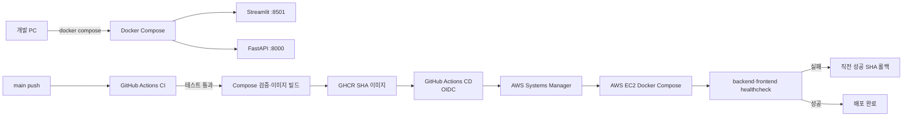
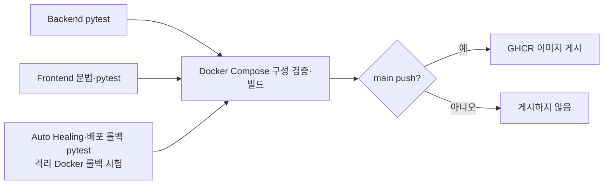

# P3-2 배포 및 장애 복구 보고서

> ChargePin — 서울 전기차 충전소 안내 멀티 에이전트 서비스

- 문서 버전: 1.0
- 작성일: 2026-11-09
- 대상 범위: Docker Compose, GitHub Actions, GHCR, AWS EC2, Auto Healing, 장애 복구
- 작성 기준: 저장소 구현·자동 테스트·기존 AWS 검증 기록

---

## 1. 보고서 요약

ChargePin은 Streamlit 프론트엔드와 FastAPI 백엔드를 Docker Compose로 실행한다. GitHub Actions는 백엔드·프론트엔드·운영 정책 테스트와 Docker 이미지 빌드를 순서대로 수행하며, `main` 브랜치에서만 GHCR 이미지를 게시한다. AWS 배포는 GitHub OIDC와 AWS Systems Manager(SSM)를 통해 EC2에서 SHA가 고정된 이미지를 Docker Compose로 실행하는 방식이다.

장애 대응은 두 층으로 구성했다.

1. **애플리케이션 층**: 외부 API의 일시 오류는 최대 2회 자동 재시도하고, 데이터 지연·이상값·LLM 오류는 안전한 응답으로 전환한다.
2. **컨테이너 층**: Docker healthcheck와 로컬 Watchdog가 프론트엔드 컨테이너의 비정상 상태를 감지해 제한된 정책 안에서 재시작한다. 배포 시 새 이미지의 healthcheck가 실패하면 직전 성공 SHA로 롤백한다.

이번 버전은 Kubernetes, 영속 DB, Redis를 ChargePin 서비스 구성요소로 사용하지 않는다. EC2에 과거 컨테이너가 남아 있더라도 ChargePin 배포 스크립트는 backend·frontend만 갱신하며, 다른 컨테이너와 볼륨을 삭제하지 않는다.

## 2. 목표와 범위

| 목표 | 구현 기준 |
| --- | --- |
| 재현 가능한 실행 | `.env`와 Docker Compose로 프론트·백엔드를 동일한 네트워크에서 기동한다. |
| 안전한 배포 | 테스트가 통과한 `main` 이미지만 GHCR에 게시하고, EC2는 커밋 SHA가 고정된 이미지를 배포한다. |
| 장애 격리 | API 오류·LLM 오류·데이터 품질 오류가 사용자 화면의 잘못된 충전 가능 안내로 이어지지 않게 한다. |
| 자동 복구 | 컨테이너 healthcheck, Watchdog 정책, 배포 healthcheck 실패 시 이미지 롤백을 제공한다. |
| 증빙 가능성 | pytest 결과, GitHub Actions run, Watchdog JSONL, Test API 결과를 근거로 남긴다. |

### 제외 범위

- Kubernetes Pod·Service·매니페스트 운영
- ChargePin용 PostgreSQL·Redis 및 DB 장애 복구
- EC2 서비스 본체에 의도적으로 장애 버전을 배포하는 실험
- 24시간 상시 실행되는 AWS Watchdog 서비스와 외부 알림 채널

## 3. 실행·배포 아키텍처



### 3.1 로컬 Docker Compose 구성

| 서비스 | 포트 | 기동 조건 | healthcheck |
| --- | --- | --- | --- |
| `backend` | `8000` | `.env` 주입 | `GET /healthz`, 15초 간격, 3회 재시도 |
| `frontend` | `8501` | backend healthy 이후 시작 | `GET /_stcore/health`, 15초 간격, 3회 재시도 |

- 프론트엔드는 Compose 서비스명 `backend`로 FastAPI에 연결한다.
- 외부 API·OpenAI 키는 backend `.env`에만 주입한다.
- 프론트엔드에는 카카오 지도 JavaScript 키만 전달한다.
- backend는 읽기 전용으로 Auto Healing JSONL 로그를 읽어 운영 대시보드에 표시한다.

### 3.2 AWS EC2 배포 구성

| 항목 | 구현 내용 |
| --- | --- |
| 이미지 | `ghcr.io/ac9989/chargepin-backend:sha-<commit>`, `chargepin-frontend:sha-<commit>` |
| Compose 파일 | `compose.prod.yml` |
| 배포 방식 | GitHub Actions → OIDC → AWS SSM `SendCommand` → EC2 Docker Compose |
| 실행 정책 | `restart: unless-stopped` |
| 접근 포트 | EC2 내부 loopback의 `127.0.0.1:8000`, `127.0.0.1:8501`; 외부 노출은 기존 Nginx 프록시가 담당 |
| 배포 범위 | backend·frontend만 갱신, `--remove-orphans` 미사용 |

## 4. CI/CD 배포 파이프라인

### 4.1 CI 게이트



| CI 단계 | 내용 | 실패 시 |
| --- | --- | --- |
| Backend unit tests | Planner·Executor·Critic·가드레일·Test API·운영 API 계약 검사 | 이후 단계 중단 |
| Frontend syntax/tests | Streamlit 코드 문법, 채팅 안내, 지도 안전성, 대시보드 계약 검사 | 이후 단계 중단 |
| Auto Healing/rollback tests | Watchdog 정책, 배포 실패·롤백 정책, 격리된 Docker healthcheck 실패 시험 | 이후 단계 중단 |
| Docker build | `.env.example` 기반 Compose 유효성 확인 및 backend·frontend 이미지 빌드 | GHCR 게시 중단 |
| Publish | `main` push일 때만 GHCR의 `latest`, `sha-<commit>` 태그 게시 | CD 대상 없음 |

### 4.2 CD 게이트

1. `main`의 CI가 성공한 경우에만 CD workflow가 배포 후보를 받는다.
2. CD는 `ops/deploy.py`와 `compose.prod.yml` 문법·구성값을 먼저 검증한다.
3. GitHub OIDC로 단기 AWS 권한을 받고 SSM을 통해 EC2에 배포 명령을 전달한다.
4. EC2는 새 SHA 이미지의 `pull → up --wait`를 수행한다.
5. healthcheck가 성공하면 해당 SHA를 `last_successful_sha`로 저장한다.
6. healthcheck가 실패하면 직전 성공 SHA의 backend·frontend를 다시 `pull → up --wait`로 시작한다.

정적 AWS access key는 GitHub Secret에 저장하지 않는다. OIDC 역할·SSM 권한·대상 인스턴스 ID는 배포 환경의 설정 값으로 관리한다.

## 5. 감지·복구 설계

### 5.1 API·에이전트 오류

| 장애 | 감지 | 복구·사용자 처리 | 기록 |
| --- | --- | --- | --- |
| 외부 API timeout·연결 오류·429·5xx | `ProviderError(retryable=True)` | 0.25초, 0.5초 간격으로 최대 2회 자동 재시도 후 안전한 실패 응답 | Handoff retry, 운영 이벤트 |
| API 401/403·형식 오류 | 비재시도 ProviderError | 재시도하지 않고 인증/응답 확인 안내 | 운영 이벤트 |
| Executor 예외 | Orchestrator 예외 처리 | HTTP 500 원문을 사용자에게 노출하지 않고 `SAFE_UNAVAILABLE` | `executor_exception` 감사 이벤트 |
| LLM 호출·스키마 오류 | Planner 구조화 결과 검증 실패 | Executor·Provider 호출 없이 `NEEDS_INPUT` | `llm_plan_error` 이벤트 |
| stale·invalid_count | Critic 최신성·수량 검증 | 정보 지연·확인 불가로 표시, 잘못된 수치 숨김 | Critic 판정·findings |

### 5.2 Auto Healing Watchdog

| 정책 | 구현 값 |
| --- | --- |
| 감시 대상 | 로컬 Docker의 Streamlit frontend 컨테이너 1개 |
| 관측 간격 | 15초 |
| 재시작 조건 | `running/unhealthy`가 연속 2회 관측될 때 |
| 기본 모드 | dry-run. `--apply`를 명시해야 실제 `docker restart` 수행 |
| 재시작 제한 | 10분 동안 최대 3회 |
| 쿨다운 | 재시작 뒤 120초 |
| 복구 시간 제한 | 120초 |
| 제외 | 수동 중지 컨테이너, `starting`, `healthy`, 다른 컨테이너 |
| 로그 | `ops/logs/autoheal.jsonl`에 전환·재시도·복구 시간·실패 기록 |

Watchdog는 현재 로컬 개발·시연용이다. 별도 터미널에서 실행해야 하며 AWS의 24시간 서비스·알림 에이전트로는 아직 운영하지 않는다.

### 5.3 배포 롤백

| 상황 | 조치 |
| --- | --- |
| 새 이미지 pull 실패 | 실행 중인 기존 서비스는 건드리지 않고 실패 종료 |
| 새 이미지 기동·healthcheck 실패 | 직전 성공 SHA가 있으면 해당 SHA로 backend·frontend만 롤백 |
| 첫 배포 실패 | 이전 성공 SHA가 없으므로 자동 롤백 대상 없음; 수동 확인 필요 |
| 롤백도 실패 | 이전 SHA 기록은 유지하고 `manual recovery required` 상태를 남김 |

## 6. 장애시험 설계

### 6.1 Test API·Test Checker

Test API는 실제 카카오·환경공단·LLM에 장애를 내지 않고, 결정적인 fixture로 실패를 재현한다. `CHARGEPIN_ENABLE_FAULT_INJECTION=true`이고 상급 관리자 인증을 통과한 경우에만 사용할 수 있다.

| ID | 주입 시나리오 | 기대 복구 결과 |
| --- | --- | --- |
| 정상 | `normal` | 검증된 충전소 결과와 Critic PASS |
| 데이터 지연 | `stale` | 최신성 실패, `정보 지연` 안전 표시 |
| 수량 이상 | `invalid_count` | 빈자리 수 숨김, SAFE_UNAVAILABLE |
| FT-01 | `timeout` | 총 3회 호출(최초 1회 + 재시도 2회) 후 안전한 실패·재시도 이력 |
| FT-02 | `executor_exception` | HTTP 500 원문 없이 안전한 실패·감사 이벤트 |
| FT-04 | `llm_invalid_schema` | Provider 미호출, `NEEDS_INPUT`, `llm_plan_error` |

### 6.2 필수 실행 증빙 계획

이번 범위에는 DB가 없으므로 DB 장애시험은 제외한다. 필수 장애시험은 아래 **3개 시나리오를 각 3회**, 총 9회로 관리한다.

| 시나리오 | 반복 | 남길 증빙 |
| --- | ---: | --- |
| FT-01 외부 API timeout | 3회 | 자동 재시도 2회, 안전 응답, 운영 대시보드 재시도 이벤트 |
| FT-02 Executor 예외 | 3회 | 안전 응답, `executor_exception` 이벤트 |
| FT-04 LLM 스키마 오류 | 3회 | Provider 미호출, `llm_plan_error`, 재입력 안내 |
| 합계 | **9회** | `fault-recovery-evidence.json`, 운영 대시보드 캡처, 실행 로그 |

현재 대시보드의 필수 장애시험 관리표는 `0 / 9회`다. pytest의 fixture 검증과 실제 Test API 실행 증빙은 구분한다.

## 7. 테스트·검증 결과

### 7.1 코드 테스트

2026-11-09 로컬 `uv run` 실행 결과는 아래와 같다.

| 그룹 | 명령 | 결과 |
| --- | --- | --- |
| Backend | `uv run --with-requirements requirements.txt pytest -q` (Backend) | **39 passed** |
| Frontend | `uv run --with-requirements requirements.txt pytest -q` (Frontend) | **24 passed** |
| Ops | `uv run --with pytest==8.3.5 pytest -q tests/ops` (프로젝트 루트) | **13 passed** |
| 합계 | 단위·계약·복구 정책 | **76 passed** |

Ops 테스트는 Windows에서도 실제 Docker 배포를 실행하지 않고, Linux 배포 잠금과 Docker 호출을 가짜 객체로 대체해 롤백 정책만 검증한다. CI에서는 별도로 격리 컨테이너를 이용한 Docker healthcheck 실패·롤백 시험을 실행한다.

### 7.2 기존 배포 검증 기록

`ops/CD_SETUP.md`에 기록된 2026-11-07 검증은 아래와 같다.

| 검증 | 기록 상태 |
| --- | --- |
| GitHub OIDC → AWS SSM 읽기 전용 명령 | 성공 기록 있음 |
| 알려진 정상 SHA의 SSM → EC2 재배포 | 성공 기록 있음 |
| 존재하지 않는 이미지 배포 요청 | 거부되고 기존 SHA·컨테이너 상태 유지 기록 있음 |
| 격리 GitHub runner에서 Docker healthcheck 실패·롤백 | 성공 기록 있음 |
| 서비스 EC2에 고의 bad-health 이미지 배포 | 서비스 중단 위험 때문에 **미실행** |

이 기록은 배포 체인의 구현·기본 검증 근거다. 최신 애플리케이션 버전의 실제 사용자 흐름, 카카오 지도, 외부 API, Test API 9회 증빙은 별도로 다시 확인해야 한다.

## 8. 운영 절차

### 8.1 일반 개발·테스트

단위 테스트는 Docker를 기동하지 않는다.

```powershell
cd C:\study\Project\2026-aio2-guide-main\aio2_p3_ChargePin\Backend
uv run --with-requirements requirements.txt pytest -q

cd ..\Frontend
uv run --with-requirements requirements.txt pytest -q

cd ..
uv run --with pytest==8.3.5 pytest -q tests/ops
```

화면·컨테이너·통합 동작을 확인할 때만 아래를 실행한다.

```powershell
docker compose up --build -d
docker compose ps
```

### 8.2 Auto Healing 시연

```powershell
# 기본은 실제 재시작을 하지 않는 dry-run
python .\ops\autoheal.py --watch

# 통제된 시연에서만 실제 프론트 컨테이너 재시작 허용
python .\ops\autoheal.py --watch --apply
```

시연이 끝나면 Watchdog를 중지하고 `ops/logs/autoheal.jsonl`의 이벤트·복구 시간을 캡처한다. 로그와 `.env`는 Git에 올리지 않는다.

### 8.3 Test API 장애 증빙

1. `.env`에서 `CHARGEPIN_ENABLE_FAULT_INJECTION=true`로 설정한다.
2. Compose를 재시작하고 상급 관리자 키를 현재 PowerShell 세션의 `CHARGEPIN_TEST_OPERATOR_KEY`에만 설정한다.
3. `py Backend/scripts/run_fault_evidence.py --repeat 3`을 실행한다.
4. 생성된 `artifacts/fault-recovery-evidence.json`, 운영 대시보드, 실행 로그를 저장한다.
5. 끝나면 환경 변수를 다시 `false`로 바꾸고 Compose를 재시작한다.

## 9. 한계·후속 조치

| 항목 | 현재 상태 | 다음 조치 |
| --- | --- | --- |
| 필수 장애시험 | 0 / 9회 실행 증빙 전 | FT-01·02·04를 각 3회 실행·캡처 |
| AWS 실제 장애 롤아웃 | 미실행 | 서비스 영향이 없는 시간에 승인 후 별도 수행 |
| Watchdog 상시 운영 | 로컬 수동 실행 | EC2 프로세스 감독·알림 도입 검토 |
| 배포 알림 | 수신 증빙 없음 | 실패 알림 채널·담당자·에스컬레이션 기준 확정 |
| 운영 이력 영속성 | 프로세스 메모리·JSONL 중심 | 필요 시 영속 저장소 도입을 별도 범위로 계획 |

## 10. 결론

ChargePin은 Docker Compose 기반 실행, healthcheck, CI 게이트, SHA 기반 GHCR 이미지, AWS SSM 배포, 배포 롤백 정책, 로컬 Auto Healing, Test API·Test Checker를 구현했다. 코드 수준에서는 백엔드·프론트·운영 정책 테스트 총 76건이 통과했다.

다만 P3-2의 최종 완료 판단에는 코드 테스트와 별개로 FT-01·FT-02·FT-04의 실제 실행 증빙 9회, 최신 `main`의 GitHub Actions 성공 기록, Docker 통합 화면 확인, 필요 시 EC2 배포·롤백 확인이 남아 있다. 따라서 현재 상태는 **구현 및 자동 테스트 완료, 현장 장애 증빙 진행 전**으로 관리한다.
