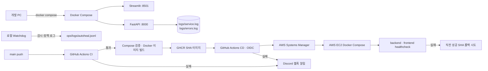

# P3-2 배포 및 장애 복구 보고서 1.1

> ChargePin — 서울 전기차 충전소 안내 멀티 에이전트 서비스

- 문서 버전: 1.1
- 작성일: 2026-11-09
- 기준 커밋: `467e1e1`
- 대상 범위: Docker Compose, AWS EC2, Auto Healing, 구조화 로그, Test API 장애시험
- 1.0 대비 반영: 안전한 운영 로그 영속, 실제 9회 장애시험 결과, Discord 실패 알림 증빙

---

## 1. 요약

ChargePin은 Streamlit 프론트엔드와 FastAPI 백엔드를 Docker Compose로 실행한다. CI가 백엔드·프론트엔드·운영 정책 테스트를 통과하면 Docker 이미지를 빌드하고, `main`에서만 GHCR 이미지를 게시한다. CD는 GitHub OIDC와 AWS Systems Manager(SSM)를 이용해 EC2의 SHA 고정 Docker Compose 이미지를 갱신한다.

장애 대응은 네 층이다.

1. **입력·계획 층**: 위험한 요청과 LLM 구조화 오류를 Provider 호출 전에 차단한다.
2. **조회·품질 층**: Provider의 일시 오류는 최대 2회 재시도하고, 지연·이상값은 안전한 응답으로 전환한다.
3. **컨테이너 층**: healthcheck, Compose restart 정책, 로컬 Watchdog, 배포 SHA 롤백 정책으로 컨테이너 장애를 다룬다.
4. **운영 관측 층**: Handoff·세션은 메모리로 관리하고, 익명화된 운영 이벤트는 호스트의 JSONL 로그에 남긴다. CI/CD 실패는 Discord 웹훅으로 팀 채널에 알린다.

Kubernetes, ChargePin 전용 DB·Redis는 이번 범위에 사용하지 않는다.

## 2. 실행·배포 구조



### 2.1 Compose 구성

| 서비스 | 포트 | 기동 조건 | 상태 확인 |
| --- | --- | --- | --- |
| `backend` | `8000` | `.env` 런타임 주입 | `GET /healthz`, 15초 간격, 3회 재시도 |
| `frontend` | `8501` | backend healthy 이후 기동 | `GET /_stcore/health`, 15초 간격, 3회 재시도 |

- 프론트엔드는 Compose 서비스명 `backend`로 FastAPI에 연결한다.
- 외부 API·OpenAI 키는 backend에만, 브라우저에는 카카오 지도 JavaScript 키만 전달한다.
- `./logs:/app/logs`를 backend에 마운트해 컨테이너 재기동 뒤에도 `service.log`, `errors.log`를 호스트에 남긴다.
- `./ops/logs:/ops/logs:ro`는 Watchdog JSONL을 운영 대시보드용으로 읽는 별도 마운트다.

### 2.2 AWS EC2 배포 구성

| 항목 | 구현 내용 |
| --- | --- |
| 이미지 | `ghcr.io/ac9989/chargepin-backend:sha-<commit>`, `chargepin-frontend:sha-<commit>` |
| 배포 방식 | GitHub Actions → OIDC → AWS SSM `SendCommand` → EC2 Docker Compose |
| 실행 정책 | `restart: unless-stopped` |
| 배포 범위 | backend·frontend만 갱신하며 다른 컨테이너·볼륨을 삭제하지 않음 |
| 롤백 | 새 SHA healthcheck 실패 시 직전 성공 SHA로 backend·frontend 재기동 시도 |

## 3. 감지·복구 설계

| 장애 | 감지 신호 | 복구·사용자 처리 | 안전한 기록 |
| --- | --- | --- | --- |
| API timeout·연결 오류·429·5xx | `ProviderError(retryable=True)` | 0.25초·0.5초 대기, 자동 최대 2회 재시도 후 안전 응답 | retry history, `retry` 이벤트 |
| API 401/403·형식 오류 | 비재시도 ProviderError | 재시도하지 않고 인증·응답 확인 안내 | 운영 이벤트 |
| Executor 예외 | Orchestrator 예외 처리 | 내부 500 원문을 노출하지 않고 `SAFE_UNAVAILABLE` | `executor_exception`, `agent_error` |
| LLM 호출·스키마 오류 | Planner 구조화 결과 검증 실패 | Executor·Provider 호출 없이 `NEEDS_INPUT` | `llm_plan_error`, 오류 로그 |
| stale·invalid_count | Critic 최신성·수량 검증 | 정보 지연·확인 불가, 부정확한 수량 숨김 | Critic verdict·findings |
| frontend unhealthy 연속 관측 | Watchdog 상태 관측 | 정책 조건 충족 시 재시작 시도 | `ops/logs/autoheal.jsonl` |
| 배포 healthcheck 실패 | `up --wait` 실패 | 직전 성공 SHA 롤백 시도 | CD 실행 로그·Discord 알림 |

### 3.1 Auto Healing Watchdog 정책

| 항목 | 값 |
| --- | --- |
| 대상 | 로컬 Docker의 Streamlit frontend 컨테이너 1개 |
| 관측 간격 | 15초 |
| 재시작 조건 | `running/unhealthy` 2회 연속 관측 |
| 기본 모드 | dry-run, `--apply`일 때만 실제 `docker restart` |
| 제한 | 10분 최대 3회, 재시작 후 120초 쿨다운, 복구 대기 120초 |
| 기록 | `ops/logs/autoheal.jsonl`에 상태 전이·재시작·복구 시간·실패 기록 |

Watchdog는 현재 로컬 개발·시연용이다. EC2에서 24시간 실행되는 별도 Watchdog 프로세스와 외부 장애 에스컬레이션은 후속 범위다.

## 4. 구조화 운영 로그

| 파일 | 기록 대상 | 보안 기준 |
| --- | --- | --- |
| `logs/service.log` | Handoff 전이, 감사 이벤트, 결과 요약, 재시도, 가드레일, 운영 이벤트 | JSON 한 줄당 한 이벤트, `request_id`와 안전한 메타데이터만 기록 |
| `logs/errors.log` | Planner·Executor 등 오류 수준 이벤트 | `service.log`의 오류 이벤트만 별도 분리 |
| `ops/logs/autoheal.jsonl` | Watchdog 상태 전이·복구 시간 | backend가 읽기 전용으로 Snapshot에 표시 |

채팅 원문, API/서비스 키, Bearer 토큰, 비밀번호, Provider 원문 응답은 파일 로그에 기록하지 않는다. 파일 I/O 오류가 발생해도 사용자 검색 흐름은 중단하지 않는다. 로그 파일과 `.env`는 Git에 올리지 않는다.

## 5. 장애시험 결과

### 5.1 Test API 보안 경계

Test API는 실제 제공처·LLM에 장애를 발생시키지 않는다. 아래 두 조건을 동시에 만족할 때만 노출한다.

1. `CHARGEPIN_ENABLE_FAULT_INJECTION=true`
2. 상급 관리자(SENIOR_ADMIN) 인증

운영 환경에서는 해당 설정을 `false`로 유지한다.

### 5.2 실행 결과: 구현한 3개 시나리오 × 3회

실행 도구 `Backend/scripts/run_fault_evidence.py --repeat 3`가 만든 `artifacts/fault-recovery-evidence.json`을 확인했다. 2026-11-09 UTC 기준 **9개 기록이 모두 `passed: true`**다.

| 시나리오 | 횟수 | 실제 결과 | 재시도 |
| --- | ---: | --- | --- |
| FT-01 `timeout` | 3 | HTTP 200, `SAFE_UNAVAILABLE` | 각 실행마다 자동 재시도 2회 |
| FT-02 `executor_exception` | 3 | HTTP 200, `SAFE_UNAVAILABLE` | 없음 |
| FT-04 `llm_invalid_schema` | 3 | HTTP 200, `NEEDS_INPUT`, Provider 미호출 | 없음 |
| 합계 | **9 / 9** | 기대한 안전한 종료·응답 확인 | - |

이 수치는 **현재 구현한 3개 시나리오의 실행 통과 수**다. 교육 가이드의 FT-03 DB 연결 오류는 공통 요구로 해석될 수 있으나, ChargePin은 DB를 서비스 구성에 포함하지 않아 해당 시나리오를 구현·시험하지 않았다. 따라서 9/9를 “공통 4종 전체 완료”로 표현하지 않는다.

timeout의 경우 외부 Provider가 정상으로 회복된 증거가 아니라, 정해진 재시도 한도 뒤 사용자에게 안전한 실패로 전환된 증거다. 응답 안전성·재시도 횟수는 확인했지만 실제 외부 API 복구 시간은 이 fixture 시험의 측정 대상이 아니다.

## 6. 검증 결과와 실행 증빙

| 구분 | 결과·근거 |
| --- | --- |
| Backend pytest | 구조화 로그 보안 테스트가 추가된 뒤 **40 passed** 확인 |
| Frontend pytest | **24 passed** (기존 CI 게이트) |
| Ops pytest | **13 passed** (Watchdog·배포 롤백 정책) |
| 최신 main CI | 성공 — [run 42561841488](https://github.com/ac9989/2026-aio2-p3-ChargePin/actions/runs/42561841488), 커밋 `467e1e1` |
| 최신 main CD | 성공 — [run 42562090395](https://github.com/ac9989/2026-aio2-p3-ChargePin/actions/runs/42562090395), 커밋 `467e1e1` |
| 실패 알림 | feature 브랜치의 의도적 pytest 실패 시 Discord 수신 확인 — [실패 run 42557685477](https://github.com/ac9989/2026-aio2-p3-ChargePin/actions/runs/42557685477) |

현재 코드 단위·계약·운영 정책 테스트의 합계는 **77개(Backend 40, Frontend 24, Ops 13)**다. Docker 통합 화면·EC2의 실제 서비스 장애 롤아웃은 별도 화면/실행 증빙으로 구분한다.

## 7. 운영 절차

### 7.1 일반 검증

```powershell
cd C:\study\Project\2026-aio2-guide-main\aio2_p3_ChargePin\Backend
uv run --with-requirements requirements.txt pytest -q

cd ..\Frontend
uv run --with-requirements requirements.txt pytest -q

cd ..
uv run --with pytest==8.3.5 pytest -q tests/ops
```

화면·컨테이너·로그 볼륨을 확인할 때만 다음을 실행한다.

```powershell
docker compose up --build -d
docker compose ps
Get-Content logs\service.log -Tail 10
```

### 7.2 Test API 9회 증빙

1. 로컬 `.env`에서 `CHARGEPIN_ENABLE_FAULT_INJECTION=true`로 설정한다.
2. Compose를 재기동하고 상급 관리자 키를 현재 PowerShell 세션의 `CHARGEPIN_TEST_OPERATOR_KEY`에만 설정한다.
3. `py Backend/scripts/run_fault_evidence.py --repeat 3`을 실행한다.
4. `artifacts/fault-recovery-evidence.json`, 운영 대시보드, `logs/service.log`를 캡처한다.
5. 종료 후 기능 플래그를 `false`로 되돌리고 Compose를 재기동한다.

## 8. 한계와 후속 조치

| 항목 | 현재 상태 | 후속 조치 |
| --- | --- | --- |
| DB 장애(FT-03) | DB 미사용으로 미구현 | DB를 도입하는 경우 연결 오류·재연결 시험을 별도 추가 |
| Watchdog 상시 운영 | 로컬 수동 실행 | EC2 프로세스 감독·알림 에스컬레이션 검토 |
| AWS 서비스 장애 주입 | 서비스 영향 위험으로 미실행 | 승인된 시간·격리 환경에서 별도 검증 |
| 운영 대시보드 이력 | 현재 프로세스 집계 중심 | 파일 로그를 재기동 후 이력 조회 화면으로 확장 가능 |

## 9. 결론

ChargePin은 Docker Compose, healthcheck, GHCR SHA 이미지, AWS SSM 배포·롤백 정책, 로컬 Watchdog, 안전한 구조화 로그, Test API/Test Checker를 구현했다. 구현한 3종의 장애 시나리오는 각 3회로 총 9/9 안전한 기대 결과를 확인했고, 최신 main의 CI/CD 성공과 CI 실패 시 Discord 알림 수신도 증빙했다.

다만 DB 미도입에 따른 FT-03 미구현, EC2 서비스 본체의 고의 장애 주입, EC2 상시 Watchdog는 남은 한계다.
