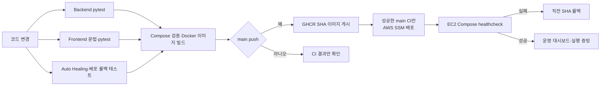

# P3-3 파이프라인 구현 결과 보고서

> ChargePin — 서울 전기차 충전소 안내 멀티 에이전트 서비스

- 문서 버전: 1.0
- 작성일: 2026-11-09
- 대상 범위: Test API·Test Checker, pytest, GitHub Actions CI/CD, Docker 이미지, AWS EC2 배포 게이트
- 작성 기준: 저장소 구현·로컬 실행 결과·기존 GitHub/AWS 검증 기록

---

## 1. 구현 목적

P3-3의 목표는 기능 변경이 사용자 환경으로 전달되기 전에 자동 테스트·컨테이너 빌드·배포 검증을 순서대로 통과하게 만드는 것이다. ChargePin은 외부 API·LLM의 실제 장애를 CI에서 호출하지 않고, Test API와 가짜 Provider로 결정적인 실패 시나리오를 재현한다.



## 2. 구현 구성

| 구성 요소 | 구현 파일·위치 | 역할 |
| --- | --- | --- |
| Backend 테스트 | `Backend/tests/` | Planner·Executor·Critic·가드레일·API 계약·복구 검사 |
| Frontend 테스트 | `Frontend/tests/` | 채팅 안내·지도 출력 안전성·대시보드·운영 계약 검사 |
| Ops 테스트 | `tests/ops/` | Watchdog 정책·배포 실패·SHA 롤백 정책 검사 |
| Test API | `Backend/app/testkit.py`, `Backend/app/main.py` | 통제된 정상·오류 fixture 주입 |
| Test Checker | `Backend/tests/test_fault_recovery.py` | Test API 결과, 재시도, Handoff, 운영 이벤트 검사 |
| 실행 증빙 도구 | `Backend/scripts/run_fault_evidence.py` | FT-01·FT-02·FT-04를 각 3회 실행해 JSON 기록 생성 |
| CI | `.github/workflows/ci.yml` | 테스트·Compose 검증·GHCR 게시 |
| CD | `.github/workflows/cd.yml` | 성공한 main CI의 SHA를 SSM으로 EC2에 배포 |
| 배포·롤백 스크립트 | `ops/deploy.py`, `compose.prod.yml` | SHA 고정 배포·healthcheck·직전 SHA 롤백 |

## 3. pytest 테스트 구현 결과

### 3.1 테스트 그룹

| 그룹 | 파일 수 | 테스트 수 | 주요 검증 내용 |
| --- | ---: | ---: | --- |
| Backend | 5개 | 39개 | 자연어 Planner, SearchRequest, 서울 범위, 가드레일, 재시도, Critic, API 계약, Test API·운영 이벤트 |
| Frontend | 3개 | 24개 | 채팅 조건 안내, 지도 HTML 이스케이프, 역할별 UI, 대시보드 데이터·운영 계약 |
| Ops | 2개 | 13개 | Auto Healing 재시작 정책, 쿨다운·재시작 상한, Docker 배포·롤백 정책 |
| 합계 | **10개** | **76개** | 단위·계약·복구 정책 |

### 3.2 로컬 실행 결과

2026-11-09 기준 아래 명령으로 실행했다.

```powershell
# Backend
cd C:\study\Project\2026-aio2-guide-main\aio2_p3_ChargePin\Backend
uv run --with-requirements requirements.txt pytest -q

# Frontend
cd ..\Frontend
uv run --with-requirements requirements.txt pytest -q

# Auto Healing·배포 롤백
cd ..
uv run --with pytest==8.3.5 pytest -q tests/ops
```

| 실행 대상 | 결과 |
| --- | --- |
| Backend | **39 passed** |
| Frontend | **24 passed** |
| Ops | **13 passed** |
| 총계 | **76 passed** |

Backend·Frontend에는 `pytest.ini`을 추가해 `app`, 프론트 모듈을 안정적으로 찾도록 했다. Ops의 배포 롤백 단위 테스트는 Windows에서 실제 Linux 배포나 Docker 명령을 실행하지 않고, 운영체제 잠금·Docker 호출을 가짜로 바꿔 정책만 검사한다.

## 4. Test API·Test Checker

### 4.1 Test API 안전 경계

Test API는 일반 사용자 기능이 아니다. 아래 두 조건을 만족해야만 사용된다.

1. `CHARGEPIN_ENABLE_FAULT_INJECTION=true`
2. 상급 관리자(SENIOR_ADMIN) 인증

조건이 충족되지 않으면 Test API는 `404`로 숨겨진다. 일반 운영·배포 환경의 `.env`는 해당 기능을 `false`로 유지한다.

### 4.2 시나리오와 Checker 결과

| 시나리오 | 주입 내용 | Test Checker 기대값 |
| --- | --- | --- |
| `normal` | 정상 충전소 fixture | `completed`, Critic `PASS`, AVAILABLE 상태 |
| `stale` | 7일 초과 보고 시각 | `degraded`, `DELAYED`, 수량 미표시 |
| `invalid_count` | 빈자리 수 > 총 충전기 수 | `degraded`, `UNAVAILABLE`, 수량 미표시 |
| `timeout` / FT-01 | 재시도 가능한 Provider timeout | 자동 재시도 2회, 총 3회 시도, 안전한 실패, retry 이벤트 |
| `executor_exception` / FT-02 | Executor 강제 예외 | 500 원문 없이 안전한 실패, `executor_exception` 감사 이벤트 |
| `llm_invalid_schema` / FT-04 | Planner 구조화 응답 스키마 오류 | `NEEDS_INPUT`, `llm_plan_error`, Kakao·KECO 미호출 |

Test Checker는 FastAPI `TestClient`를 사용한다. 따라서 실행 중인 서버·실제 환경공단·카카오·LLM 호출 없이 테스트할 수 있다.

### 4.3 필수 장애시험 실행 증빙

DB는 이번 시스템 범위에서 제외했으므로 필수 장애시험은 4종 12회가 아니라 **3종 × 3회 = 9회**다.

| ID | 반복 | 증빙 기준 |
| --- | ---: | --- |
| FT-01 외부 API timeout | 3회 | 재시도 2회·안전 응답·운영 이력 |
| FT-02 Executor 예외 | 3회 | `executor_exception` 이벤트·안전 응답 |
| FT-04 LLM 스키마 오류 | 3회 | `llm_plan_error`·Provider 미호출 |
| 합계 | **9회** | JSON 결과·운영 대시보드·실행 로그 |

실제 증빙 실행 명령은 아래와 같다.

```powershell
# Test API를 true로 설정하고 Compose를 재기동한 뒤 실행한다.
$env:CHARGEPIN_TEST_OPERATOR_KEY = "상급 관리자 서비스 키"
py Backend/scripts/run_fault_evidence.py --repeat 3
```

결과는 `artifacts/fault-recovery-evidence.json`에 저장된다. 실행 후 `CHARGEPIN_ENABLE_FAULT_INJECTION`을 다시 `false`로 바꾸고 Compose를 재시작한다.

## 5. GitHub Actions CI 구현

### 5.1 트리거

| 이벤트 | CI 동작 |
| --- | --- |
| `main` push | 테스트·빌드·GHCR 이미지 게시 수행 |
| `feature/**` push | 테스트·빌드 수행, GHCR 게시 생략 |
| `main` Pull Request | 테스트·빌드 수행, GHCR 게시 생략 |

### 5.2 Job 의존성

| Job | 실행 내용 | 선행 조건 |
| --- | --- | --- |
| `backend-tests` | Backend requirements 설치 후 `pytest -q` | 없음 |
| `frontend-syntax` | 문법 검사·Frontend `pytest -q` | 없음 |
| `autohealing-tests` | Ops `pytest -q`, 격리 Docker healthcheck 실패·롤백 스크립트 | 없음 |
| `docker-build` | `.env.example` 복사, `docker compose config`, backend·frontend 이미지 빌드 | 위 3개 Job 모두 성공 |
| `publish-images` | GHCR 로그인, backend·frontend의 `latest`·`sha-<commit>` 게시 | `docker-build` 성공 + main push |

따라서 테스트 하나라도 실패하면 `docker-build`는 `needs` 조건으로 실행되지 않으며, 이미지 게시도 진행되지 않는다.

### 5.3 과거 실패와 수정 상태

초기 CI에서 Planner 테스트 3건이 실패한 기록이 있었다. 실패 원인은 현재의 설계인 “명확한 장소는 규칙 빠른 경로, 문맥형 표현만 LLM”과 예전 테스트 기대값의 불일치 및 `두 키로` 장소 추출 누락이었다.

수정 사항:

- `두 키로`·`한 키로` 등의 한글 수량을 장소명에서 제거
- 문맥형 조건 변경만 LLM 문맥을 받도록 테스트 기대값 수정
- LLM 오류 테스트를 실제 LLM 경로 문장으로 수정
- Backend·Frontend `pytest.ini` 추가

수정 후 로컬 pytest는 76건 전체 통과했다. 최신 `main`의 GitHub Actions 통과 화면은 제출 증빙 시 별도로 캡처한다. 이전 실패 run은 이력을 위해 GitHub에 남아 있으며 현재 코드 실패를 뜻하지 않는다.

## 6. GHCR·AWS CD 구현

### 6.1 이미지 게시

CI의 `publish-images`는 `main`에서 다음 태그를 생성한다.

| 이미지 | 태그 |
| --- | --- |
| backend | `ghcr.io/ac9989/chargepin-backend:latest`, `sha-<github.sha>` |
| frontend | `ghcr.io/ac9989/chargepin-frontend:latest`, `sha-<github.sha>` |

SHA 태그를 사용하므로 EC2는 테스트된 특정 커밋 버전을 배포하고, `latest` 변경에 의해 의도하지 않은 이미지가 배포되는 것을 막는다.

### 6.2 AWS SSM 배포

CD workflow는 `ChargePin CI`가 성공한 `main` push의 `workflow_run` 이벤트에서만 배포 Job을 실행한다.

1. EC2 instance ID, AWS role ARN, Seoul 리전, 40자리 commit SHA를 검증한다.
2. GitHub OIDC로 AWS 임시 자격 증명을 발급받는다.
3. SSM이 EC2에 `compose.prod.yml`, `ops/deploy.py`를 해당 commit SHA 기준으로 내려받게 한다.
4. `python3 ops/deploy.py <SHA>`가 backend·frontend 이미지를 pull하고 `up --wait`를 실행한다.
5. 실패 시 직전 성공 SHA를 사용해 롤백한다.

CD는 동일 배포가 동시에 실행되지 않도록 `chargepin-production-deploy` concurrency group을 사용한다.

### 6.3 확인된 기존 증빙과 제한

| 항목 | 상태 |
| --- | --- |
| GitHub OIDC → AWS SSM 읽기 전용 명령 | 기존 성공 기록 있음 |
| 알려진 정상 SHA의 EC2 재배포·healthcheck | 기존 성공 기록 있음 |
| 존재하지 않는 이미지 요청 거부·기존 컨테이너 유지 | 기존 성공 기록 있음 |
| 격리 GitHub runner의 Docker healthcheck 실패·롤백 | 기존 성공 기록 있음 |
| 최신 ChargePin main의 CI→GHCR→CD 전체 run | 제출 전 최신 run 캡처 필요 |
| 서비스 EC2의 고의 bad-health rollout | 서비스 중단 위험으로 미실행 |

## 7. 결과·증빙 관리

### 7.1 운영 대시보드 표시 기준

| 항목 | 데이터 기준 |
| --- | --- |
| 요청 성공·실패·평균 응답 | 현재 백엔드 프로세스의 운영 이벤트 |
| 재시도·가드레일 | Memory Keeper·운영 이벤트의 집계값 |
| 컨테이너 상태 | Compose healthcheck·플랫폼 snapshot |
| Auto Healing | `ops/logs/autoheal.jsonl`의 안전한 이벤트 |
| 배포 파이프라인 | GitHub 실시간 또는 관리표에 설정된 근거 |
| 필수 장애시험 | 관리표의 `0 / 9회`에서 실제 실행 증빙 후 갱신 |

대시보드는 근거가 없는 수치를 생성하지 않는다. GitHub 상태가 이전 실행을 가리킬 수 있으므로 제출 시에는 **최신 커밋 SHA와 해당 Actions run URL**을 함께 기록한다.

### 7.2 제출용 증빙 체크리스트

- [x] Backend·Frontend·Ops pytest 총 76건 로컬 통과
- [x] CI 테스트 → Docker build → GHCR publish의 Job 의존성 구현
- [x] 성공 CI 기반 AWS SSM 배포·SHA 롤백 구현
- [x] Test API·Test Checker·실행 증빙 스크립트 구현
- [ ] 최신 main GitHub Actions 성공 run 캡처
- [ ] 최신 Docker Compose 화면·`healthy` 상태 캡처
- [ ] FT-01·FT-02·FT-04 각 3회, 총 9회 결과 JSON·대시보드 캡처
- [ ] 배포 실패 차단 또는 롤백 run 캡처
- [ ] 실패 알림 채널 수신 증빙(도입 시)

## 8. 한계와 다음 조치

| 한계 | 다음 조치 |
| --- | --- |
| Test API 실증은 아직 0 / 9회 | 시연 환경에서 `run_fault_evidence.py --repeat 3` 실행 |
| 최신 main의 원격 CI 상태는 로컬 결과와 별도 | GitHub Actions의 최신 SHA run을 확인·캡처 |
| Auto Healing은 로컬 수동 Watchdog | Watchdog 실행·로그와 실제 복구 시간을 시연 |
| 실패 알림 수신 증빙 없음 | Slack 등 채널·수신자·에스컬레이션 규칙을 정한 뒤 추가 |
| DB·Kubernetes 제외 | 현 과제 범위를 Docker Compose 중심으로 유지 |

## 9. 결론

ChargePin은 코드 테스트, Test API·Test Checker, GitHub Actions CI, GHCR 이미지 게시, AWS SSM 기반 SHA 배포, Docker healthcheck 롤백 구조를 구현했다. 로컬 기준 Backend 39건, Frontend 24건, Ops 13건으로 총 76건의 pytest가 통과했다.

P3-3의 구현은 완료됐지만, 최종 제출 증빙은 최신 `main`의 원격 CI/CD 실행 결과와 실제 장애시험 9회를 추가로 남겨야 한다. 이 두 증빙을 완료하면 테스트 실패 차단·배포·복구의 전체 흐름을 결과 보고서와 운영 대시보드로 제시할 수 있다.
