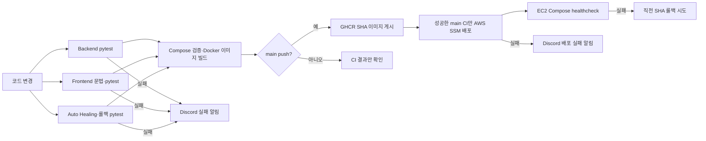

# P3-3 파이프라인 구현 결과 보고서 1.1

> ChargePin — 서울 전기차 충전소 안내 멀티 에이전트 서비스

- 문서 버전: 1.1
- 작성일: 2026-11-09
- 기준 커밋: `467e1e1`
- 대상 범위: pytest, Test API·Checker, GitHub Actions CI/CD, GHCR, AWS EC2, Discord 실패 알림
- 1.0 대비 반영: Backend 48개(운영 DB 안전 저장 포함) 테스트, 최신 9회 장애시험, 실패 차단·Discord 수신 증빙

---

## 1. 구현 목적

P3-3의 목적은 코드 변경이 사용자 환경으로 전달되기 전에 테스트·컨테이너 빌드·배포 검증을 순서대로 통과하게 하고, 실패를 팀이 즉시 인지하도록 하는 것이다. ChargePin은 실제 외부 API·유료 LLM의 불안정성 대신 Test API와 가짜 Provider로 결정적인 오류를 재현한다.



## 2. 구성 요소

| 구성 | 파일·위치 | 역할 |
| --- | --- | --- |
| Backend 테스트 | `Backend/tests/` | Planner·Executor·Critic·Guardrail·계약·복구·로그 보안 검증 |
| Frontend 테스트 | `Frontend/tests/` | 채팅 안내·지도 안전성·역할 UI·대시보드 계약 검증 |
| Ops 테스트 | `tests/ops/` | Watchdog 정책·Docker 배포 실패·SHA 롤백 정책 검증 |
| Test API | `Backend/app/testkit.py`, `Backend/app/main.py` | 통제된 정상·오류 fixture 주입 |
| Test Checker | `Backend/tests/test_fault_recovery.py` | Test API 결과, 재시도, Handoff, 운영 이벤트 검증 |
| 로그 보안 테스트 | `Backend/tests/test_logging.py` | 키·토큰·채팅 원문이 파일 로그에 남지 않는지 확인 |
| 장애 실행 도구 | `Backend/scripts/run_fault_evidence.py` | 구현한 3개 장애 시나리오를 반복 실행해 JSON 증빙 생성 |
| CI | `.github/workflows/ci.yml` | 테스트·Compose 검증·Docker build·GHCR publish·실패 알림 |
| CD | `.github/workflows/cd.yml` | 성공 main CI의 SHA를 SSM으로 EC2 배포·실패 알림 |
| 배포·롤백 | `ops/deploy.py`, `compose.prod.yml` | SHA 고정 배포·healthcheck·직전 SHA 롤백 |

## 3. pytest 구현·결과

| 그룹 | 파일 수 | 테스트 수 | 주요 검증 |
| --- | ---: | ---: | --- |
| Backend | 7개 | **48개** | 자연어 경로, SearchRequest, 서울 범위, Guardrail, Critic, 재시도, API 계약, Test API, 구조화 로그·DB 안전 저장, transient/persistent bounded retry |
| Frontend | 3개 | 24개 | 채팅 안내, 지도 HTML 이스케이프, 역할 UI, 대시보드 계약 |
| Ops | 2개 | 13개 | Auto Healing 재시작 정책, 쿨다운·상한, Docker 배포·롤백 정책 |
| 합계 | **12개** | **85개** | 단위·계약·복구 정책 |

실행 명령은 다음과 같다.

```powershell
cd C:\study\Project\2026-aio2-guide-main\aio2_p3_ChargePin\Backend
uv run --with-requirements requirements.txt pytest -q

cd ..\Frontend
uv run --with-requirements requirements.txt pytest -q

cd ..
uv run --with pytest==8.3.5 pytest -q tests/ops
```

Backend 48개는 구조화 로그·DB 전달 안전성과 transient/persistent Executor·Planner bounded retry 테스트를 포함해 통과를 확인했다. CI에서는 이 세 테스트 그룹이 모두 성공해야 Docker build Job이 시작된다.

## 4. Test API·Test Checker·실행 증빙

### 4.1 안전 경계

Test API는 `CHARGEPIN_ENABLE_FAULT_INJECTION=true`과 상급 관리자 인증을 동시에 요구한다. 조건이 없으면 `404`로 노출하지 않으며, 일반 운영 `.env`에서는 `false`다.

### 4.2 시나리오

| 시나리오 | 주입 내용 | Checker·실행 기대값 |
| --- | --- | --- |
| `normal` | 정상 충전소 fixture | `completed`, Critic `PASS`, AVAILABLE |
| `stale` | 7일 초과 보고 시각 | `degraded`, `DELAYED`, 수량 미표시 |
| `invalid_count` | 빈자리 > 전체 충전기 수 | `degraded`, `UNAVAILABLE`, 수량 미표시 |
| FT-01 `timeout` | 재시도 가능한 Provider timeout | 최초 1회+자동 재시도 2회, 안전한 실패 |
| FT-02 `executor_exception` | Executor 강제 예외 | 자동 재시도 2회 후 내부 500 원문 없이 안전한 실패 |
| FT-04 `llm_invalid_schema` | Planner 스키마 오류 | Planner 자동 재시도 2회 후 `NEEDS_INPUT`, Provider 미호출 |

### 4.3 실제 9회 실행

`py Backend/scripts/run_fault_evidence.py --repeat 3`의 `artifacts/fault-recovery-evidence.json`에는 다음 9개 성공 기록이 있다.

| 시나리오 | 반복 | 결과 |
| --- | ---: | --- |
| FT-01 `timeout` | 3 | 모두 `SAFE_UNAVAILABLE`, 자동 재시도 2회 |
| FT-02 `executor_exception` | 3 | 모두 `SAFE_UNAVAILABLE`, 자동 재시도 2회 |
| FT-04 `llm_invalid_schema` | 3 | 모두 `NEEDS_INPUT`, Provider 미호출, Planner 자동 재시도 2회 |
| 합계 | **9 / 9** | 모든 기록 `passed: true` |

이는 DB 폴백 구현 전 확보한 3개 시나리오 실행 증빙이다. 현재 PostgreSQL 운영 이력과 파일 로그 폴백을 구현했지만, 교육 가이드의 DB 연결 오류(FT-03)를 3회 반복한 실행 증빙은 아직 없으므로 9/9를 공통 4개 시나리오 전체 완료라고 표현하지 않는다.

## 5. CI 실패 차단과 Discord 알림

### 5.1 CI Job 의존성

| Job | 실행 내용 | 실패 시 |
| --- | --- | --- |
| `backend-tests` | Backend pytest | `docker-build` 실행 차단 |
| `frontend-syntax` | compileall + Frontend pytest | `docker-build` 실행 차단 |
| `autohealing-tests` | Ops pytest + 격리 Docker rollback 시험 | `docker-build` 실행 차단 |
| `docker-build` | `.env.example`, `docker compose config`, 이미지 build | GHCR publish 차단 |
| `publish-images` | main push에서 GHCR `latest`, `sha-<commit>` 게시 | CD 배포 후보 없음 |
| `notify-failure` | 앞선 Job 실패 확인 후 Discord 웹훅 POST | `ALERT_WEBHOOK_URL` 미설정이면 알림만 skip |

`needs` 관계로 테스트가 하나라도 실패하면 이미지 빌드·게시가 진행되지 않는다. `notify-failure`는 `failure()` 조건으로 실행돼 실패가 발생한 경우 Discord 채널에 브랜치·실행자·Actions URL을 보낸다.

### 5.2 실제 실패 알림 시연

| 순서 | 실행 결과 |
| --- | --- |
| 1 | `feature/discord-alert-test`에서 `test_logging.py`에 의도적 `assertEqual(1, 2)` 테스트를 추가·push |
| 2 | Backend pytest Job 실패 확인 |
| 3 | `docker-build`·이미지 publish가 실행되지 않음 확인 |
| 4 | Discord 팀 채널에 CI 실패 알림 도착 확인 |
| 5 | 임시 실패 테스트를 제거하고 복구 CI 성공 확인 |

- 실패 실행: [ChargePin CI run 42557685477](https://github.com/ac9989/2026-aio2-p3-ChargePin/actions/runs/42557685477)
- 복구 브랜치 성공: [ChargePin CI run 42558093514](https://github.com/ac9989/2026-aio2-p3-ChargePin/actions/runs/42558093514)
- 최신 main CI 성공: [ChargePin CI run 42561841488](https://github.com/ac9989/2026-aio2-p3-ChargePin/actions/runs/42561841488)
- 최신 main CD 성공: [ChargePin CD run 42562090395](https://github.com/ac9989/2026-aio2-p3-ChargePin/actions/runs/42562090395)

Discord 웹훅 URL은 GitHub Secret `ALERT_WEBHOOK_URL`로만 주입한다. 코드·workflow 로그·문서·캡처에는 URL 원문을 남기지 않는다.

## 6. GHCR·AWS CD

CD workflow는 성공한 `main` CI의 `workflow_run`만 배포 후보로 처리한다.

1. EC2 instance ID, AWS role ARN, Seoul 리전, 40자리 commit SHA를 검증한다.
2. GitHub OIDC로 단기 AWS 권한을 발급받는다.
3. SSM이 EC2에 해당 SHA 기준 `compose.prod.yml`, `ops/deploy.py`를 내려받게 한다.
4. EC2는 SHA 고정 이미지를 `pull → up --wait`로 실행한다.
5. healthcheck 성공 시 해당 SHA를 `last_successful_sha`로 저장한다.
6. 실패 시 이전 성공 SHA가 있으면 backend·frontend 롤백을 시도하고, CD 실패 알림을 Discord로 보낸다.

## 7. 제출 증빙과 한계

| 항목 | 상태 |
| --- | --- |
| Backend·Frontend·Ops 자동 테스트 | 85개 테스트 구성, 현재 로컬 실행 통과. 현재 커밋의 CI run은 push 뒤 확인 |
| Test API 3개 시나리오 × 3회 | 9/9 JSON 증빙 있음 |
| CI 테스트 실패 차단 | 실패 run에서 Docker build 미실행으로 증빙 |
| 실패 알림 채널 | Discord 수신 확인·실패 run 링크 있음 |
| 최신 main CI/CD | 커밋 `467e1e1` 기준 성공 run 링크 있음 |
| Docker Compose healthy 화면 | 최종 발표 캡처로 별도 보관 필요 |
| DB 장애 FT-03 | DB 폴백 구현, 3회 반복 장애 증빙 대기 |
| EC2 서비스 장애 주입·상시 Watchdog | 별도 운영 범위, 미실행 |

## 8. 결론

ChargePin은 테스트 → Docker build → GHCR → AWS EC2 Docker Compose 배포의 게이트를 구현했고, 테스트 실패 시 이미지 빌드를 차단하고 Discord 채널에 실제 알림을 보냈다. 구조화 로그·DB 안전 저장과 bounded retry를 포함한 Backend 48개, Frontend 24개, Ops 13개의 테스트 구조를 운영한다. 구현한 3개 장애 시나리오는 각 3회로 총 9/9 기대 결과를 확인했다.

남은 제한은 FT-03 3회 실행 증빙, EC2 서비스 본체의 고의 장애 주입과 상시 Watchdog를 아직 운영하지 않는 점이다.
