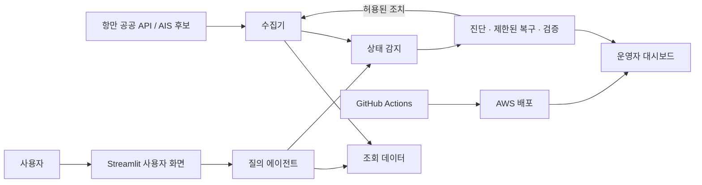
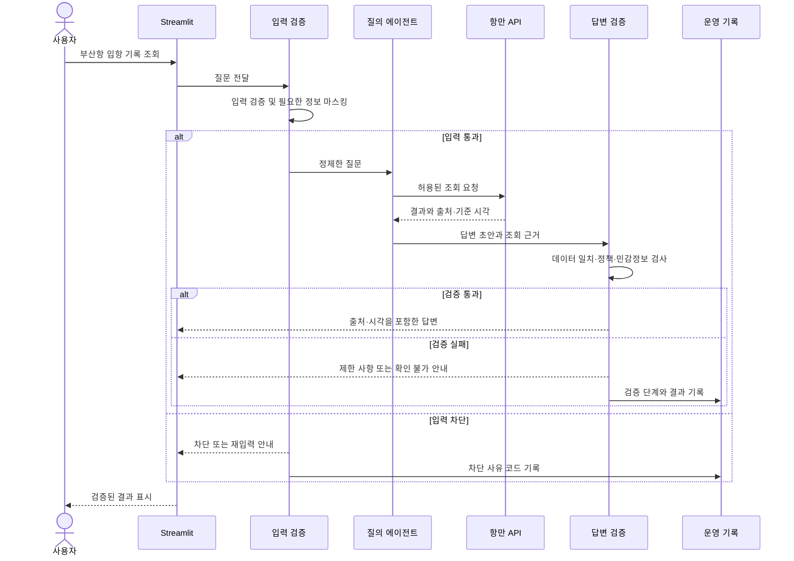
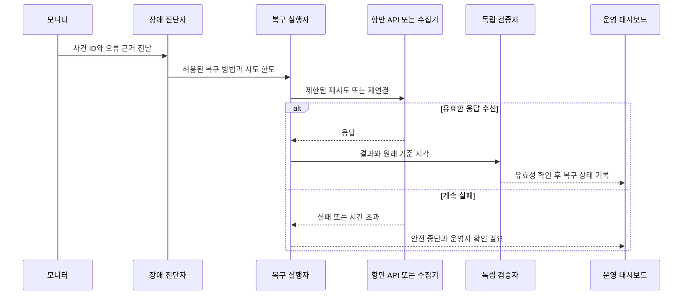
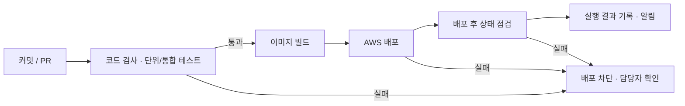

# Seak 제품 요구사항 PRD

**버전:** v1.0 초안  |  **작성일:** 2026.11.02  |  **상태:** 공유 전 초기안

초기 모델 v1.0을 구현하고 검증하기 위한 기능 요구사항과 완료 기준을 정리한다.

> **읽는 순서:** 목표와 사용자 요구(2~5절) → 데이터 현황(8절) → 에이전트·가드레일·운영(16~18절) → 시험·평가 증거(19~20절). 이 문서는 팀 공유 전 계획이며 구현 실적을 뜻하지 않는다.

## 1 문서 목적과 범위

이 문서는 Seak 초기 모델의 기능 요구사항과 확인 기준을 정의한다. 기획서에서 정한 지도·선박·항만·화물 데이터와 AI 대화라는 방향을 개발 가능한 요구사항으로 구체화한다.

표기 원칙: 필수는 v1.0의 기본 목표, 조건부는 데이터 확인 후 확정, 검토는 팀이 결정할 사항이다. 선박운항정보·관제정보·항만별 입출항 통계 API는 팀이 확보했다고 보고했다. 실제 응답과 연동은 아직 확인하지 않았으며, AIS Stream 발급과 수신 및 일부 정책은 검증 전이다.

## 2 목표와 비목표

- 목표: 확보한 국내 항만 공공 API 중 하나 이상을 실제로 연결하고, 항만 정보 조회와 AI 대화를 시연한다. AIS Stream의 발급·수신·이용 조건을 확인하면 관측 선박 위치를 지도에 추가한다.
- 운영 목표: 장애의 감지·진단·제한된 복구·독립 검증을 구현하고, 운영 대시보드와 테스트 기록으로 확인한다.
- 조건부 목표: 공공데이터의 식별자와 항차·기간이 맞으면 선박별 입출항·화물 정보를 연결해 표시한다.
- 초기 제외: 모든 해역과 선박의 완전한 관측 보장, 유료 판매·결제, 검증되지 않은 자동 예측. 추후 확장은 가능하다.

## 3 사용자 화면 요구사항

### FR 01 지도 및 검색  필수

- 사용자는 세계 지도를 이동·확대·축소하고, 수집된 선박 위치와 주요 항만을 구분해 볼 수 있다.
- 지역 또는 항만을 검색하고, 선종 정보가 수신된 경우 선종 필터를 적용한다.
- 선박 수는 중복 식별자를 제거해 정해진 수신 시간 범위 안의 선박으로 계산한다. 시간 범위 기본값은 팀 결정 사항이다.
### FR 02 선박 상세  필수 및 조건부

- 선박 선택 시 수신된 이름, 식별자, 좌표, 속도, 방향, 선종과 마지막 수신 시각을 제공 가능한 항목에 한해 표시한다.
- 오래된 위치는 마지막 확인 위치임을 표시한다. 오래됨 기준은 팀이 정하고 일관되게 적용한다.
- 입출항 및 화물 데이터는 신뢰할 수 있는 식별자·항차·기간이 일치할 때만 연결하고 출처와 시점을 함께 표시한다.
### FR 03 항만 상세  필수 및 조건부

- 항만 선택 시 항만명과 위치를 보여주고, 실제 조회가 확인된 입출항 기록과 항만 통계를 제공한다. 화물·컨테이너 통계는 해당 API 확보와 응답 확인 후 추가한다.
- 기간과 입항·출항 또는 수입·수출 구분, 단위와 데이터 기준을 표시한다. 미지원 항목은 데이터 상태를 안내한다.

## 4 AI 대화 요구사항

### FR 04 AI 에이전트와 채팅창  필수

- 화면 우측 하단에 팝업형 채팅창을 제공하고 열기·닫기, 질문 입력, 답변과 추천 질문을 제공한다.
- 질문을 선박 위치, 항만 입출항, 화물 통계, 국가별 무역 또는 서비스 데이터 안내로 분류한다.
- AI 에이전트는 질문의 의도·해역·항만·기간·품목을 파악하고 허용된 조회 도구를 선택·호출하며, 필요한 경우 추가 조건을 묻고 결과를 바탕으로 답한다. 답변에 데이터 출처, 기준 시각·기간, 단위를 표시한다.
- 항만, 기간, 품목 또는 중량·금액 등 판단에 필요한 조건이 불명확하면 질문하거나 적용한 기본값을 알린다.
### FR 05 부분 정보와 오류 처리  필수

- 자료가 일부 존재하면 확인 가능한 내용과 그 범위를 답하고 연관된 조회를 제안한다.
- 수신된 선박이 없는 경우 관측된 신호 없음으로 표현하며 수신 오류나 지역 제한 가능성을 구분해 안내한다.
- 조회 실패, 타임아웃, 응답 데이터 없음, 연결 안 된 정보는 각각 적절히 표시한다. 근거 없는 수치와 추정을 생성하지 않는다.

## 5 대표 질문과 검증 기준

### AC 01 해역별 선박

“부산항 주변에서 확인된 선박은 몇 척이야?”는 AIS가 해당 해역에서 수신되는 경우에 시험한다. 지정 영역과 시간 범위의 고유 선박 수, 조회 시각과 출처를 표시한다. 정상 수신 중 관측 0건과 수집기·연결 장애는 다른 상태로 표시하며, 0건을 실제 선박이 없다는 뜻으로 단정하지 않는다.

### AC 02 항만 입출항 기록
“부산항의 입항 기록을 보여줘”라는 질문에 실제 API가 지원하는 기간·항만 조건을 적용하고, 제공되는 선박명·시각 및 출처를 표시한다. 필수 조건이 누락되거나 해당 조회가 지원되지 않으면 확인 질문 또는 제한 사항을 안내한다.

### AC 03 항만별 선박 입출항 통계
“부산항의 월별 입항 선박 수를 비교해줘”라는 질문에 조회 가능한 기간과 선박 수를 표시한다. 총톤수(GT)는 선박 규모 지표로, 화물의 중량이나 컨테이너 수량으로 표현하지 않는다.

### AC 04 선박별 기록과 화물
호출부호·항만·항차·시간 등의 일치가 확인된 선박과 관제·입출항 기록만 연결한다. 개별 화물은 적합한 데이터와 연결 근거를 확보한 경우에만 제공한다.

### AC 05 품목·국가별 통계 — 조건부
“부산항 수입 화물 상위 품목”과 “타이어를 가장 많이 수입한 나라”는 해당 품목·무역 API의 승인, 실제 응답, 기간과 단위를 확인한 뒤 적용한다. 현재 확보한 선박 입출항 API만으로 답을 만들어 내지 않는다.

## 6 데이터 및 연계 요구사항

- AIS 수집기는 WebSocket 수신, 유효성 확인, 최근 위치와 수신 시각 저장, 연결 중단 시 재접속을 지원한다.
- 공공 API는 이용 조건이 허용하는 범위에서 결과와 기준 시점·출처를 관리하고 조회 실패 시 상태를 기록한다.
- 선박 연결 후보는 MMSI, IMO, 호출부호, 항차·시각이다. 이름만 일치하는 경우 자동 확정하지 않고 팀이 연결 규칙을 정한다.
- 항만 코드, 국가 코드, 품목 분류, 날짜와 단위를 표준화하되 원본 값과 출처를 보존한다.
- 항만 통계와 선박 개별 화물, 수입 통계와 항만 물동량은 집계 대상이 다를 수 있으므로 서로 동일하다고 가정하지 않는다.

## 7 시스템 구성 및 기술 후보

Streamlit 화면 → 지도·상세 정보·채팅창 → AI 에이전트(모델, 질문 분석, 도구 선택·호출, 결과 정리) → 선박·항만·무역 조회 도구 → 저장소 및 AIS·공공 API 수집기. 데이터 수집은 화면 실행과 분리하는 방안을 우선 검토한다.

기술 후보: Python, Streamlit, FastAPI, Pydantic, LangGraph, Gemini API, Folium 또는 PyDeck, SQLite 또는 PostgreSQL, Docker, GitHub Actions, AWS. 실제 모델·저장소·배포 방식은 수업 제약과 비용, 테스트 결과를 확인한 뒤 확정한다.

API 키는 코드와 공개 저장소에 넣지 않고 환경 변수 등으로 관리한다. 데이터 최신성 기준, 수집 주기, 서버 비용과 AI 호출비는 결정이 필요하다.

## 8 데이터 확보 현황과 확인 계획

| 데이터 | 상태 | 확인 가능한 활용 범위와 후속 확인 |
|---|---|---|
| [선박운항정보](https://www.data.go.kr/data/15006353/openapi.do) | 팀이 확보함 | 항만·기간·호출부호 기준의 입출항 등. 실제 응답·기간·호출 한도 확인 |
| [관제정보](https://www.data.go.kr/data/15006354/openapi.do) | 팀이 확보함 | 선박 호출부호와 항만별 관제 교신 정보. 연계 필드와 실제 응답 확인 |
| [항만별 선박입출항실적 통계정보](https://www.data.go.kr/data/15059059/openapi.do) | 팀이 확보함 | 월·연도·항만별 입출항 선박 수와 총톤수. 실제 조회 기간·필드 확인 |
| [AIS Stream](https://aisstream.io/) | 개인 GitHub 가입·키 발급 및 수신 시험 전 | 관측된 선박 위치 후보. 한국·해외 수신 범위, 이용·보관·표시 조건 확인 |
| 품목별 화물·컨테이너·국가별 무역 통계 | 추가 후보 | 신청·승인·응답 및 연결 가능성을 확인한 경우에만 사용 |

세 공공 API의 확보 상태는 팀이 전달한 정보이다. 키 확보와 실제 데이터 수신 성공은 별개이며 확인 전에는 연동 완료로 표시하지 않는다. API별 식별자, 조회기간, 데이터 단위, 출처, 갱신 시각, 호출 제한과 보관·표시 조건을 기록한다.

AIS Stream은 공급자 문서상 서버에서 WebSocket으로 연결한다. 개인 발급, 한국 해역 수신, 서비스 노출과 데이터 보관 조건은 별도 시험·확인한다. 통신 성공이나 관측 0건만으로 전체 해역의 선박 유무를 판단하지 않는다. [AIS Stream 이용 안내](https://aisstream.io/documentation)

## 9 테스트 및 완료 기준

- AIS 이용과 수신이 확인된 경우 지도에서 수신된 선박의 상세와 마지막 수신 시각을 확인한다. 그렇지 않으면 항만 지도와 데이터의 제한 상태를 확인한다.
- 국내 공공데이터 한 종류 이상을 실제 조회하고 결과의 출처와 기간을 볼 수 있다.
- 대표 질문에서 조회 결과와 답변의 값·기간·단위가 일치한다.
- 데이터 없음, 연결 실패, 오래된 위치, 지원하지 않는 질문을 각각 시험한다.
- 일치하지 않는 선박 식별자나 항차를 임의로 연결하지 않는지 시험한다.
- 팀원이 지도와 채팅을 사용해 주요 시나리오를 재현할 수 있다.

## 10 우선순위 및 미결정 사항

필수: 항만 지도·표시, 실제 조회가 확인된 항만 공공 API 1개 이상, 데이터 기반 채팅, 출처·시각·오류 안내, 에이전트 협업과 제한적 자동 복구, 운영 대시보드, 테스트·배포 증거. AIS 선박 위치는 발급·실제 수신·이용 조건을 확인해 적용한다.

조건부: 선박별 화물, 상세 선종, 국가별 수입 순위, 추가 해외 데이터는 접근·응답·식별자 확인 후 적용한다. 관세청 국가별 수입 조회는 우선 연결 후보로 검토한다.

팀 결정: 첫 시연 해역과 항만, 수신 시간 창과 오래된 위치 기준, 데이터 수집·보관 기간, 지도 및 AI 모델, 비용 한도, 작업 담당과 일정.

문서 상태: v1.0 공유 전 초기안. 팀원에게 공유하는 시점부터 기준 문서로 관리하며 이후 변경 내용·사유·영향·결정일·결정자와 버전 변경 여부를 기록한다.

## 11 개발 및 배포 계획 — 3일 가정

### 개발 전 준비  착수 조건

- AIS Stream 키 발급이 가능하면 한국과 해외의 시연 후보 해역에서 수신 시험을 수행하고, 데이터가 들어오는 해역과 시간을 기록한다. 준비되지 않으면 항만 공공데이터 중심으로 시연 범위를 정한다.
- 시연할 공공데이터 API 1개 이상의 키와 실제 샘플 응답을 확보하고, 질문에 필요한 항목·단위·기간 및 이용 조건을 확인한다.
- AWS 계정·권한·비용 한도, AI 모델 접근, GitHub 저장소와 팀원 권한을 확인한다.
- 핵심 시연 질문 3개 내외, 각 질문의 데이터 출처, 프론트엔드·백엔드 역할, 겸임할 배포·테스트 업무와 인터페이스를 결정한다.

### 1일 차  핵심 흐름과 첫 배포

- 프론트엔드는 Streamlit 지도·선박 상세·채팅 UI를 구현한다. 백엔드는 실제 사용이 확인된 공공데이터 1개 이상을 연결하고 조회 기능을 제공한다. AIS 수신은 키·응답·이용 조건을 확인한 뒤 연결한다. 백엔드의 AI 에이전트 담당은 모델 연결, 질문 분석, 도구 선택·호출, 결과 처리와 답변 생성 흐름을 구현해 프론트엔드 채팅 화면에 연결한다.
- AWS에서 개발 버전에 접속하고 대표 질문 1개 이상을 시험한다.
- GitHub에 구현 이력을 기록하고, Actions로 기본 검사와 의미 있는 핵심 테스트를 실행한다.
- 배포 성공 여부를 기록한다. 첫날에 전 기능 완성을 보장하지 않는다.

### 2일 차  완성 및 검증

- 에이전트가 질문에 맞는 도구를 선택하고 입력 조건을 올바르게 전달하는지 검증한다. 대표 질문별 실제 데이터와 답변을 대조하고 오류·공백·수신 중단을 확인한다.
- 필요한 기능을 수정하고 AWS 재배포와 CI 실행을 확인한다. CD가 구현됐다면 코드 변경부터 자동 배포 및 서비스 접속까지 시험한다.
- 디버깅 보고서, 발표 자료, 시연 영상과 남은 한계 목록을 작성한다.

### 3일 차  발표

- 지도, 상세 정보, 질의응답을 시연한다. GitHub 작업 기록과 실제 구현한 CI/CD 범위, 장애 대응 사례를 설명한다.
- 발표 전 라이브 서비스와 API 상태를 확인하고, 장애 시 녹화 영상을 녹화본으로 명시한다.

## 12 배포와 CI CD 요구사항

### FR 06 AWS 배포  필수

- 팀이 선택한 AWS 환경에서 Streamlit 앱을 실행하고 발표 환경에서 접속할 수 있어야 한다.
- API 키와 자격 증명은 환경 변수 또는 비밀 관리 기능에 보관한다. 저장소, 로그, 발표 자료에 노출하지 않는다.
- 배포 결과, 오류와 접속 검증 결과를 기록하고, AI 모델·서버 사용 비용과 종료 계획을 확인한다.

### FR 07 GitHub 협업 및 CI  필수

- 저장소에 README, 실행 방법, 환경 변수 이름, 시스템 개요와 데이터 출처를 기록한다. 실제 비밀 값은 포함하지 않는다.
- 이슈, 커밋과 풀리퀘스트 등으로 역할별 변경과 문제 해결을 추적한다.
- GitHub Actions가 코드 변경 또는 풀리퀘스트 시 기본 검사와 데이터 계산·조회 응답 처리 등 핵심 테스트를 수행하도록 구성한다.
- 테스트 성공·실패 이력을 확인하며, 실패한 검사를 성공으로 표기하지 않는다.

### FR 08 자동 배포 CD  핵심 목표

- 팀이 시간·권한·환경을 확인한 뒤 검증에 통과한 변경을 AWS에 자동 배포하는 흐름을 구현한다.
- 변경 → 검사 → 배포 → 접속 확인까지 검증한다. 실제로 자동 배포를 구현하지 못하면 ‘CI와 AWS 수동 배포’로 보고한다.
- CI/CD 담당, 배포 대상 브랜치, 배포 자격 증명 및 실패 시 재시도·복구 방식은 팀에서 결정한다.

## 13 디버깅 보고서와 발표 검증

### 디버깅 보고서 필수 항목

- 문제 제목, 발견 시점과 재현 조건.
- 오류 현상과 로그 등 확인 근거. 비밀 정보는 제거한다.
- 확인 과정, 확인된 원인 또는 미확인 상태.
- 수정 사항, 재검증 방법과 결과, 남은 한계.
- 관련 이슈·커밋·풀리퀘스트 링크와 담당자.

### 추가 완료 기준

- 사전 확인된 실제 데이터와 최소 한 개 공공 API를 연결하고, 배포 서비스에서 대표 시나리오가 동작한다.
- 테스트 실행 기록과 AWS 접속 결과가 확인된다. 자동 배포 여부는 실제 구현 결과에 맞게 표시한다.
- API 수신 실패 또는 발표 환경 장애에 대비한 시연 영상이 준비되어 있다.
- 디버깅 보고서와 데이터 출처, 서비스 한계가 발표 자료 또는 저장소에 정리되어 있다.

### 데이터 확보가 불충분할 때

- 다른 수신 가능 해역이나 제공 항목이 확인된 공공 API를 우선 사용하고, 변경된 시연 범위를 팀에 공유한다.
- 실제 확보한 과거 샘플이나 녹화 영상으로 설명할 경우 기준 시각과 샘플·녹화 여부를 표시한다. 가상 데이터는 가상 데이터라고 표시하며 실시간 결과로 제시하지 않는다.
- 제공자 승인 또는 이용 조건이 확인되지 않은 데이터는 그 상태를 기록하고 사용 가능 범위를 확인한다.

## 14 AI 에이전트 제작 담당과 검증

**담당 업무:** 사용할 모델을 연결하고, 에이전트의 역할과 답변 원칙을 정의한다. 데이터 담당과 조회 도구의 이름·입력·출력·오류 형식을 합의하고, 질문에 맞는 도구 선택과 실행 결과를 이용한 답변 흐름을 구현한다. 채팅 화면과 연결하고 대표 질문 및 실패 사례를 테스트한다.

**초기 도구:** 해역별 수신 선박 조회, 선박 상세 조회, 연결된 항만 입출항·화물 통계 조회, 연결된 품목·국가별 수출입 조회. 실제 API 응답을 검증한 도구부터 제공한다.

**완료 기준:** 대표 질문에 대해 에이전트가 적절한 도구와 조건을 선택해 실제 조회 결과를 답변에 반영한다. 출처와 기간·단위를 표시하고, 모호한 질문이나 빈 결과·호출 실패를 처리한다. 도구 선택·조회 결과와 답변 값의 일치 여부를 테스트 기록에 남긴다.

역할 분담은 제안이다. 팀원 수가 적으면 한 사람이 에이전트·챗봇과 다른 업무를 겸할 수 있다.

## 15 프론트엔드와 백엔드 업무 구분

### 프론트엔드

- Streamlit 화면과 지도, 선박·항만 마커, 검색·필터, 상세 정보 패널을 만든다.
- 우측 하단 채팅 UI를 구현하고 백엔드의 에이전트 요청·응답을 표시한다.
- 데이터 출처, 시각과 로딩·빈 결과·연결 오류 상태를 화면에서 이해하기 쉽게 보여준다.
- 화면 조작과 발표용 시연 흐름을 테스트한다.

### 백엔드 데이터

- 공공 API 호출, 데이터 정리·조회와 이용 조건에 맞는 저장을 구현한다. AIS 수신 및 재접속은 발급과 실제 수신을 확인한 뒤 적용한다.
- 선박·항만·항차 연결 규칙과 데이터 출처·기준 시각을 관리한다.
- 화면 및 에이전트에 제공할 입력·출력 형식과 오류 상태를 프론트엔드·AI 담당과 합의한다.

### 백엔드 AI 에이전트

- 모델과 질문 분석을 연결하고 조회 도구를 선택·호출하는 에이전트 흐름을 구현한다.
- 도구 결과, 출처와 시각을 반영해 답변을 생성하고 누락 조건·실패를 처리한다.
- 대표 질문에 맞는 도구 선택 및 결과와 답변의 일치 여부를 테스트한다.

### 공통 및 겸임 업무

- AWS 배포와 CI/CD는 담당자를 정해 진행하고 비밀 값을 안전하게 관리한다.
- 프론트·백엔드가 통합 테스트와 디버깅 기록에 함께 참여한다. 발표 자료·녹화·README의 담당자를 별도로 정한다.
- Streamlit은 화면과 서버 측 Python 코드가 한 프로젝트에 있을 수 있다. 이 구분은 작업 분담이며 별도 프론트엔드 서버가 필수라는 의미가 아니다.

## 16 멀티 에이전트와 운영 구조

사용자 질의 처리와 장애 복구는 같은 서비스의 서로 다른 흐름으로 설계한다. 다음 다이어그램은 **계획안**이며 구현 완료를 의미하지 않는다.

| 역할 | 책임 | 실행 방식·제한 |
|---|---|---|
| 질의 에이전트 | 질문 조건 파악, 조회 도구 선택, 근거 기반 답변 초안 | 모델과 허용된 조회 도구 사용 |
| 모니터 | API·수집기·모델·저장소 상태 감지 | 기준에 따른 코드; 빈 결과와 장애 구분 |
| 장애 진단자 | 오류 유형을 해석하고 복구 방안 선택 | 정책 범위의 규칙 또는 LLM; 원인 미확인 상태 허용 |
| 복구 실행자 | 재연결·재시도 등 허용된 조치 실행 | 코드로 제한; 임의 명령·키 변경 금지 |
| 검증자 | 복구 후 별도로 결과의 정상성과 데이터 유효성 확인 | 독립된 검증 규칙; 불일치 시 성공 처리 금지 |

### 16.1 역할 간 전달 계약

공유 상태에는 요청 ID, 사건 ID, 대상 서비스, 발생·관측 시각, 감지 근거, 오류 유형, 시도 횟수, 선택한 조치, 검증 결과, 출처와 최종 상태를 포함한다. 필수·선택 항목과 허용값은 Pydantic 등으로 정의하며 구체 필드는 구현 전 합의한다. 원문 질문·응답과 개인정보·키는 운영 로그에 무조건 저장하지 않는다.

### 16.2 데이터가 확인된 항만 질의

실제 API 요청 조건과 응답은 연결 시험 후 확정한다. 개인정보를 외부 모델에 보내기 전 검사하는 방식과 검출 한계도 검토한다.

## 17 가드레일과 도구 권한

| 단계 | 검사할 내용 | 실패·불확실할 때 |
|---|---|---|
| 입력 | 길이·형식, 프롬프트 인젝션 징후, 개인정보·인증정보 | 차단·마스킹 또는 재입력 요청; 원문 비밀 기록 금지 |
| 도구 호출 | 허용된 조회 도구인지, 항만·기간·식별자 등이 허용 범위인지 | 호출 거부 또는 조건 재확인; 임의 셸·외부 URL 호출 금지 |
| 외부 데이터 인계 | API가 보낸 텍스트를 지시가 아닌 데이터로 취급 | 스키마 오류·불명확한 응답은 오류로 표시 |
| 답변 검증 | 선박·기간·수치·단위·출처가 조회 결과에 부합하는지, 정책과 개인정보를 위반하는지 | 검증 가능한 항목은 코드로 비교; 불일치 시 답변 차단·안내, 제한된 재생성은 팀 정책으로 결정 |
| 최종 처리 | 통과·수정·경고·차단 및 검증 상태 기록 | 정책에 따라 안전한 상태로 종료하고 운영 기록 남김 |

강의의 유해성 검사·개인정보 마스킹·정책 검증·심각도별 처리 개념을 적용한다. 강의 예시에서 사용한 특정 Moderation API를 반드시 동일하게 사용한다는 뜻은 아니며, Gemini 연동과 검사 수단별 기능·비용·이용 조건은 결정 전이다. 정규식과 모델 검증은 오탐·미탐 가능성이 있어 시험 결과와 한계를 함께 기록한다.

## 18 자동 복구와 운영 대시보드

### 18.1 복구 시퀀스

| 장애 상황 | 감지와 제한적 조치 | 확인할 결과 |
|---|---|---|
| 공공 API 일시 오류 | 시간 초과·오류를 감지하고 정해진 횟수만 재시도 | 응답 내용과 상태 재검증 |
| AIS 연결 중단 | 연결 종료를 감지하고 간격을 두고 재연결 | 연결·구독과 이후 수신을 각각 확인 |
| AIS 연결 중 관측 없음 | 연결 상태, 최근 메시지, 비교 해역을 확인 | 0건과 장애를 구분; 공급자 장애 원인은 단정하지 않음 |
| LLM 출력 오류 | 필수 형식·출처·수치 불일치 검사 | 제한적 재생성 또는 사실 기반 안내 |
| DB·복구 상태 저장 오류 | 읽기·쓰기 오류 또는 기록 누락 감지 | 미확인 조치를 성공으로 표기하지 않고 안전 중단 |

외부 공급자 장애는 내부 재시도로 해결되지 않을 수 있다. 캐시는 해당 데이터의 보관·표시가 허용된 경우에만 사용하며 원래 수집 시각을 유지한다. 초기 재시도 횟수와 시간 제한은 제안값을 정해 시험하고 팀이 확정한다.

### 18.2 초기 복구 정책 제안

아래 수치는 실측 결과가 아닌 테스트용 제안이며 팀의 검토 후 확정한다.

- 시간 초과·일시적 서버 오류: 최초 호출 포함 최대 3회, 재시도 사이 간격을 두고 실패가 지속되면 안전 중단한다.
- 인증 오류·잘못된 요청: 같은 요청을 반복하지 않고 설정 확인이 필요하다고 표시한다. 호출 제한 오류는 공급자 안내와 재시도 가능 시점을 확인한다.
- LLM 형식·수치 검증 실패: 최대 1회 재생성을 검토하고, 다시 실패하면 확인 가능한 사실과 제한 사항만 안내한다.
- 빈 결과: 응답 자체가 정상이라면 오류나 복구 성공으로 집계하지 않는다.

### 18.3 운영 화면 요구사항

- 수집·API·모델·DB의 정상 / 지연 / 장애 / 확인 불가 상태와 마지막 확인 시각.
- 사건 ID별 감지 → 진단 → 조치 → 재검증 → 종료 타임라인과 각 역할의 결과.
- API 호출 성공·실패, 응답 시간, 재시도 횟수, 데이터 최신성 및 모델 호출 수·지연. 사용량은 제공되는 경우에만 표시한다.
- GitHub Actions의 검사·빌드·배포 결과와 변경 식별자. 연동이 구현되기 전에는 확인 가능한 링크로 제공한다.
- 사용자 화면과 운영 화면을 구분하고 운영 화면 접근 권한과 로그 보관 기간을 정한다.

## 19 시험과 평가 증거

| 영역 | 핵심 시험 | 남길 증거 |
|---|---|---|
| 데이터 | 정상 응답, 빈 결과, 시간 초과, 오래된 관측과 식별자 불일치 | 출처·시각·기대 결과와 실제 결과 |
| 가드레일 | 프롬프트 인젝션 예시, 개인정보, 도구 권한 밖 요청, 원본과 다른 수치 | 입력 유형, 기대 처리, 실제 처리, 오탐·미탐 |
| 협업 | 각 역할의 입력·출력과 사건 ID 연결, 누락된 상태 처리 | 시퀀스·상태 계약·실행 기록 |
| 복구 | 격리된 시험 환경의 API 지연·실패 및 복구 실패 | 감지·조치·독립 검증의 시각과 결과 |
| 배포 | 단위·통합 시험, 검사 실패 차단, 배포와 접속 확인 | Actions 실행 및 실제 배포 기록 |

실제 공공 API에 장애를 유발하지 않는다. 시험용 모의 응답은 시험용으로 표시하며 라이브 데이터로 발표하지 않는다. 코드 테스트는 TDD를 적용하고, 모델의 도구 선택과 답변은 별도의 평가 문항으로 측정한다. 예비 제안으로 핵심 모듈의 테스트 커버리지 80% 이상을 검토하되, 팀이 확정하기 전에는 목표치이며 달성 실적이 아니다. 자동 복구율은 **자동 복구에 성공한 시험 건수 / 복구 대상 시험 건수**로 계산하고, 안전 중단과 미실행은 별도로 기록한다. 목표 수치와 표본 수는 실측 전 제안으로만 둔다.

## 20 평가 항목과 산출물 연결

| 교과목 3 항목 | 제출·시연할 근거 |
|---|---|
| P3-0 저장소 | 접근 가능한 저장소, 실행 설명, 소스와 산출물 링크 |
| P3-1 멀티 에이전트 아키텍처 | 역할·책임, 선택 근거, 전달 상태·데이터 계약, 시퀀스와 실패 분기 |
| P3-2 배포·장애 복구 | 배포 매니페스트, 발견·조치·검증 기록, 장애 유형별 결과와 복구율 |
| P3-3 파이프라인 | 커밋·테스트·빌드·배포 흐름, 커버리지 정책, 실패 차단, 알림·담당자 연결 |

평가표에는 멀티 컨테이너의 Pod/Service, 서비스 탐색·로드밸런싱·시크릿 관리 및 외부 알림이 명시돼 있다. Docker Compose만으로 동등 충족되는지는 강사에게 확인한다. Kubernetes가 필요하다면 AWS 자원·비용을 확인해 K3s 등 후보를 검토한다. 실제 구현하지 않은 기능은 계획으로 표시한다. [교과목별 평가표](https://docs.google.com/spreadsheets/d/1PTF-DiHO_BBKDDf7NSLnMHqlDb-L5p8P6__KLI6OHCA/edit?gid=287730879#gid=287730879)

도구별 성공·실패와 배포 상태를 실제 결과에 따라 기록한다. 외부 알림과 담당자 배정은 팀의 사용 가능 환경을 확인해 구현한다.
