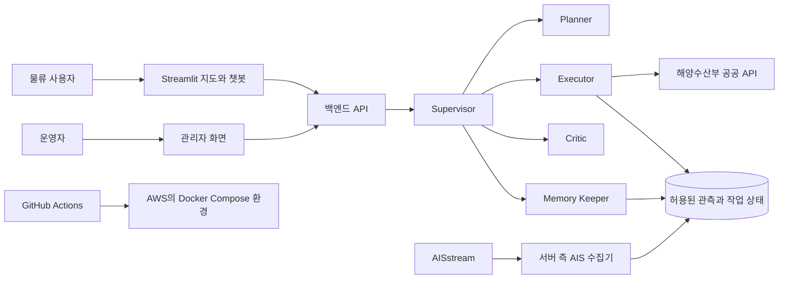
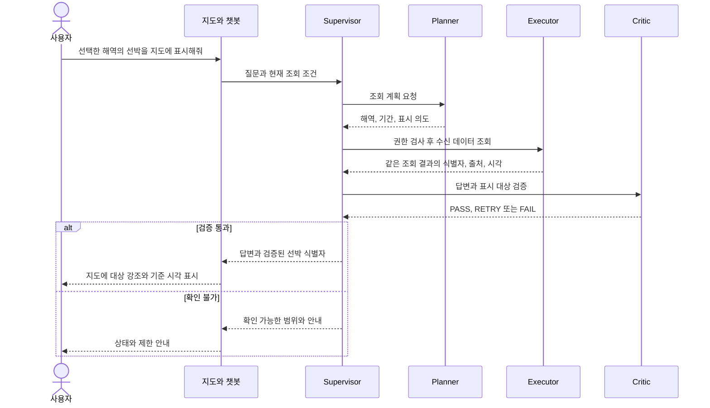
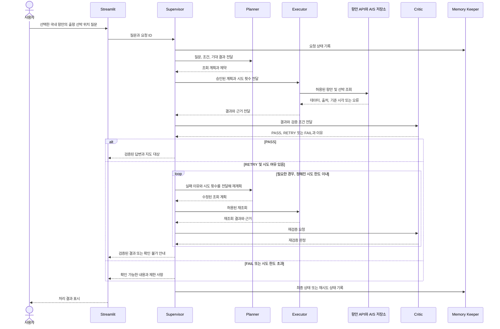
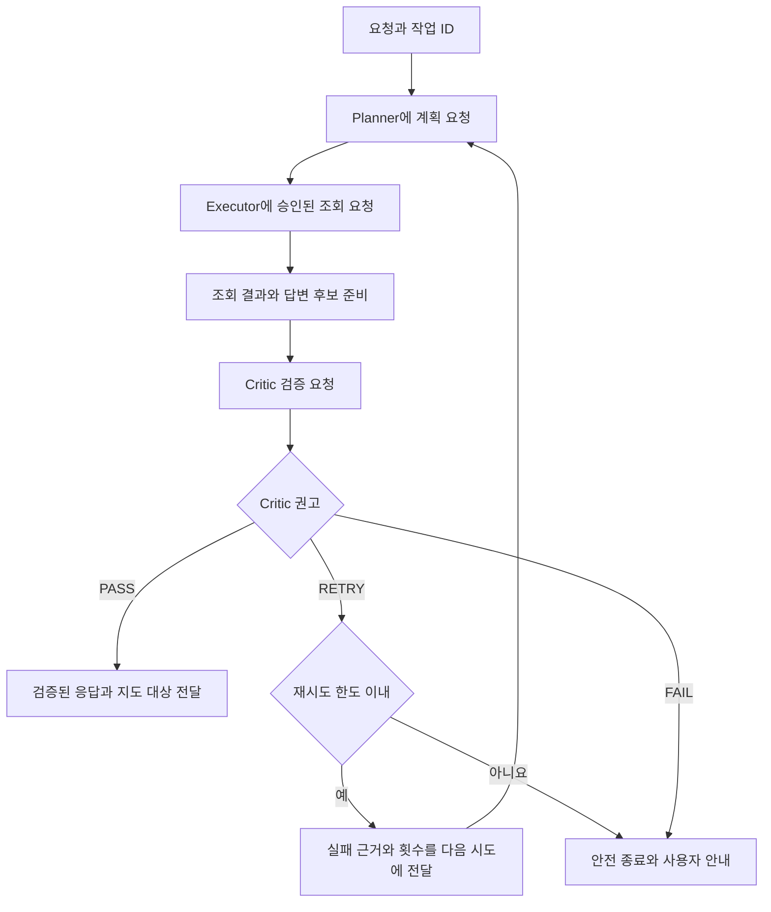
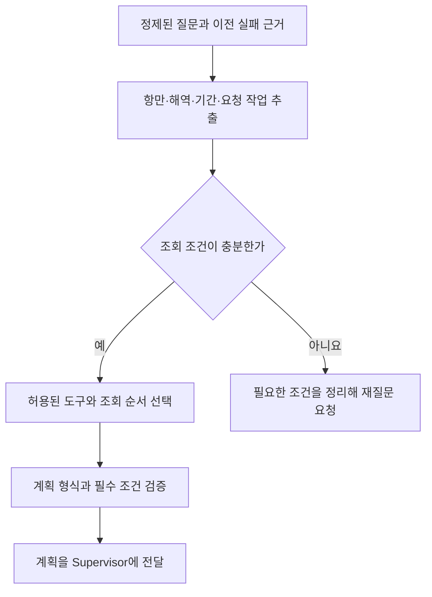
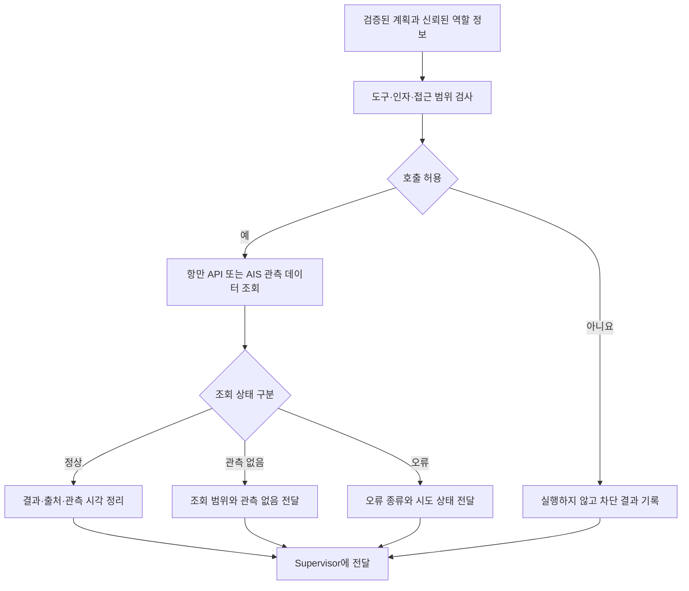
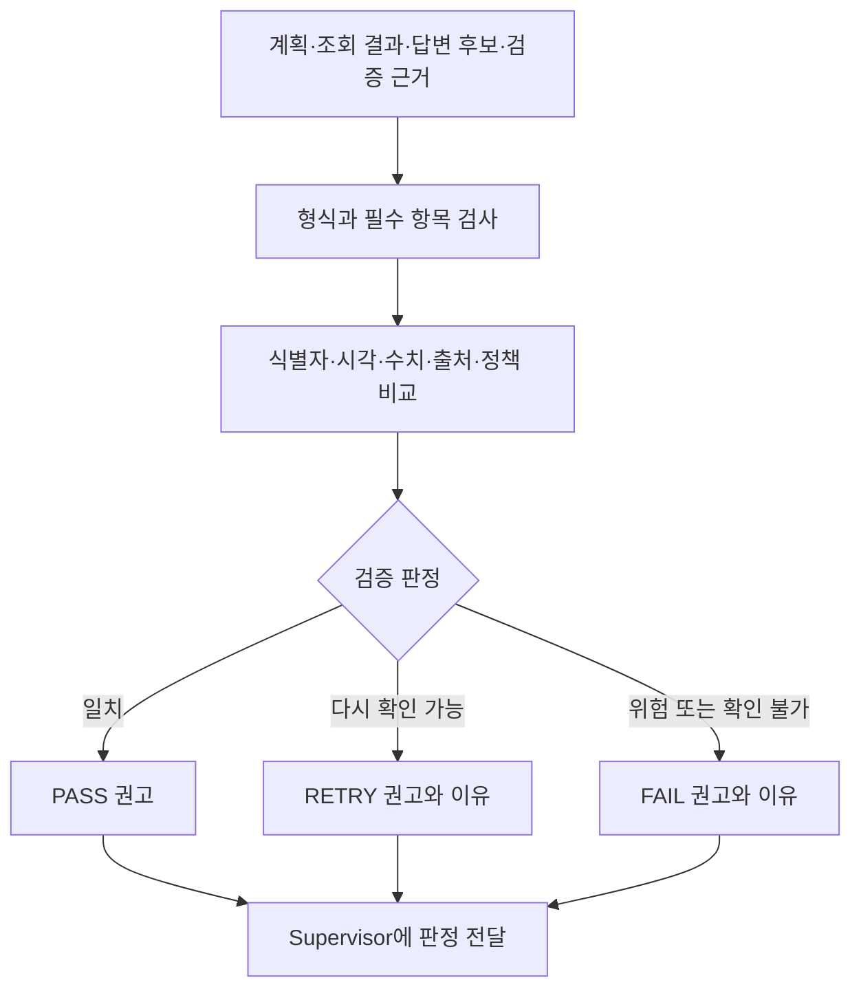
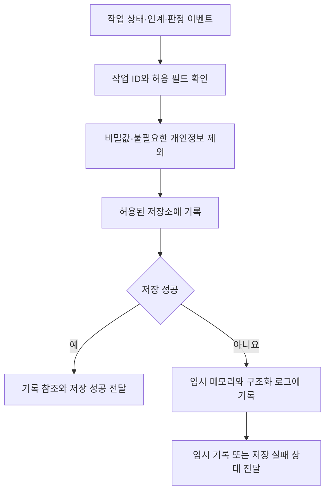
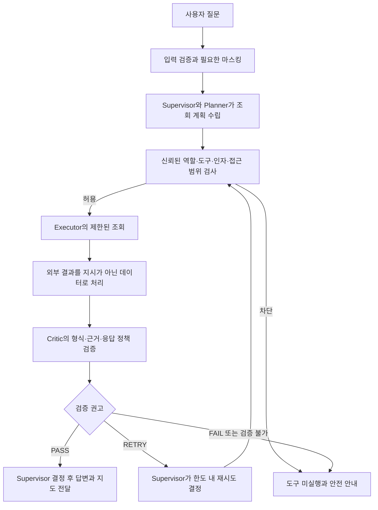

# Seak 제품 요구사항 정의서

**버전:** v1.1 팀 검토용 통합안  
**작성일:** 2026년 11월 2일  
**문서 상태:** 팀 내부 기획과 구현 기준을 정리한 초안입니다. 현재 대화에서 확인된 의견과 기존 기획을 반영했으며, 미결정 사항은 팀 협의가 필요합니다. 실제 API 연동·구현·시험 완료를 뜻하지 않습니다.

P0-A는 교과목 가이드의 필수 조건, P0-B는 Seak의 핵심 목표, P1·P2는 팀이 검토할 확장 범위입니다. 본문 속 예시와 수치는 명시적으로 확정되거나 실측한 것이 아니면 제안입니다.

## 1. 제품 목표와 완료 범위

Seak(시크)는 바다를 뜻하는 Sea와 탐색을 뜻하는 Seek를 결합한 이름입니다. 국내외 여러 해역에서 수신되는 선박 위치와 항만 정보를 지도와 자연어 질문으로 탐색하는 해운·물류 정보 서비스입니다.

초기 모델은 국내 여러 항만과 해외 시연 후보 해역의 실제 데이터 수신을 확인하고, 선박과 항만 기록을 연결할 수 있는 사례를 검증합니다. 멀티 에이전트의 협업·가드레일·장애 복구 과정은 별도 운영 화면에서 확인합니다.

세계 지도 이동과 전 세계의 모든 선박을 항상 관측하는 것은 다릅니다. 실제 표시 범위는 선택한 수집 해역, 제공자의 수신 범위와 관측 시점에 따릅니다.

국가별 해역 조회와 선박의 국적·선적국 필터는 서로 다른 기능입니다. 국적 필터는 신뢰할 수 있는 근거가 확보된 경우에만 제공합니다.

핵심 가치는 **국내외 해역의 관측 위치와 항만 정보를 출처·시각과 함께 확인하는 것**입니다. 같은 선박이라는 근거가 확인된 경우 신고 기록과 마지막 관측 위치를 연결해 제공합니다. 교과목 평가의 필수 과제인 자가 치유 워크플로우와 장애 시험을 제품 요구사항에 포함합니다.

| 우선순위 | 기준 |
|---|---|
| P0-A 교과목 필수 | Docker Compose 실행, Critic 포함 역할 분리 에이전트 3개 이상, 공통 장애 4종, 테스트 실패 시 배포 차단 실증과 파이프라인 실패 알림 1개 채널 |
| P0-B 서비스 핵심 목표 | 국내 항만과 해외 해역을 포함한 복수 후보 지역의 수신 가능 여부 시험, 실제 관측 지도와 국내 공공 API 조회, 지도·챗봇의 출처·시각 표시와 기본 가드레일 |
| P1 적극 목표 | 실제 수신 해역 확대, 확인된 출항 기록과 AIS 선박 연결, 5개 역할과 별도 Memory Keeper, 운영 화면과 자동 배포 |
| P2 조건부·확장 | 추가 품목·국가 통계, 해외 항만의 상세 행정 데이터, 대체 API, Kubernetes와 롤백. 각 데이터·비용·평가 조건을 확인한 뒤 결정 |

AIS 키와 해양수산부 API 활용 키는 팀이 확보했다고 보고했습니다. 실제 데이터 수신, 선박 식별 일치, 각 화물 필드의 값과 재사용 권한은 확인 전입니다.

AIS 지도는 핵심 구현 목표이지만 특정 해역의 수신은 외부 조건에 좌우됩니다. 수신되지 않으면 미수신으로 표시하고 실제 수신이 확인된 대체 해역을 별도로 검토합니다.

녹화나 테스트용 데이터를 실제 관측처럼 표시하지 않으며, 미구현된 핵심 기능은 완료로 보고하지 않습니다.

### 1.1 해결하려는 문제와 사용자

선박 위치, 항만 입출항과 무역 통계가 서로 다른 출처에 있어 사용자는 정보를 옮겨 보며 시각·단위·식별자가 같은지 판단해야 합니다. 조회 장애가 발생했을 때 어느 단계가 실패했는지 찾기도 어렵습니다.

Seak는 데이터의 근거와 상태를 함께 보여주고 장애 대응 과정을 추적하는 것을 목표로 합니다. 이러한 사용자 불편과 사업 가치는 실제 운영·고객 검증 전의 가설입니다.

| 대상 | 필요 | 초기 모델에서 확인할 가치 |
|---|---|---|
| 포워더·물류 실무자 | 여러 화면에 흩어진 선박·항만 정보를 살펴봅니다. | 관측 가능한 선박과 항만 기록을 한 화면에서 조회합니다. |
| 수출입 기업 담당자 | 출항 기록과 조건에 맞는 통계를 이해합니다. | 출처·시각·단위와 정보의 한계를 함께 확인합니다. |
| 프로젝트 운영자 | 시스템의 장애와 에이전트 판단을 살핍니다. | 요청·검증·복구와 배포 이력을 확인합니다. |

위 고객 대상은 B2B 가능성을 검토하기 위한 가설이며 계약 고객이나 매출을 뜻하지 않습니다. 부산·인천·울산과 일본·중국·미국 주변 등은 시험할 수 있는 예시일 뿐이며 실제 시연 대상과 데이터 수신은 팀이 검증해 정합니다.

**초기 범위에서 제공하지 않는 것**은 다음과 같습니다.

- 모든 선박의 빈틈없는 위치와 전체 항적 보장
- 항만 집계만으로 개별 선박의 품목·중량을 확정하는 기능
- 개별 컨테이너의 실시간 화물 추적
- 상품 결제와 유료 상용 서비스

화물 고유 ID·환적 연결, 위성영상 분석 및 AIS 공백 구간의 확률적 위치 추정은 장기 비전의 후속 연구 후보입니다. 이번 시연에 구현됐다고 가정하지 않습니다.

### 1.2 문서와 제출 산출물의 관계

이 PRD는 팀 내부의 계획·합의·구현·검증 기준입니다. 제출할 세 산출물은 별도로 작성합니다.

1. 멀티 에이전트 아키텍처 설계서: 실제 역할·권한·Handoff·상태와 실패 분기.
2. 배포 및 장애 복구 보고서: 실제 실행 환경, 공통 장애 시험과 복구 증거.
3. CI/CD 파이프라인 구현 결과 보고서: 실제 테스트·배포 차단·알림 실행 이력.

실현 가능성이 확인된 것, 팀의 제안, 실제 구현·측정 결과를 구분합니다. 개인정보와 라이선스가 확인되지 않은 자료는 실제 공개 서비스에 사용하지 않습니다.

## 2. 대표 시나리오

| ID | 질문 또는 상황 | 기대 결과 |
|---|---|---|
| US-01 | 선택한 국내 항만에서 출항한 A선은 지금 어디야? | 출항 기록과 AIS의 선박 동일성이 검증되고 위치가 수신된 경우, 마지막 관측 위치·시각과 신고 목적지를 보여줍니다. |
| US-02 | 선택한 해역의 선박을 지도에 표시해줘. | 지정된 해역과 시간 창에서 관측된 선박을 같은 조회 결과로 계산해 지도에 강조합니다. 색상은 시스템 설정으로 적용하며 빨간색을 초기 후보로 검토합니다. |
| US-03 | 이 선박의 신고 화물량은? | 같은 항차의 적하화물톤과 화물명세가 유효하면 각각의 원본 의미와 시각을 함께 표시합니다. |
| US-04 | API가 응답하지 않습니다. | 오류를 분류하고 허용된 복구를 시도한 뒤 결과와 한계를 안내합니다. |
| US-05 | 운영자가 복구 과정을 확인합니다. | 사건 ID로 감지·조치·Critic 검증·최종 결정을 추적합니다. |
| US-06 | 인천항 출항 기록과 울산항 입출항 통계를 확인해줘. | 각 API가 지원하고 실제 확인된 항만·기간의 기록과 통계를 표시합니다. 도시명은 검증할 예시입니다. |
| US-07 | 선택한 해외 해역에서 관측된 선박을 보여줘. | 해당 해역이 수집 범위에 있고 실제 AIS 신호가 수신된 경우 출처·시각과 함께 표시합니다. |

관측되지 않은 선박을 ‘존재하지 않음’으로, 신고된 목적지를 ‘도착 완료’로, 화물명세 코드를 임의의 제품명으로 설명하지 않습니다.

추가 시나리오: 사용자는 선택한 항만의 입출항 목록과 제공되는 기간별 선박 수를 조회하고, 데이터가 확보된 경우에만 특정 국가·HS코드의 월별 무역 통계를 질문할 수 있습니다. 조건이 모호하면 항만·기간·품목·금액 또는 중량 기준을 확인하거나 사용한 기본값을 알려줍니다.

## 3. 데이터와 식별 연결

### 3.1 데이터 출처

| 출처 | 확보 상태 | 용도 및 조건 |
|---|---|---|
| [선박운항정보](https://www.data.go.kr/data/15006353/openapi.do) | 팀이 키 확보를 보고했습니다. | 국내 항만·기간·호출부호 기준 선박 입출항 신고 |
| [관제정보](https://www.data.go.kr/data/15006354/openapi.do) | 팀이 키 확보를 보고했습니다. | 호출부호와 항만별 관제 교신 기록 |
| [항만별 선박입출항 통계](https://www.data.go.kr/data/15059059/openapi.do) | 팀이 키 확보를 보고했습니다. | 항만별 선박 수·총톤수 통계 |
| [AISstream](https://aisstream.io/documentation/) | 키를 발급받았습니다. | 서버에서 구독한 해역의 선박 식별·위치 메시지. 실제 커버리지와 이용 조건은 확인 전 |
| [Pelyr](https://pelyr.com/pelyr-data-license) | 팀원이 API 키를 확보했다고 공유했습니다. | 보조 후보. 계정별·데이터 출처별 이용 범위와 표시·재가공 조건 확인 |
| [BarentsWatch](https://developer.barentswatch.no/docs/AIS/live-ais-api/) | 팀원이 Client ID와 Secret을 확보했다고 공유했습니다. | 노르웨이 인근 보조 후보. 실제 수신과 출처·이용 조건 확인 |
| [Fintraffic Digitraffic](https://www.digitraffic.fi/en/marine-traffic/) | 별도 API 키 없이 접근 가능한 후보로 확인했습니다. | 핀란드 인근 보조 후보. 실제 수신과 출처·라이선스 조건 확인 |
| [MarineTraffic](https://www.marinetraffic.com/) | 개인용 서비스·체험 화면을 공유했습니다. | 개발용 API 상품, 접근 권한과 데이터 재사용 조건은 별도 확인이 필요합니다. |
| [관세청 품목별 국가별 통계](https://www.data.go.kr/data/15100475/openapi.do) | 추가 신청 후보 | 국가와 HS코드별 월간 통계. 선박별 화물과 연결하지 않습니다. |
| [관세청 품목별 통계](https://www.data.go.kr/data/15101609/openapi.do) | 추가 신청 후보 | 품목별 집계 범위를 확인합니다. |
| [관세청 국가별 통계](https://www.data.go.kr/data/15101612/openapi.do) | 추가 신청 후보 | 국가별 집계 범위를 확인합니다. 품목별 결과와 임의 결합하지 않습니다. |

[국가물류통합정보센터 항만별 품목 통계](https://nlic.go.kr/nlic/harborPrdlstGtqy.action)는 참고 가능한 통계 화면입니다. 자동 연동 방법, 단위와 재사용 조건은 확인 전입니다.

기존에 검토한 다음 자료도 추가 확보와 응답 확인이 필요합니다.

- [품목별 화물처리실적](https://www.data.go.kr/data/15056791/openapi.do)
- [컨테이너 처리실적](https://www.data.go.kr/data/15057586/openapi.do)
- [울산항 수출입 화물정보](https://www.data.go.kr/data/15156637/openapi.do)

특정 항만의 품목별 데이터 지원, 단위와 선박·항차 연결 가능성은 실제 사용할 API 작업에서 검증합니다.

현재 확보한 해양수산부 자료는 국내 항만 범위의 조회를 위한 것입니다. 해외 해역의 AIS 관측만으로 해당 국가의 항만 행정 기록이나 개별 화물을 조회할 수 있다고 보지 않습니다. 추가 API는 승인·응답·단위·출처·보관·표시·제3자 제공 조건을 각각 확인합니다.

제공자별 이용 조건도 구분합니다.

- **AISstream:** 공개 표시·보관·재가공 및 향후 판매 조건을 확인합니다.
- **Pelyr:** 출처·계정별 조건을 구분하고, Pelyr 제공 무료 데이터의 비상업 조건을 확인합니다.
- **Fintraffic·BarentsWatch:** 각 데이터의 출처 표시, 라이선스와 재가공 조건을 확인합니다.
- **MarineTraffic:** 개인용 화면이나 체험이 개발용 API 권한을 뜻한다고 가정하지 않습니다.

팀이 확보하지 못한 연안 AIS 통계 서비스는 초기 데이터 소스로 확정하지 않습니다. 해당 서비스에 관해 제공받은 약관에는 비상업 사용과 결과의 저장 제한이 있으므로, 향후 이용하려면 현재 약관과 이용 가능성을 다시 확인합니다.

선박운항정보 명세의 주요 필드는 호출부호 clsgn, 출항일시 tkoffDt, 목적지항구명 dstnPrtNm, 화물명세 ldadngFrghtClCd, 적하화물톤 ldFrghtTon입니다. 값의 존재와 해석은 실제 응답 및 제공자의 코드 설명으로 확인합니다.

### 3.2 선박 연결 규칙

1. 선박운항정보에서 항만·조회 기간·출항 기준을 적용하고 선박명, 호출부호, 신고 시각과 목적지를 가져옵니다.
2. AISstream에서 위치 보고와 선박 정적 정보가 모두 수신되도록 설정합니다. 정적 정보에서 호출부호·MMSI 등을 확보할 수 있습니다.
3. 유효한 호출부호를 정규화해 후보를 찾고 MMSI, 선박명, 항차·관측 시각 등 사용 가능한 근거를 대조합니다.
4. 후보가 유일하고 팀이 확정한 검증 조건을 만족할 때에만 같은 선박으로 연결합니다. 누락·충돌·중복이면 확인 필요로 둡니다.
5. 연결된 MMSI의 마지막 위치와 실제 수신 시각을 반환합니다. 선박 이름만으로 자동 확정하지 않습니다.

AISstream은 미리 지정한 해역의 메시지를 수신하는 방식입니다. 가입만으로 모든 선박의 과거 또는 현재 위치가 즉시 조회되는 것은 아닙니다.

어느 항만에서 출항했든 해당 선박의 위치는 구독 범위와 실제 수신 범위에 들어와야 갱신됩니다. 일부 항만 근처의 구독만으로 전 항로를 지속 추적한다고 가정하지 않습니다.

#### 3.2.1 AIS 수집과 화면 제공

- 서버가 WebSocket을 연결하고 시연 해역의 경계와 필요한 위치·정적 메시지를 구독합니다. 브라우저에는 API 키를 전달하지 않고, 화면과 챗봇은 서버가 제공하는 검증된 같은 조회 결과를 사용합니다.
- AIS 메시지는 실제 수신 시 도착합니다. 임의의 고정 주기로 모든 선박의 현재 위치가 반환되는 것은 아니며, 구독 직후 과거 위치나 전체 선박 목록이 자동으로 채워진다고 가정하지 않습니다.
- 공식 문서 기준 계정당 구독 연결 최대 3개, 출발 IP당 열린 연결 최대 3개입니다. MMSI 필터 최대 200개는 지정 가능한 식별자 수이며 전체 해역 수신 선박 수의 상한이라는 뜻이 아닙니다.
- 연결 직후 3초 안에 구독을 보내고, 재연결 시 전체 구독 조건을 다시 전송합니다. 구독 변경은 기존 설정을 대체하며 변경 빈도도 공급자의 제한을 따릅니다. 압축·지속 수신과 재연결 정책을 시험합니다.
- 서비스에 명시된 가동률 보장이나 중단 구간의 내구성 있는 재전송이 없으므로, 관측 공백과 마지막 수신 시각을 화면에 표시합니다. 위치 데이터의 보관과 공개는 이용 조건 확인 후 적용합니다.

**수용 기준:**

- 지도와 챗봇은 같은 서버 수집 결과의 MMSI와 관측 시각을 사용합니다.
- 선박의 최근 위치가 수신되지 않았거나 구독 해역 밖인 것으로 확인되면 현재 위치 확인 불가 상태를 표시합니다.
- 이전 관측이 있고 보관·표시가 허용된다면 마지막 관측 위치와 시각을 따로 표시할 수 있습니다.
- 연결에 성공했다는 사실만으로 위치 수신 성공이라고 판정하지 않습니다.

제한과 동작은 [AISstream 공식 문서](https://aisstream.io/documentation/)로 재확인합니다.

### 3.3 데이터 해석 원칙

- 총톤수(GT), 신고된 적하·양하 톤수, 품목 순중량, 컨테이너 TEU와 금액은 서로 다른 단위로 관리합니다.
- 적하화물톤과 화물명세가 함께 있다고 해서 각 품목의 상세 무게가 확인된 것으로 가정하지 않습니다.
- 관세청의 월간 무역 집계와 항만 물동량, 개별 선박 기록은 집계 범위와 시점이 다릅니다. 서로 직접 연결하지 않습니다.
- 원본 출처, 신고·관측 시각, 수집 시각, 단위, 변환 여부와 검증 상태를 유지합니다. 데이터별 보관·표시 허용 범위 안에서만 저장합니다.

### 3.4 전체 서비스와 데이터 흐름

사용자 화면은 지도와 챗봇을, 운영자 화면은 접근이 제한된 운영 지표를 제공합니다. 아래는 **목표 구조**이며 실제 구현 형태는 자원과 평가 조건을 확인해 확정합니다.

지도와 챗봇은 같은 조회 결과와 식별자를 사용합니다. 수집기는 화면 사용자마다 별도 연결을 만드는 대신 공유하는 구성을 우선합니다. 실제 구독 영역 전환, 저장 허용 여부와 API의 부하 한도는 구현 전 확인합니다.

## 4. 기능 요구사항

### 사용자 조회 경험과 비용 관리

- 초기 지도에는 선박을 표시하지 않습니다. 사용자가 해역을 선택하고 선박 조회 버튼을 누르거나 챗봇에서 표시를 요청하면, 해당 조건의 수신 결과를 지도와 목록에 표시합니다.
- 새로고침 버튼은 조회 결과를 다시 가져옵니다. 화면 갱신 시각과 선박별 마지막 AIS 관측 시각을 구분합니다.
- 서버의 AIS 수신과 화면 갱신은 별개입니다. 시연 해역의 수집기를 공유하는 방식을 우선 검토하며, 실제 수신 범위와 보관 조건을 확인합니다. 버튼을 누를 때만 수집을 시작한다면 최초 신호를 기다려야 할 수 있습니다.
- 선박 상세는 확인된 선박명·관측 시각·출처와 연결 근거를 보여줍니다. 항만 출항 기록과 신고 목적지는 같은 선박으로 검증되고 값이 있는 경우에만 함께 표시합니다. 요약 복사는 선택 기능입니다.
- 위 사용자 경험은 선적 목록과 지도 활용 사례를 참고한 제안입니다. B/L·컨테이너 화물 추적이나 지연 예측을 현재 데이터만으로 제공한다고 가정하지 않습니다.
- 실시간 애니메이션과 브라우저별 AIS 연결을 기본 요구사항으로 두지 않습니다. 표시 개수·수집 범위와 호출량은 실제 자원 측정으로 결정합니다.

**수용 기준:** 초기 지도에 선박이 없고 조회 전 안내가 보입니다. 조회 후 지도·목록·챗봇은 같은 결과와 관측 시각을 사용합니다. 미수신과 조회 오류를 구분하며, 선박 미수신을 선박 부재나 운송 지연으로 해석하지 않습니다.

사용자와 운영자가 보는 화면을 구분합니다.

| 화면 | 주로 확인할 내용 |
|---|---|
| 사용자 화면 | 지도, 선박·항만 상세, 챗봇 답변과 데이터 상태·출처·시각 |
| 운영자 화면 | 권한이 있는 운영자가 보는 서비스 상태, 에이전트 처리, 장애·검증·배포 이력 |

### FR-01 지도와 선박 목록

- 사용자는 세계 지도를 이동하고 국내외 시연 후보 해역을 선택할 수 있어야 합니다. 국내 복수 항만과 해외 해역은 실제 구독·수신을 확인해 정하며, 한 항만으로 서비스 자체를 제한하지 않습니다.
- 나라·항만 선택은 선택한 지리적 해역을 뜻하며 선박의 국적과 구분합니다. 국적 필터와 컨테이너선 판별은 신뢰할 수 있는 선박 속성과 분류 기준이 확보된 경우에만 제공합니다. 단순 화물선 코드만으로 컨테이너선이라고 확정하지 않습니다.
- 지도를 옮겨도 선택 해역이 자동으로 실시간 수집된다고 가정하지 않습니다. 실제 구독·수신 상태를 확인하며, 영역 변경 및 수집 정책은 서버에서 통제합니다.
- 수신된 좌표, 선박 식별자, 마지막 수신 시각과 데이터 출처를 표시합니다.
- 지도 이동·확대·축소, 항만 또는 선박 검색, 선박·항만 선택을 제공합니다. 선종 필터는 선종 데이터의 수신과 의미가 확인된 경우에 적용합니다.
- 선박을 선택하면 수신한 이름, MMSI·호출부호, 속도·방향·선종 등 확인된 값만 상세에 표시합니다. 존재하지 않는 값은 확인 불가로 표시합니다.
- 시간 창 안에서 중복 MMSI를 제거해 관측 선박 수를 계산합니다. 신호 미수신을 선박 부재라고 단정하지 않습니다.
- 최신성 판정의 초기 시험값은 마지막 수신 후 10분이며 팀이 수신 상태를 보고 확정합니다.

**수용 기준:** 같은 MMSI의 여러 위치가 있으면 기준 시각에 유효한 최신 위치만 목록과 지도에 사용하고, 오래된 위치에는 마지막 수신 시각을 표시합니다.

### FR-02 출항 선박 위치 연결

- 선택한 국내 항만의 출항 기록에서 유효한 호출부호와 시각을 조회하고 3.2절 기준으로 AIS 선박 후보를 비교합니다.
- 검증된 MMSI의 관측 위치를 표시하고 연결에 사용한 근거와 출처를 기록합니다.
- 호출부호 누락·복수 후보·상충·AIS 미수신이면 위치를 확정하지 않고 해당 이유를 안내합니다.

**수용 기준:** 같은 호출부호와 신뢰할 수 있는 보조 근거가 있는 정상 사례와, 누락·불일치·중복 사례에서 서로 다른 결과가 나와야 합니다.

### FR-03 항만 기록과 화물 정보

- 항만·기간·입항 또는 출항 기준으로 선박 기록을 조회하며, API의 페이징을 처리합니다.
- 선택한 항만의 입출항 목록과 확보한 항만별 선박 수·총톤수 통계를 API가 지원하는 기준·기간에서 표시합니다.
- 화물·컨테이너 및 품목별 통계는 별도 API의 접근, 조회 범위, 단위와 응답이 확인된 경우에만 제공하며 입출항 선박 통계와 구분합니다.
- 신고된 목적지와 출항일시를 출처와 함께 표시합니다.
- 화물명세와 적하·양하 관련 값은 실제 응답의 항차·의미·단위가 확인된 경우에만 표시합니다.
- 화물명세가 알 수 없는 코드면 원본 코드 또는 확인 불가로 표시하고 제품명을 생성하지 않습니다.

**수용 기준:** 값이 없거나 코드가 미확인인 응답을 0 또는 임의의 품목명으로 바꾸지 않습니다.

### FR-04 자연어 질문과 지도 동기화

- 사용자는 항만·선박·관측 위치에 대해 자연어로 질문할 수 있습니다. 채팅창 열기·닫기, 질문 입력과 답변 표시를 지원하며 팝업 위치는 Streamlit 지도 연동 시험으로 확정합니다.
- 항만·기간·선박·품목 등 조건이 모호하면 되묻거나 적용한 기본값을 명시합니다.
- 빈 결과나 미지원 질문에는 확인 가능한 범위와 관련 조회를 안내합니다.
- Planner는 질문을 구조화하고 Executor는 허용된 조회 도구만 호출합니다.
- 지도 강조 요청은 서버가 반환한 검증된 선박 식별자와 동일한 조회 결과를 사용합니다. LLM이 좌표를 새로 만들지 않습니다.
- 사용자가 색상을 지정하지 않고 “지도에 표시해줘”라고 요청해도 결과를 강조합니다. 빨간색 등 눈에 띄는 기본 색은 UI 설정 후보이며 최종 색상과 접근성은 팀이 결정합니다. 강조 대상은 서버가 승인한 결과에 한정합니다.
- 기준 정보가 부족하면 사용자에게 조건을 묻거나 확인 불가를 안내합니다.

**수용 기준:** 응답에 표시한 선박 수·식별자와 지도에서 강조한 대상이 일치합니다.

#### 지도와 챗봇의 동일 조회 흐름

동시에 위치가 갱신될 때 지도와 답변이 서로 다른 대상을 가리키지 않도록 조회 결과 식별자 또는 같은 결과 묶음을 기준으로 사용합니다. 붉은색 등 강조 색상은 제안이며 최종 디자인은 팀이 정합니다.

### FR-05 데이터 상태와 신뢰 표시

- 정상 관측, 오래된 관측, 관측 없음, 연결 오류, 식별 미확인 상태를 구분합니다.
- 관측 시각·기준 기간·출처·단위와 필수 한계를 사용자에게 표시합니다.
- AIS는 실제 수신 시점의 관측이며, 신고 목적지는 확정된 도착이나 실제 항적이 아닙니다.

**수용 기준:** 비어 있는 정상 응답과 API 장애를 서로 다른 상태와 문구로 보여줍니다.

#### 상태별 사용자 안내와 안전 종료

안전 종료는 해당 요청을 제한된 상태에서 마무리하는 것이며, 항상 서비스 전체를 중단한다는 뜻은 아닙니다. 아래 문구는 팀 검토용 예시이며 실제로 확인된 상태에 맞춰 적용합니다.

| 상태 | 판단 조건 | 사용자 안내 예시 |
|---|---|---|
| 정상 관측 | 위치와 출처·시각 및 식별 조건이 확인됨 | 실제 수신 위치와 마지막 관측 시각을 표시합니다. |
| 오래된 관측 | 보관·표시가 허용된 마지막 위치만 있고 팀의 최신성 기준을 넘음 | “현재 위치는 확인되지 않습니다. 마지막 관측 시각을 확인해 주세요.” |
| 관측 없음 | 확인 가능한 구독 범위와 수집 기간에 해당하는 관측이 없음 | “선택한 수집 범위와 기간에 수신된 선박 신호가 없습니다.” |
| 미구독·범위 미확인 | 선택 해역이 수집 대상이 아니거나 수집 여부를 확인하지 못함 | “선택한 해역의 수신 상태를 확인할 수 없습니다.” |
| API·DB 등 조회 오류 | 실제 오류나 시간 초과가 확인됨 | “현재 정보를 가져올 수 없습니다. 잠시 후 다시 시도해 주세요.” |
| 선박 식별 미확인 | 호출부호 누락·충돌 또는 근거 부족으로 같은 선박인지 확인 불가 | “출항 기록과 위치 정보가 같은 선박인지 확인할 수 없습니다.” |
| 정책·검증 실패 | 답변 불일치 또는 검증기 오류로 검증된 결과를 제공할 수 없음 | “조회 결과를 확인하지 못해 답변을 제공할 수 없습니다.” |
| 권한 없음 | 서버가 해당 요청을 허용하지 않음 | “요청한 정보에 접근할 수 없습니다.” |

관측 없음은 선박 부재나 공급자 장애의 증거가 아닙니다. 수집 상태가 불명확하거나 수집 이력이 요청 기간을 덮지 않으면 관측 없음으로 단정하지 않습니다.

마지막 위치가 없거나 표시가 허용되지 않으면 위치를 표시하지 않습니다. 사용자에게 불필요한 내부 오류 상세를 보여주지 않고, 사건 ID는 실제로 생성됐을 때만 제공합니다.

**수용 기준:** 각 상태에서 지도·챗봇이 같은 상태와 기준 시각을 표시하고, 무한 재시도·임의 좌표·미검증 답변 없이 종료합니다. 정상 요청은 계속 처리 가능한 범위에서 처리합니다.

### FR-06 조건부 무역·항만 통계

- 추가 API의 승인과 실제 응답이 확인되면 월·국가·HS코드 기준 통계를 제공합니다.
- 무역 통계의 수출 목적국과 수입 원산국 기준, 기간, 금액·중량 단위를 표시합니다.
- 항만 통계나 국가 통계를 특정 선박의 적재 품목으로 추론하지 않습니다.

**수용 기준:** 미승인·미연결 API에 관한 질문에는 추측값 대신 제공 불가와 확인 가능한 자료를 안내합니다.

### FR-07 운영자 대시보드

- 사용자 화면과 운영자 화면을 구분하고 운영자 접근을 제한합니다.
- 수집기·API·모델·DB의 상태와 마지막 확인 시각을 표시합니다. 연결은 정상이지만 관측이 없는 상태와 연결 오류를 구분합니다.
- API 호출 성공·실패와 응답 시간, AIS 마지막 수신, 에이전트별 처리 및 재시도, 모델 호출 시간은 실제 수집된 경우에만 표시합니다.
- 사건 ID별 감지 → 진단 → 조치 → Critic 검증 → 최종 상태와 시험·배포 이력을 확인합니다. CI 직접 연동 전에는 확인 가능한 실행 기록 링크를 사용합니다.
- 보안 검사·차단·권한 실패도 실제 수집된 작업 ID·단계·사유 코드로 확인합니다. 시험 사건과 실제 운영 사건을 구분하고 비밀값이나 불필요한 개인정보는 표시하지 않습니다.

**수용 기준:** 장애 시험 1건 이상에서 사건 ID로 감지·조치·검증·최종 상태의 실제 기록을 연결해서 확인할 수 있습니다. 측정하지 않은 지표는 표시하지 않습니다.

### 공통 비기능 요구사항

아래는 기능이 충족해야 할 품질 조건입니다. 수치가 미정인 항목은 시험 결과와 팀의 시간·비용 한도를 보고 확정합니다.

| ID | 구분 | 요구사항과 확인 기준 |
|---|---|---|
| NFR-01 | 신뢰성 | 관측 상태와 마지막 수신 시각을 구분하고 근거 없는 위치·수치를 출력하지 않습니다. |
| NFR-02 | 안전성 | 무한 재시도를 막고 권한·검증 실패 시 해당 요청을 안전하게 마무리합니다. |
| NFR-03 | 보안·개인정보 | 사용자·운영자와 에이전트별 접근을 구분하고 비밀값을 모델·화면·로그에 노출하지 않습니다. |
| NFR-04 | 관측 가능성 | 권한 있는 운영자가 작업·사건 ID로 처리·검증·복구 상태를 추적할 수 있습니다. |
| NFR-05 | 비용·성능 | 요청·수집·LLM 호출량과 응답 시간을 측정하고 팀이 정한 한도를 적용합니다. 목표 수치는 미정입니다. |
| NFR-06 | 재현성 | Docker Compose와 격리된 시험 환경에서 동일한 정상·장애 조건을 재현할 수 있습니다. |
| NFR-07 | 사용성 | 관측 없음·장애·오래된 위치를 다른 문구로 표시하고 지도 강조는 색상 외에 구분 수단을 검토합니다. |
| NFR-08 | 데이터 이용 | 출처별 보관·표시·재가공·외부 제공 조건을 확인하고 허용된 범위에서 사용합니다. |

## 5. 멀티 에이전트 요구사항

### 5.1 역할과 권한

| 역할 | 입력 | 판단·행동 | 출력 |
|---|---|---|---|
| Supervisor | 질문, 공유 상태, Critic 판정 | 역할 배정과 최종 성공·재시도·안전 종료를 결정 | 다음 역할, 최종 상태 |
| Planner | 질문, 허용된 기능과 제약 | 조건 추출, 조회 순서와 완료 조건 계획 | 구조화된 실행 계획 |
| Executor | 검증된 계획, 허용 도구 | 항만·AIS 조회와 정해진 데이터 변환 | 결과, 출처, 오류 |
| Critic | 계획, 원본 결과, 답변 후보 | 스키마·식별·수치·시각·정책 검증 | PASS·RETRY·FAIL 및 근거 |
| Memory Keeper | 상태 변경 요청, 요청 ID | 상태·중간 결과 참조·실패 이력 저장과 읽기 | 상태 참조·저장 결과 |

최소 3개의 역할 분리 에이전트와 Critic은 필수입니다. 위 5역할과 별도 Memory Keeper는 적극 목표입니다.

각 역할에 독립 책임과 실행·인계 기록을 부여하며, 단순히 동일 코드를 다섯 이름으로 표시하지 않습니다. 어떤 역할이 모델 또는 규칙으로 판단하는지는 실제 구현 결과에 맞춰 보고합니다.

Supervisor만 최종 성공·재시도·종료를 결정합니다. 도구 실행 실패와 결과 품질 실패를 구분하고, Critic이 RETRY를 제시하면 이전 실패 사유와 시도 횟수를 전달합니다. 무한 반복은 금지합니다.

### 5.2 Handoff와 공유 상태

모든 인계에는 다음 정보를 포함합니다.

| 필드 | 내용 |
|---|---|
| task_id / incident_id | 사용자 요청과 장애 사건의 추적 식별자 |
| from_agent / to_agent | 보내는 역할과 다음 역할 |
| objective / inputs | 작업 목적과 항만·선박·기간 등 검증된 입력 |
| constraints / expected_output | 허용 도구, 금지 행동, 기대 출력 형식 |
| attempt / retry_limit | 현재 시도 횟수와 한도 |
| evidence_refs / memory_refs | 데이터 출처·관측 시각·중간 결과 참조 |
| outcome / error_type | 처리 결과와 인프라 오류 또는 검증 실패 구분 |
| critic_decision / final_status | Critic 판정과 Supervisor의 최종 상태 |

API 키·비밀번호·개인정보 원문은 Handoff와 운영 로그에 넣지 않습니다. 참조값을 사용할 때 실제로 접근 가능한 저장 방법과 만료 정책을 명시합니다.

### 5.3 정상 처리와 실패 분기

1. 사용자 요청을 입력 검사하고 필요한 민감정보를 마스킹합니다.
2. Supervisor가 작업을 시작하고 Planner가 항만·선박·기간과 기대 출력을 정리합니다.
3. Executor가 허용된 도구로 항만 기록과 수신된 AIS 데이터를 조회하며 출처·기준 시각과 오류를 결과에 포함합니다.
4. Critic이 스키마, 연결 근거, 숫자·단위·시각·출처를 확인해 PASS·RETRY·FAIL과 이유를 반환합니다.
5. Supervisor가 최종 상태를 결정합니다. PASS는 답변·지도에 반영하고 RETRY는 한도 내에서 실행하며 FAIL이나 한도 초과는 확인 가능한 정보와 제한 사항을 안내합니다.
6. 요청 ID·인계·판정과 복구 이력을 허용 범위에서 남깁니다. 도구 실행 실패와 답변 검증 실패는 다르게 기록합니다.

#### 에이전트 간 Handoff 시퀀스

각 화살표는 다음 역할에 작업 조건, 근거, 결과 또는 판정을 전달하는 지점입니다. 아래는 실제 실행 결과가 아닌 설계 예시입니다.

### 5.4 에이전트별 기대 처리 개념도

다음 흐름도는 요구사항과 책임을 이해하기 위한 개념 제안입니다. 실제 서비스·컨테이너의 물리적 분리, 실행 방식과 세부 인터페이스는 구현 과정과 후속 아키텍처 설계서에서 결정합니다. 각 역할의 입력·수행 범위·출력은 검증 가능해야 하며 이름만으로 도구 실행이나 최종 결정 권한이 부여되지 않습니다.

#### Supervisor — 요청 조정과 최종 결정

최종 성공·재시도·종료 결정자는 Supervisor 하나입니다. 각 단계의 상태는 허용된 범위에서 Memory Keeper에 기록합니다.

#### Planner — 질문을 조회 계획으로 변환

Gemini 또는 정해진 규칙을 사용할 수 있습니다. Planner는 임의의 좌표나 조회 결과를 만들어내지 않고 외부 도구를 직접 실행하지 않습니다.

#### Executor — 허용된 도구로 데이터 조회

도구 실행 결과와 답변의 검증 결과는 서로 다른 값입니다. Executor는 직접 최종 성공을 결정하지 않습니다.

#### Critic — 데이터와 답변 검증

관측 결과가 없더라도 그 사실을 정확히 안내한 답변은 정상 처리할 수 있습니다. 근거와 원본을 검증하는 데 필요한 최소 자료는 Critic에게 제공하며, Critic이 원본 결과나 최종 상태를 임의 수정하지 못하게 합니다.

#### Memory Keeper — 상태·인계·실패 이력 관리

DB 복구 후 기록을 재시도할 수 있으나 임시 메모리는 프로세스 재시작 시 사라질 수 있습니다. 실제 저장 성공과 임시 기록을 구분합니다.

## 6. 가드레일과 보안

각 단계의 기본 원칙은 아래와 같습니다. 세부 응답 정책과 역할별 권한은 이어지는 6.1~6.6절에서 정리합니다.

| 검사 단계 | 판단과 불통과 처리 |
|---|---|
| 입력 | 길이·형식·프롬프트 공격 징후·개인정보를 검사하고 재입력, 마스킹 또는 차단합니다. |
| 도구 호출 | 허용된 도구와 항만·기간·식별자 매개변수만 승인하고 범위 밖 호출은 거부합니다. |
| 외부 데이터 | 선박명 등 외부 텍스트는 지시가 아닌 데이터로 취급하고 응답 형식을 검증합니다. |
| 답변 | 가능한 숫자·단위·식별자·출처를 조회 결과와 비교하고 불일치 시 제한된 재시도 또는 확인 불가로 처리합니다. |
| 운영 기록 | 차단 사유와 결과는 남기되 키·비밀번호·불필요한 개인정보 원문은 기록하지 않습니다. |

프롬프트 공격과 개인정보 검사는 완전한 탐지를 보장하지 않으므로 오탐·미탐과 테스트 한계를 기록합니다. 강의 예시의 특정 유해성 검사 API 사용은 확정하지 않았습니다.

### 6.1 응답 정책과 실패 처리

정책은 팀이 관리하는 규칙으로 정의하고, 숫자·식별자·시각 등 비교 가능한 부분은 코드로 검증합니다. 문맥 정책 검증에 LLM을 사용할 수 있으나 판정 오류·지연·비용을 별도로 측정합니다.

| 정책 ID | 규칙 | 불통과 시 |
|---|---|---|
| POL-01 | 수신·검증되지 않은 선박 위치나 선박 수를 만들지 않습니다. | 임의 값은 표시하지 않고 확인 불가를 안내합니다. |
| POL-02 | 오래된 관측은 마지막 관측 시각·출처를 표시합니다. | 현재 위치로 단정하지 않으며 근거가 없으면 위치를 숨깁니다. |
| POL-03 | 신고 목적지·항만 통계·개별 선박 화물·국가 무역 통계의 범위를 섞지 않습니다. | 추정 결과를 막고 확인 가능한 범위를 안내합니다. |
| POL-04 | 챗봇의 선박 식별자·수량과 지도 강조 대상을 같은 검증된 조회 결과로 관리합니다. | 불일치를 수정·재검증하거나 강조를 하지 않습니다. |
| POL-05 | API 키·비밀번호와 불필요한 개인정보를 모델·로그·답변에 노출하지 않습니다. | 전달·출력을 막거나 안전하게 마스킹하고 사유를 기록합니다. |

Critic은 PASS·RETRY·FAIL과 근거를 권고하며 최종 결정은 Supervisor가 합니다.

재작성한 답변도 다시 검증합니다. 검증이 실패하거나 검증기가 응답하지 않으면 검증되지 않은 모델 출력을 표시하지 않습니다. 경고 문구만 붙여 확인되지 않은 수치를 사실처럼 내보내지 않습니다.

### 6.2 도구 권한과 에이전트별 접근 제어

역할과 사용자 권한은 모델이나 사용자 입력이 직접 정하지 않고 신뢰된 서버에서 결정합니다. 도구 호출 전 역할·도구 이름·인자·데이터 접근 범위를 검사하고, 등록되지 않은 역할이나 도구는 기본적으로 거부합니다.

| 역할 | 필요한 읽기 정보 예시 | 허용되는 작성·행동 예시 |
|---|---|---|
| Supervisor | 요청 상태, 실행 결과 참조, Critic 판정 | 역할 배정, 시도 관리와 최종 상태 결정 |
| Planner | 정제된 질문, 필요한 도구 설명, 이전 실패 근거 | 조회 계획 작성. 도구 직접 실행과 Critic 판정 수정은 불가 |
| Executor | 승인된 계획, 조회에 필요한 관측·항만 정보 | 허용된 조회 도구 실행과 결과·오류 반환. 최종 검증 판정은 불가 |
| Critic | 검증에 필요한 계획·원본 결과·출처·시각·답변 후보 | 검증 판정과 이유 작성. 원본 결과와 최종 상태 임의 수정은 불가 |
| Memory Keeper | 기록에 필요한 작업 상태와 검증·장애 사건 | 허용된 상태·이력 기록. API 키와 불필요한 원문 저장은 불가 |

Critic은 검증에 필요한 원본 근거를 읽을 수 있어야 합니다. 필드의 읽기·쓰기 허용 여부만으로 필드 안에 섞인 비밀정보가 제거되지는 않으므로, 인계·기록 전에 내용 검사와 최소화도 적용합니다.

신뢰된 조정 계층이 에이전트 호출 **전에** 읽을 수 있는 필드만 전달하고, 반환된 변경은 쓰기 권한을 검사해 반영합니다.

같은 프로세스의 논리적 필터만으로 운영체제나 네트워크 수준의 독립 격리가 보장되는 것은 아닙니다. 실제 배포 경계와 역할 인증을 별도 확인합니다. 고객사별 자료를 취급하게 되면 로그인한 사용자·고객사 범위도 서버에서 확인합니다.

#### 보안 검사와 최종 결정 흐름

차단·검증·재시도 결과는 비밀값을 제거한 상태로 운영 이력에 기록합니다. 다이어그램의 흐름은 제안이며 실제 구현된 역할과 실행 증거를 후속 설계서에 반영합니다.

### 6.3 입력·외부 자료·화면 보호

- **직접·간접 인젝션:** 사용자 질문뿐 아니라 외부 API의 텍스트 필드도 신뢰되지 않은 데이터로 다룹니다. 외부 문자열이 관리자 지시·도구 권한·시스템 정책을 바꾸지 못하도록 역할 분리와 실행 전 코드 검사를 적용합니다. 프롬프트나 키워드 검사 하나만으로 모든 공격을 차단한다고 주장하지 않습니다.
- **입력·인자 검증:** 질문 길이, 항만 코드, 기간, 좌표 범위와 조회량의 허용 기준을 팀이 정합니다. 잘못된 값은 임의 보정하지 않고 재입력을 요청하며, 정해진 재시도·동시 요청·호출량 한도를 적용합니다.
- **화면 출력:** 선박명과 외부 텍스트를 지도 팝업·채팅에서 표시할 때 실행 가능한 코드가 아니라 안전하게 처리된 데이터로 렌더링합니다. 확인되지 않은 HTML이나 스크립트를 실행하지 않습니다.
- **권한 실패:** 도구 권한이나 답변 검증 결과를 얻지 못하면 해당 위험 작업·미검증 출력을 허용하지 않습니다. 사용자에게는 원인을 단정하지 않는 안전 안내와 확인 가능한 부분만 제공합니다.

### 6.4 사용자·운영자·고객사 접근

일반 사용자 화면과 관리자 화면을 구분하고, 운영 기록과 관리 기능에는 인증된 운영자만 접근할 수 있도록 서버에서 요청마다 권한을 확인합니다. UI에서 메뉴를 숨기는 것만으로 접근 제어가 완료된 것으로 보지 않습니다. 로그인 방식과 공개 시연 범위는 팀이 결정합니다.

고객사별 비공개 데이터가 도입되는 경우 사용자와 고객사의 접근 범위를 서버가 확인합니다. 서로 다른 고객사에 대한 격리는 후속 확장 검증이며, 현재 구현하지 않은 다중 고객사 기능을 완료된 기능으로 표기하지 않습니다.

### 6.5 비밀값·로그·비용 보호

- AIS·공공 API·Gemini의 자격증명은 서버 또는 CI의 비밀 관리 기능에만 주입하고 브라우저, 프롬프트, Handoff, GitHub, 이미지, 사용자 화면과 로그에 넣지 않습니다.
- API 키가 모델에 전달되지 않도록 도구 실행 계층이 공급자 인증을 처리합니다. 환경변수 사용만으로 같은 프로세스의 모든 코드가 격리되는 것은 아니므로 실제 서비스 권한과 배포 경계도 확인합니다.
- 로그는 작업·사건 ID, 시각, 역할, 검사 결과, 사유 코드와 재시도 등 필요한 항목을 중심으로 하며 비밀값·불필요한 개인정보 원문은 제외합니다. 저장 기간과 접근 권한은 팀이 확정합니다.
- Gemini API의 과금 계정과 데이터 사용 조건은 실제 프로젝트·지역·요금제에 따라 확인합니다. 개인용 구독만으로 API 결제 상태나 데이터 처리 조건이 확정됐다고 가정하지 않으며, 민감정보 전송은 최소화합니다. [Gemini API 이용 조건](https://ai.google.dev/gemini-api/terms?hl=en)
- 반복 조회, 무한 재시도, 대량 응답과 불필요한 LLM 호출을 제한하고 실제 사용량·비용을 확인합니다. 예산이나 한도 알림만으로 모든 초과 과금이 즉시 차단된다고 가정하지 않습니다.
- Docker 관... (22KB 남음)
