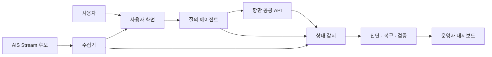
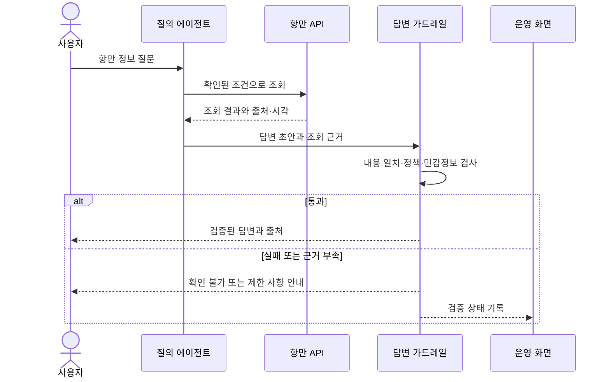

# Seak 서비스 기획서

**버전:** v1.0 초안  |  **작성일:** 2026.11.02  |  **상태:** 공유 전 초기안

해운·항만 데이터를 지도와 대화로 탐색하는 서비스의 방향과 초기 구현 범위를 공유하기 위한 문서다.

> **이 문서의 핵심:** 국내 항만 공공데이터와 조건부 AIS를 이용해 조회 서비스를 만들고, 에이전트 협업과 장애 복구를 별도의 운영 화면에서 검증한다. 데이터 확보 현황은 6절, 화면은 13절, 가드레일은 14절, 발표 근거는 15절에서 확인한다.

## 1 서비스 개요

Seak(시크)는 Sea와 Seek를 결합한 이름이다. 선박의 위치부터 항만·화물·무역 정보까지 지도와 자연어 대화를 통해 탐색하는 해운·물류 정보 서비스다.

장기적으로 선박과 항만, 물류 흐름을 연결한다. 첫 모델은 확보한 국내 항만 공공 API를 실제로 시험하고, AIS Stream의 발급·수신·이용 조건이 확인되면 관측 가능한 선박 위치를 추가한다. 에이전트 협업과 장애 감지·복구를 운영 화면에서 검증한다.

## 2 배경과 해결하려는 문제

선박 위치, 항만 입출항, 화물 처리 및 수출입 통계는 서로 다른 출처에 나뉘어 있다. 사용자는 여러 서비스를 오가며 자료의 기간과 단위를 확인해야 한다. Seak는 이를 하나의 지도와 챗봇에서 탐색하도록 돕는다.

초기 모델의 핵심 가설은 선박 위치와 항만·무역 통계를 한 화면에서 살펴보고 자연어로 조회하면 관련 정보를 이해하고 탐색하기 쉬워진다는 것이다. 이는 구현과 테스트로 검증할 가설이다.

## 3 대상 사용자와 사용 상황

- 해운·물류 정보에 관심 있는 사용자: 지도에서 선박 및 항만 현황을 살펴본다.
- 수출입·물류 실무자와 학습자: 항만별 물동량이나 품목별 무역 통계를 조회한다.
- 프로젝트 팀: 데이터 연결 가능성과 질의응답의 유용성을 검증한다.
사용자와 활용 상황은 초기 가정이며 팀 검토를 통해 구체화한다. 현재 문서의 목적은 구현 가능한 모델을 만드는 것이다.

## 4 서비스 목표와 초기 범위

- 항만을 지도에 표시하고, AIS Stream의 발급과 실제 수신이 확인되면 관측된 선박 위치와 마지막 수신 시각을 추가한다.
- 국내 항만의 실제 조회가 확인된 입출항·관제 기록과 선박 입출항 통계를 제공한다. 화물·무역 품목 정보는 해당 API 확보와 응답 확인 후 제공한다.
- 우측 하단 채팅창에서 선박·항만·품목에 관한 질문을 받고 연결된 데이터를 조회해 답한다.
- 데이터 출처, 기준 기간, 갱신 시점과 확인 가능한 범위를 화면과 답변에 표시한다.
실시간 위치는 수신 가능한 해역과 선박을 기준으로 한다. 개별 선박의 화물이나 상역·하역 정보는 적합한 데이터와 연결 식별자를 확보한 경우 제공한다. 항만 단위 통계와 개별 선박 기록은 구분한다.

## 5 주요 이용 흐름

1. 사용자는 항만을 검색하거나 지도를 탐색한다. 선박 위치는 AIS 수신이 확인된 경우 표시한다.
1. 선박 또는 항만을 선택해 확보된 위치, 운항, 입출항 및 화물 관련 정보를 본다.
1. 채팅창에 “부산항 입항 기록을 보여줘” 또는 “부산항의 월별 입항 선박 수를 비교해줘”라고 질문한다. 선박 위치 질문은 AIS 수신이 확인된 해역에서 시험한다.
1. 시스템은 질문에 맞는 데이터를 찾아 조회·계산하고 출처와 기준을 포함해 답한다.
1. 정보가 부분적으로만 확보되면 확인된 내용과 관련해 더 살펴볼 수 있는 정보를 안내한다.

## 6 데이터 확보 현황

| 데이터 | 현재 상태 | 초기 서비스에서 확인할 내용 |
|---|---|---|
| [선박운항정보](https://www.data.go.kr/data/15006353/openapi.do) | 팀이 확보함 | 항만·기간·호출부호별 선박 입출항 기록 |
| [관제정보](https://www.data.go.kr/data/15006354/openapi.do) | 팀이 확보함 | 선박과 항만의 관제 교신 기록 |
| [항만별 선박입출항실적 통계정보](https://www.data.go.kr/data/15059059/openapi.do) | 팀이 확보함 | 항만·월·연도별 입출항 선박 수와 총톤수 |
| [AIS Stream](https://aisstream.io/) | 개인 신청·발급·수신 시험 전 | 수신된 선박 위치·정보와 마지막 수신 시각 |
| 화물·컨테이너·국가별 무역 API | 추가 후보 | 신청·응답·기간·품목·단위와 선박 연결 가능성 |

공공 API의 확보 상태는 팀이 전달한 정보이다. 실제 요청·응답 및 이용 조건은 아직 검증이 필요하다. AIS가 국내 해역에서 들어오는지 확인되지 않았으며, 수신 가능한 선박만 관측한다. 항만 선박 수·선박 총톤수를 화물 수량으로 해석하지 않는다.

## 7 서비스 구성

사용자 → Streamlit 화면(지도와 팝업 채팅) → 질문 처리 및 조회 기능 → 데이터 저장소 → AIS와 공공데이터 수집. AIS 수집은 화면과 분리해 운용하는 방안을 우선 검토한다.

Python과 Streamlit을 기본 후보로 한다. FastAPI·Pydantic, LangGraph·Gemini API, Folium 또는 PyDeck, SQLite 또는 PostgreSQL을 검토하고 팀의 수업 제약·시험 결과와 비용에 따라 확정한다.

## 8 운영 및 안내 원칙

- 확인된 위치와 통계의 출처, 해당 기간 또는 마지막 수신 시각을 표시한다.
- 데이터 부재, 수신 장애, 수신 범위 제한을 구분해 사용자에게 자연스럽게 안내한다.
- 질문에 필요한 정보가 부족하면 확인 가능한 관련 정보나 추가 조건을 제안한다.
- 데이터별 무료 이용 범위와 서비스 표시·공유 조건을 조사해 기록한다.

## 9 사전 준비와 3일 실행 계획

이 일정은 개발 시작 전에 API와 계정 준비가 끝났다는 가정의 제안이다. 기간은 3일이며 담당 인원과 실제 작업 시간은 팀이 정한다. 1일 차의 목표는 핵심 흐름이 작동하는 첫 배포이며, 모든 기능의 완성을 뜻하지 않는다.

### 개발 시작 전 사전 준비

- 확보한 공공 API의 실제 요청과 응답을 확인하고, AIS Stream은 개인 계정 발급과 실제 수신을 시험한다. 키 발급만으로 연동 완료로 보지 않는다.
- 한국과 해외 시연 후보 해역에서 AIS가 실제 수신되는지 확인하고, 신호가 들어오는 해역과 확인 시각을 기록한다.
- 항만·화물·무역 API의 조회 조건, 샘플 응답, 제공 기간·단위, 호출 제한 및 배포 시 이용 조건을 확인한다.
- 공개할 수 있는 실제 샘플 응답과 API별 조사표를 정리한다. 키나 계정 정보는 샘플과 저장소에서 제외한다.
- AWS 사용 가능 여부와 비용 한도, 배포 담당, AI 모델 접근과 비용, GitHub 저장소 및 팀원 접근 권한을 확인한다.
- 시연할 지역·항만·대표 질문 3개 내외와 각 질문에 필요한 데이터의 실제 지원 여부를 정한다.
- 프론트엔드와 백엔드를 중심으로 담당자를 정하고, AI 에이전트·데이터·AWS·CI/CD·테스트·문서 업무를 팀 인원에 맞춰 배정한다.

### 1일 차 핵심 구현과 첫 배포

1. 프로젝트 기본 구조와 Streamlit 화면을 만들고 실행한다.
2. 백엔드는 항만 데이터 조회 기능을 만들고, 프론트엔드는 지도와 상세 화면을 연결한다. AIS 수신은 발급·수신·이용 조건이 확인된 경우 적용한다.
3. 사용 가능성이 확인된 항만·화물·무역 공공데이터 1개 이상을 연결한다.
4. 백엔드는 AI 에이전트를 구현하고 프론트엔드 채팅 화면과 연결한다. 질문의 의도와 조건을 파악하고, 선박·항만·통계 조회 도구 중 필요한 것을 선택·호출해 결과와 출처를 바탕으로 답하도록 채팅창에 연결한다.
5. AWS에 첫 개발 버전을 배포하고 외부 접속을 확인한다.
6. GitHub에 작업 기록을 남기고 Actions로 기본 검사와 테스트 자동화를 설정한다. 배포 자동화는 구현 상태에 따라 2일 차에 확인한다.

**산출물:** 지도와 데이터 기반 챗봇이 이어지는 첫 실행 버전, 배포 주소, 코드와 초기 작업 기록.

### 2일 차 통합 디버깅과 문서화

1. API 연결과 조회 결과, 선박·항만 상세 화면을 보완한다.
2. 챗봇의 답변과 실제 데이터 값·단위·기간·출처를 대조한다.
3. AIS 수신 중단, 빈 결과, 호출 실패, 오래된 위치와 미지원 질문을 시험한다.
4. AWS 접속과 재배포를 확인하고 CI 및 구현된 경우 CD를 검증한다.
5. 실제 문제와 해결·재검증 결과, 남은 한계를 디버깅 보고서에 정리한다.
6. 발표 자료와 시연 순서를 작성하고 정상 동작 시연 영상을 녹화한다.

**산출물:** 핵심 시나리오가 검증된 발표용 모델, 디버깅 보고서, 발표 자료 초안과 백업 영상.

### 3일 차 발표와 시연

- 서비스 주제와 해결하려는 문제, 데이터 연결 구조와 핵심 기능을 설명한다.
- 지도 → 선박·항만 선택 → 챗봇 질문 순서로 시연한다.
- GitHub 작업 이력과 실제 성공한 CI/CD 범위를 보여주고, 문제 해결 사례와 현재 한계를 설명한다.
- 발표 전 연결 상태를 확인한다. 라이브 API가 불안정하면 사전에 녹화한 영상을 녹화본이라고 밝히고 활용한다.

## 10 협업 및 기록 계획

| 구분 | 담당 업무 |
|---|---|
| 프론트엔드 | Streamlit 화면 구성, 세계 지도와 항만·선박 표시, 검색·필터, 상세 패널, 채팅창 및 로딩·오류 안내 |
| 백엔드 데이터 | 공공 API 연동, 데이터 정리, 선박·항만·통계 조회 및 연결 검증. AIS 수신은 확인된 경우 적용 |
| 백엔드 AI 에이전트 | 모델 연결, 질문 분석, 선박·항만·통계 조회 도구 선택·호출, 결과 검증, 자연어 답변과 출처 생성 |
| 배포와 협업 | AWS 배포, 환경 변수·비밀 관리, GitHub 저장소와 Actions, CI 및 구현 가능한 범위의 CD |
| 테스트와 발표 | 기능·답변 검증, 디버깅 보고서, README·발표 자료·시연 영상 작성 |

프론트엔드는 사용자가 보는 화면과 상호작용을, 백엔드는 데이터 수집·조회와 AI 에이전트 동작을 담당한다. Streamlit의 경우 같은 Python 프로젝트 안에서 화면과 서버 로직을 함께 작성할 수 있으므로 역할 분리는 업무 기준이며 별도 서버 구축을 의미하지 않는다.

배포·협업과 테스트·발표는 별도 인력이 반드시 필요하다는 뜻이 아니다. 팀원 수에 따라 프론트엔드 또는 백엔드 담당이 겸임한다. 구현 전 화면이 호출할 조회 함수와 에이전트 입력·출력 형식을 합의한다. 에이전트 담당은 데이터 담당과 도구 형식을 먼저 맞추고, 테스트 담당과 대표 질문·실패 사례를 확인한다.

GitHub에는 이슈, 브랜치, 커밋, 풀리퀘스트와 README를 통해 작업을 기록한다. CI는 코드 검사와 테스트 자동화, CD는 검증된 코드의 배포 자동화를 뜻한다. 자동 검사가 성공하면 Actions 실행 결과를 확인하고, AWS 자동 배포를 구현했다면 배포 성공 및 서비스 접속까지 확인한다. 수동 배포라면 CI와 수동 배포로 기록한다.

디버깅 보고서는 문제, 발생 조건, 확인 과정, 원인, 조치, 재검증 결과와 남은 한계를 포함한다. 실패했거나 해결 중인 문제도 사실대로 기록한다.

## 11 팀 논의와 버전 관리

- 팀 인원, 담당자와 실제 작업 가능 시간.
- 시연 지역·항만·질문과 API 응답 시험 결과.
- AWS 배포 방식, 예상 비용 및 CI/CD 구현 범위.
- 데이터 연결 가능성에 따른 조건부 기능과 대체 시연 계획.

현재는 팀 공유 전 **v1.0 초기안**이다. 팀원과 공유하는 시점부터 이 문서를 기준으로 관리한다. 그 이후 변경할 때 내용, 이유, 영향, 결정일과 결정자를 기록하고 버전 변경 여부를 팀에서 정한다. 기존 서비스 방향을 유지하면서 실제 데이터 검증 결과를 반영한다.

## 12 참고 데이터

AIS Stream https://aisstream.io/
선박운항정보 https://www.data.go.kr/data/15006353/openapi.do
관제정보 https://www.data.go.kr/data/15006354/openapi.do
항만별 선박입출항실적 통계정보 https://www.data.go.kr/data/15059059/openapi.do
품목별 화물처리실적 https://www.data.go.kr/data/15056791/openapi.do
컨테이너 처리실적 https://www.data.go.kr/data/15057586/openapi.do
국가별 수출입실적 https://www.data.go.kr/data/15100475/openapi.do
울산항 수출입 화물정보 https://www.data.go.kr/data/15156637/openapi.do

## 13 서비스 화면과 운영 구조

Seak의 초기 모델은 사용자가 항만 정보를 조회하는 화면과, 운영자가 시스템의 상태·복구 과정을 살펴보는 화면으로 나눈다. 두 화면은 Streamlit으로 구현하는 방안을 우선 검토한다.

| 화면 | 핵심 내용 | 독자가 확인할 수 있는 것 |
|---|---|---|
| 사용자 화면 | 항만 데이터, 조건부 선박 위치, 검색과 자연어 질문 | 조회 결과의 출처·기간·마지막 수신 시각과 제한 사항 |
| 운영자 화면 | API·수집기·모델 상태, 장애 사건, 복구 기록, 테스트·배포 이력 | 어떤 역할이 어떤 근거로 판단하고 조치했는지 |

AIS 위치는 발급·수신·이용 조건이 확인된 경우에만 표시한다. 저장·노출 범위는 각 데이터 제공자의 조건에 따른다.

## 14 에이전트 협업과 가드레일

질의 에이전트는 질문을 해석하고 허용된 조회 도구를 선택한다. 상태 감지자는 오류를 발견하고, 진단자는 원인과 조치를 판단하며, 복구 실행자는 허용된 조치만 수행한다. 검증자는 실행 결과를 별도로 확인한다. 각 역할은 사건 ID·시각·근거·시도 횟수·결과를 전달한다.

입력 검사와 필요한 개인정보 마스킹, 도구 허용 목록과 매개변수 검사, 외부 응답 검증, 답변 정책·원본 일치 확인, 최종 처리로 구분한다. 검증 방법과 모델·검사 서비스의 이용 조건은 팀이 정한다. 경고·차단 기록에는 비밀번호와 API 키를 남기지 않는다.

## 15 장애 복구와 발표 근거

예시 흐름은 **API 오류 감지 → 사건 기록 → 제한된 재시도 → 별도 결과 검증 → 복구 또는 운영자 확인 필요**이다. 공공기관의 실제 서비스를 대상으로 장애를 유발하지 않고, 시험용 응답으로 재현한다. 외부 서비스 장애는 우리 서비스가 직접 해결할 수 없으며 확인 가능한 범위와 마지막 수신 시각을 표시한다.

| 검증 대상 | 발표 시 확인할 근거 |
|---|---|
| 멀티 에이전트 협업 | 역할별 책임, 인계 형식, 시퀀스와 실제 실행 결과 |
| 가드레일 | 입력 차단·마스킹, 도구 권한, 원본 불일치 처리와 테스트 |
| 장애 복구 | 감지부터 재검증까지 사건 타임라인, 실제 시험 결과 |
| 배포와 CI/CD | 커밋·검사·빌드·배포·접속 확인과 실패 처리 |
| 운영 대시보드 | API 상태, 마지막 수신, 장애·복구 이력과 배포 상태 |

평가표의 Pod/Service 배포 매니페스트와 알림 조건을 확인한다. Docker Compose 사용만으로 해당 조건을 충족하는지는 강사 확인이 필요하다. 일정·인원·비용과 실제 구현 결과에 따라 계획을 조정하고, 완료하지 않은 기능을 완료로 표시하지 않는다. [교과목 3 평가표](https://docs.google.com/spreadsheets/d/1PTF-DiHO_BBKDDf7NSLnMHqlDb-L5p8P6__KLI6OHCA/edit?gid=287730879#gid=287730879)

