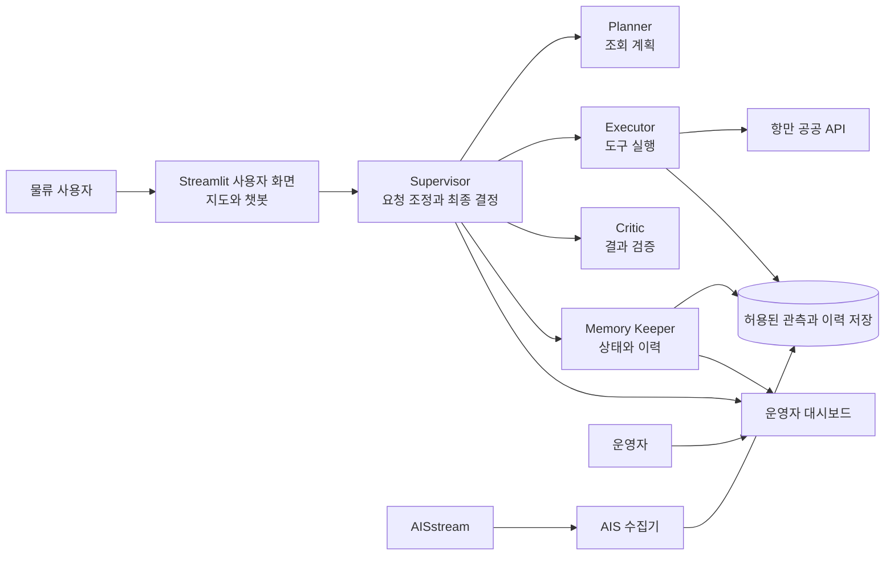
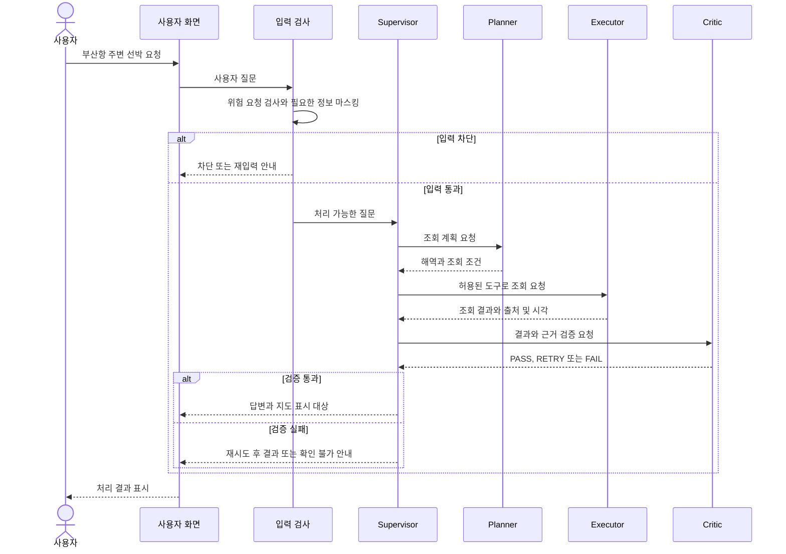

# Seak 서비스 기획서

**버전:** v1.0 팀 검토용 최신안  
**작성일:** 2026년 11월 2일  
**문서 상태:** 팀 검토용 계획. API 연동, 구현 및 시험 완료를 뜻하지 않습니다.

## 1. 프로젝트 개요

Seak는 부산항 출항 기록과 AIS 선박 위치를 연결해, 사용자가 지도와 자연어 질문으로 선박 운항 상황을 확인하는 서비스입니다. 시스템은 조회 중 발생한 장애를 탐지하고 제한된 범위에서 자동 복구하며, 그 과정과 검증 결과를 관리자 화면에 기록합니다.

**대표 이용 장면:** 사용자가 “부산항에서 출항한 A선은 지금 어디야?”라고 묻습니다. Seak는 항만의 출항 기록과 AIS 선박 식별정보를 비교하고, 같은 선박으로 확인되고 위치가 수신된 경우 마지막 관측 위치와 시각을 지도에 표시합니다.

장기적으로는 여러 해역의 선박과 항만, 물류·무역 정보를 함께 탐색하는 서비스를 지향합니다. 세계 지도를 이용할 수 있더라도 선박 위치는 실제 관측된 해역과 시점에 한합니다. 국가별 선박 필터, 추가 항만과 품목·국가 통계는 관련 데이터와 기준을 확인한 뒤 확장하는 후보입니다.

이 프로젝트의 교과목 핵심은 **멀티 에이전트 협업과 오류 자가 치유(AutoHealing)**입니다. 선박 지도와 물류 조회는 에이전트의 협업과 장애 대응을 검증하는 실제 서비스 시나리오입니다.

## 2. 사용자와 해결할 문제

| 대상 | 문제 | Seak가 제공할 가치 |
|---|---|---|
| 포워더·물류 실무자 | 항만 기록과 선박 위치를 각기 다른 서비스에서 찾아야 합니다. | 출항 기록, 신고 목적지와 수신된 위치를 한 화면에서 탐색합니다. |
| 수출입 기업 담당자 | 선박 현황과 무역 통계의 기간·범위를 구분하기 어렵습니다. | 데이터 출처와 기준 시각을 함께 제시하고 질문으로 조회합니다. |
| 프로젝트 운영자 | 장애 발생 시 원인과 조치 과정을 확인하기 어렵습니다. | 에이전트의 인계, 오류, 재시도와 검증 이력을 확인합니다. |

첫 두 대상은 향후 B2B 가능성을 검토하기 위한 가설입니다. 현재 계약 고객이나 검증된 매출이 있다는 뜻은 아닙니다.

## 3. 초기 모델의 범위

| 구분 | 내용 |
|---|---|
| 핵심 지역 | 부산항을 기본 항만으로 정하고 실제 AIS 수신과 공공 API 응답을 시험합니다. |
| 핵심 기능 | 출항 기록 조회, 수신된 선박 지도, 선박 상세, 질문과 지도 강조, 출처·기준 시각 표시 |
| 평가 핵심 | 역할이 분리된 멀티 에이전트, Critic 검증, 공통 장애 4종, 자동 복구, 운영 화면과 CI 실패 알림 |
| 조건부 기능 | 출항 기록과 AIS 선박의 연결, 신고된 화물명세·화물량 표시. 필드 값, 연결 정확도와 이용 조건을 검증한 경우에만 제공합니다. |
| 후속 후보 | 국가·품목별 무역 통계, 부산 이외 항만, 대체 AIS 제공자, Kubernetes, 유료 B2B 서비스 |
| 초기 제외 | 모든 해역의 완전한 위치 보장, 선박별 세부 화물 명세의 임의 추정, 실시간 개별 컨테이너 추적, 결제 기능 |

부산항의 항만 정보와 AIS 신호가 실제로 연결되는지 먼저 확인합니다. 특정 해역에서 신호가 없으면 위치를 만들어 내지 않고 미수신으로 표시합니다. 필요할 경우 실제 수신이 확인된 다른 해역의 화면을 별도로 시연하되 부산항 결과라고 표시하지 않습니다.

## 4. 사용자가 보는 화면

### 4.1 사용자 화면

- **지도:** 수신된 선박 위치와 항만을 표시합니다. 오래된 위치에는 마지막 수신 시각을 표시합니다.
- **검색과 필터:** 항만, 조회 기간과 실제 제공되는 선종 정보로 검색합니다.
- **선박 상세:** 선박명, 호출부호, 출항일시, 신고 목적지와 마지막 AIS 수신 위치를 확인 가능한 범위에서 표시합니다. 화물명세와 적하화물톤은 실제 응답과 의미가 확인된 경우에만 표시합니다.
- **항만 상세:** 선택한 항만의 입출항 기록과 확보된 항만별 선박 수·총톤수 통계를 제공 범위 안에서 보여줍니다. 화물·컨테이너·품목 통계는 적합한 API와 응답이 확인된 경우에 추가합니다.
- **챗봇:** 질문을 분석하고 검증된 조회 결과를 설명합니다. 사용자가 요청하면 조회 결과에 속하는 선박을 지도에서 강조합니다. 항만·기간 등 필요한 조건이 불명확하면 되묻거나 사용한 기본 조건을 알려줍니다.
- **안내:** 출처, 관측·신고 시각, 데이터 없음과 장애 상태를 구분합니다.

팝업은 Streamlit의 상세 창이나 사용한 지도 도구의 정보 창으로 구현합니다. 구체적인 팝업 위치와 지도 클릭 동작은 연동 시험 후 확정합니다.

### 4.2 관리자 화면

관리자 화면은 사용자 화면과 구분하고 접근을 제한합니다. 다음 항목은 실제로 수집된 값만 표시합니다.

- 요청별 Supervisor, Planner, Executor, Critic, Memory Keeper의 처리 과정과 인계 상태
- AIS 수집기, 공공 API, 모델과 DB의 상태 및 마지막 확인 시각
- 장애 감지, 진단, 재시도, 복구 검증과 종료 결과
- 공통 장애 시험 결과, 실제 복구 시간, 수동 개입 여부
- 테스트·빌드·배포 결과와 파이프라인 실패 알림 결과

### 4.3 대표 질문과 제공할 답

| 질문 | 제공 가능한 결과와 조건 |
|---|---|
| 부산항 주변 선박을 노란색으로 보여줘. | 정해진 해역·시간 창에서 실제 수신한 선박을 지도에 강조하고 수와 기준 시각을 표시합니다. |
| 부산항에서 출항한 A선은 어디에 있어? | 출항 기록과 AIS 선박의 동일성이 검증되고 위치가 수신됐다면 마지막 위치·시각과 신고 목적지를 표시합니다. 그렇지 않으면 이유를 안내합니다. |
| 이 선박이 실은 화물은? | 선박·항차가 연결되고 화물명세 코드와 적하량의 의미가 확인된 범위만 표시합니다. 품목별 무게를 임의로 만들지 않습니다. |
| 부산항 입출항 선박 수를 알려줘. | 확보한 통계 API가 지원하는 기간·기준의 선박 수와 출처를 표시합니다. 총톤수는 선박 크기 지표이지 화물 무게가 아닙니다. |
| 특정 나라의 특정 품목 수출입은? | 통계 API를 추가 확보하고 응답을 검증한 경우 월·국가·품목과 단위를 표시합니다. 개별 선박의 화물과 직접 연결하지 않습니다. |

## 5. 데이터 확보 현황

아래 현황은 팀이 공유한 내용을 기준으로 합니다. 키 발급과 실제 데이터 수신·서비스 제공 권한은 별개입니다.

| 데이터 | 현재 상태 | 초기 활용과 확인 사항 |
|---|---|---|
| [해양수산부 선박운항정보](https://www.data.go.kr/data/15006353/openapi.do) | 팀이 활용 키를 확보했다고 보고했습니다. | 항만·기간·호출부호와 출항 기록, 신고 목적지, 화물명세·적하량 필드를 실제 응답으로 확인합니다. |
| [해양수산부 관제정보](https://www.data.go.kr/data/15006354/openapi.do) | 팀이 활용 키를 확보했다고 보고했습니다. | 항만 관제 교신과 호출부호를 보조 근거로 확인합니다. |
| [항만별 선박입출항실적 통계](https://www.data.go.kr/data/15059059/openapi.do) | 팀이 활용 키를 확보했다고 보고했습니다. | 항만별 선박 수와 총톤수를 조회합니다. 총톤수는 화물 무게가 아닙니다. |
| [AISstream](https://aisstream.io/documentation/) | 팀원이 API 키를 발급받았습니다. | 부산과 시연 후보 해역의 실제 수신, 호출부호·MMSI 연결, 보관·표시 조건을 확인합니다. |
| [Pelyr](https://pelyr.com/pelyr-data-license) | 팀원이 API 키를 발급받았다고 공유했습니다. | 보조 후보입니다. 데이터 출처별 라이선스와 계정 조건을 구분하고 일반 무료 데이터의 비상업 조건을 확인합니다. |
| [BarentsWatch](https://developer.barentswatch.no/docs/AIS/live-ais-api/) | 팀원이 클라이언트 ID와 비밀값을 확보했다고 공유했습니다. | 노르웨이 관할 해역의 보조 후보입니다. 재가공과 출처 조건을 확인합니다. |
| [Fintraffic Digitraffic](https://www.digitraffic.fi/en/marine-traffic/) | 별도 API 키 없이 이용 가능한 후보입니다. | 핀란드 주변 수신 데이터와 CC BY 4.0 출처·변경 표시 조건을 확인합니다. |
| [MarineTraffic](https://www.marinetraffic.com/) | 개인용 서비스·체험 화면을 공유했습니다. | 개인용 웹 서비스 구독과 개발용 API는 구분합니다. API 상품·접근 권한·제3자 표시와 재판매 조건은 미확인입니다. |
| [관세청 품목·국가별 수출입실적](https://www.data.go.kr/data/15100475/openapi.do) | 추가 신청 후보입니다. | 국가와 품목을 함께 보는 월별 무역 통계입니다. 부산항의 개별 선박 화물로 간주하지 않습니다. |

관세청의 [품목별 수출입실적](https://www.data.go.kr/data/15101609/openapi.do)과 [국가별 수출입실적](https://www.data.go.kr/data/15101612/openapi.do)도 추가 신청 후보입니다. 각각의 집계를 합쳐 특정 국가의 특정 품목 수치를 임의로 산출하지 않습니다.

[국가물류통합정보센터 품목별 물동량 통계](https://nlic.go.kr/nlic/harborPrdlstGtqy.action)에서는 부산항의 월별 품목 처리 통계를 확인할 수 있습니다. 해당 화면의 자동 연동 방법과 재사용 조건은 별도 확인이 필요합니다. 이 통계를 개별 선박의 화물이나 특정일의 수출량과 동일하게 취급하지 않습니다.

기존에 검토했던 [품목별 화물처리실적](https://www.data.go.kr/data/15056791/openapi.do), [컨테이너 처리실적](https://www.data.go.kr/data/15057586/openapi.do), [울산항 수출입 화물정보](https://www.data.go.kr/data/15156637/openapi.do)도 추가 후보로 남깁니다. 발급과 실제 응답, 기간·항만·품목 필드, 연결키와 이용 조건을 확인하기 전에는 제공 가능한 기능으로 확정하지 않습니다. 품목별 화물처리실적의 특정 항만 조회는 실제 사용할 작업의 조건과 응답에서 확인해야 합니다.

### 5.1 AISstream을 지도에 연결하는 방식

사용자 브라우저가 AISstream에 직접 연결하지 않습니다. 서버의 수집기가 작은 시연 해역을 구독해 수신한 선박 정보를 정리하고, 사용자 화면은 서버에서 제공하는 위치와 마지막 수신 시각을 가져옵니다. 챗봇이 지도 강조를 요청할 때도 같은 조회 결과를 사용합니다.

- API는 사용자가 정한 초마다 모든 선박의 위치를 반환하는 방식이 아니라, 해역과 메시지 조건에 맞는 관측이 들어올 때 전달하는 스트림입니다. 지역의 모든 선박이나 빈틈없는 실시간 항적을 보장하지 않습니다.
- 공식 문서 기준 계정당 구독 연결 3개, 같은 출발 IP에서 열린 연결 3개 제한이 있습니다. 선택적인 MMSI 필터는 한 구독에 최대 200개를 지정할 수 있다는 뜻이며, 해역에서 수신할 전체 선박 수가 무조건 200척이라는 뜻은 아닙니다.
- 연결 후 정해진 시간 안에 구독 조건을 전송하고, 재연결 시 조건을 다시 보냅니다. 기존 구독 변경은 이전 조건에 추가되는 것이 아니라 전체 조건을 대체합니다.
- 팀원과 여러 브라우저가 각자 외부 연결을 늘리기보다 서버 수집기를 공유하는 구성을 우선 검토합니다. 키는 서버의 비밀값으로만 관리합니다.
- 위치 정보와 선박에 적재된 개별 상품의 정보는 다른 데이터입니다. AIS만으로 특정 컨테이너나 품목을 실시간 추적한다고 설명하지 않습니다.

연결·수신 상황과 이용 조건을 실제로 확인하고, 외부 공개 또는 향후 유료 서비스의 재가공·제공 권한은 공급자 조건을 별도 확인합니다. 제한과 동작은 [AISstream 공식 문서](https://aisstream.io/documentation/)를 기준으로 다시 확인합니다.

## 6. 멀티 에이전트 협업 설계

다음은 목표 설계이며 실제로 구현한 역할과 실행 기록을 제출합니다. 각 역할은 입력, 행동 권한과 출력을 독립적으로 갖습니다.

| 역할 | 책임 | 하지 않는 일 | 주요 출력 |
|---|---|---|---|
| Supervisor | 작업 배정, 분기 및 최종 성공·재시도·종료 결정 | 검증을 건너뛰거나 허용되지 않은 복구를 지시하지 않습니다. | 다음 역할과 최종 상태 |
| Planner | 질문을 해역·기간·선박·요청 작업으로 구조화하고 계획을 작성 | 임의의 선박이나 조회 값을 만들지 않습니다. | 조회 계획과 제약 |
| Executor | 허용된 도구로 항만 기록과 AIS 관측을 조회 | 도구 오류를 성공으로 바꾸거나 임의 명령을 실행하지 않습니다. | 조회 결과와 출처 |
| Critic | 식별자, 수치, 시각, 출처 및 응답 형식을 검증 | Supervisor 대신 최종 종료를 결정하거나 근거를 수정하지 않습니다. | PASS·RETRY·FAIL 판정과 이유 |
| Memory Keeper | 요청별 상태·인계 이력·재시도 횟수와 근거 참조를 관리 | API 키와 불필요한 개인정보를 저장하지 않습니다. | 상태 참조와 기록 결과 |

정상 흐름은 **Supervisor → Planner → Executor → Critic → Supervisor의 최종 결정 → 화면**입니다. 각 단계는 요청 ID와 시도 횟수를 전달합니다. 검증이 실패하면 이유를 전달해 정해진 횟수 안에서 재시도하고, 계속 실패하면 확인 가능한 정보만 안내합니다.

다섯 역할과 별도 Memory Keeper는 가이드의 선택 가점 목표입니다. 모두 LLM을 호출할 필요는 없으며 검증과 복구는 우선 재현 가능한 코드로 제한합니다. 다만 역할을 이름만 붙인 함수로 두지 않고 실제 입력·결정·출력·인계 기록으로 증명합니다. 실제 구현 방식의 에이전트 인정 여부는 강사에게 확인합니다.

### 6.1 서비스 전체 구조도

아래 도식은 구현 전 목표 구조입니다. 사용자 화면과 관리자 화면을 구분하고, 에이전트는 서버에서 허용된 도구와 저장소를 이용합니다.

**그림을 표시하지 않는 환경:** 사용자 화면 → Supervisor → Planner·Executor·Critic·Memory Keeper. Executor는 항만 API와 저장소를 조회하고, AIS 수집기는 관측 데이터를 저장합니다. 운영자는 별도 대시보드에서 처리 상태를 확인합니다.

### 6.2 질문 처리와 가드레일

1. 사용자가 지도 또는 챗봇에서 선박·항만을 조회합니다.
2. 입력의 형식과 위험 요청을 확인하고 필요한 개인정보와 비밀정보는 모델에 보내기 전에 마스킹합니다.
3. Planner가 조회 조건을 정리하고 Executor가 허용된 공공 API·관측 데이터 조회 도구만 호출합니다.
4. Critic이 식별자·수치·시각·출처와 답변 형식을 원본과 비교합니다.
5. Supervisor가 검증 통과, 제한된 재시도 또는 확인 불가를 결정하고 결과를 제공합니다. 단계와 사유는 비밀값을 제외해 기록합니다.

#### 질문과 가드레일의 처리 순서

**그림을 표시하지 않는 환경:** 입력 검사 → 계획 → 조회 → Critic 검증 → Supervisor 최종 결정 → 사용자에게 결과 표시. 입력 차단이나 검증 실패 시에는 그 이유와 확인 가능한 범위를 안내합니다.

검출 방식과 모델 사용은 구현·시험 후 결정합니다. 마스킹이나 모델 검증만으로 모든 개인정보와 잘못된 답변을 탐지한다고 보장하지 않습니다.

## 7. 배포와 장애 대응

### 7.1 권장 구성

Docker Compose를 필수 실행 방식으로 사용합니다. 평가 가이드의 역할별 서비스 분리 권장에 맞춰 아래 구성을 우선 설계합니다.

| 서비스 | 책임 |
|---|---|
| Streamlit | 사용자 지도·챗봇과 권한이 제한된 운영 화면 |
| Supervisor API | 요청 접수와 에이전트 흐름·최종 결정 |
| Planner / Executor / Critic | 각 역할을 독립 실행하는 경량 서비스 |
| Memory Keeper | 상태와 중간 결과 저장 정책 관리 |
| AIS 수집기 | 서버 측 AIS 연결과 수신·재연결 |
| PostgreSQL | 허용된 선박 관측, 항만 기록, 요청·장애 이력 저장 |

총 8개 서비스의 분리안이며 하나의 가상 서버에서 운영할 수 있도록 설계합니다. 실제 메모리·비용은 측정 전 미확정입니다. 용량이 부족하면 일부 역할을 같은 백엔드 컨테이너에 두는 대안을 검토하되, 역할 간 인계와 실패 분리는 유지하고 평가 해석을 확인합니다. 개별 에이전트마다 별도의 AWS 서버를 요구하지 않습니다.

상태 저장에는 볼륨을 사용하고, 인증키는 서버와 CI의 비밀 관리 기능에만 주입합니다. 운영 화면이나 에이전트에 임의 셸 명령과 Docker 관리 권한을 부여하지 않습니다.

### 7.2 기술 구성 후보

| 영역 | 권장 기술과 역할 |
|---|---|
| 사용자·운영 화면 | Python, Streamlit, PyDeck 또는 Folium. 지도 클릭과 팝업 연동 가능성을 먼저 검증합니다. |
| 서버와 데이터 계약 | FastAPI와 Pydantic을 후보로 화면 요청, 역할 간 입출력과 검증 규칙을 분리합니다. |
| 에이전트 | Gemini API와 LangGraph를 후보로 검토합니다. 모든 역할이 LLM을 호출할 필요는 없으며 비용과 실측 결과로 확정합니다. |
| 수집·저장 | AISstream WebSocket 수집기, 확보한 공공 API, PostgreSQL. 보관 조건과 서버 메모리를 확인합니다. |
| 배포·검증 | Docker Compose, GitHub Actions, AWS의 팀 허용 범위 내 경량 서버, pytest. 필요시 HTTPS와 관리자 인증을 추가합니다. |
| 기록·운영 | 구조화된 로그, 서비스 상태와 실제 수집 지표를 관리자 화면에 표시합니다. 별도 유료 관측 플랫폼은 필수가 아닙니다. |

SQLite도 초기에 검토한 경량 저장소 후보입니다. 다만 공통 DB 연결 장애를 재현하려면 서버형 DB에 대한 연결 시험이 별도로 필요하므로, 우선 PostgreSQL 기반을 제안합니다.

도구는 팀의 강의 내용·제약, 연동 결과와 비용으로 확정합니다. 서버 자원·모델 호출량 및 AWS 비용은 측정 전이므로 무료 사용을 보장하지 않습니다.

### 7.3 필수 장애 4종

| ID | 장애 | 목표 대응 |
|---|---|---|
| FT-01 | 외부 API 타임아웃 | 제한된 재시도 후 유효한 대체 결과 또는 안전 종료 |
| FT-02 | Executor 실행 예외 | 예외 감지, 시도 횟수 기록과 제한된 재실행 |
| FT-03 | DB 연결 오류 | 연결 실패 감지와 재연결, 재검증. 복구 불가 시 안전 종료 |
| FT-04 | LLM 출력 형식 오류 | 스키마 오류 감지와 제한된 재생성 또는 안전 종료 |

실제 외부 기관 서비스에 장애를 일으키지 않습니다. 시험 전용 모의 서버·어댑터와 격리된 DB 환경에서 장애를 주입합니다. 캐시나 대체 API는 이용 조건과 실제 응답을 확인한 경우에만 사용합니다.

네 시험은 실패를 감지만 하는 데 그치지 않고, 각 장애가 일시적으로 발생한 뒤 자동 재시도·재연결 또는 재검증을 통해 정상 응답으로 돌아오는 경로를 우선 구현합니다. DB 장애 시에는 시험 환경에서 연결을 일시 차단하고 자동 해제한 후 실제 DB 읽기·쓰기를 확인합니다. 주입부터 정상 응답까지 사람이 재시작하지 않아야 자동 복구로 집계합니다. 결과는 실제 시험 후 기록합니다.

### 7.4 운영 화면과 장애 확인

운영자는 API 호출 성공·실패와 응답 시간, AIS 마지막 수신·연결 상태, 에이전트 처리·재시도, 모델 호출 시간, DB 상태와 CI 실행 결과를 실제 수집한 범위에서 확인합니다. 미구현 지표나 외부 서비스 상태를 추정해 표시하지 않습니다. AIS 연결은 유지되지만 수신이 없는 경우와 WebSocket 연결 자체가 끊긴 경우를 구분합니다.

## 8. 평가와 제출 계획

팀 제공 프로젝트 진행 가이드의 배점을 기준으로 설계와 실제 증거를 연결합니다.

| 평가 영역 | 배점 | 준비할 결과 |
|---|---:|---|
| 프로젝트 기획 및 목표 달성도 | 25 | 서비스 목표, 최소 3개 역할과 Critic, Handoff·상태 설계 |
| 서비스 완성도 및 활용 가능성 | 35 | 실제 데이터 조회와 지도·챗봇, 공통 장애 4종의 재현 및 복구 시험 |
| 프로젝트 수행 과정 및 개선 노력 | 20 | 실패·수정·재시험 기록, 이슈·커밋·CI 실행 이력 |
| 발표 구성 및 전달력 | 20 | 사용자와 운영자 관점 시연, 제약과 근거를 포함한 발표 |

필수 조건은 에이전트 3개 이상과 Critic, 공통 장애 4종, Docker Compose 전체 실행, 테스트 실패 시 배포 차단 실증, 파이프라인 실패 알림 1개 채널입니다. 5개 이상 역할과 Memory Keeper 분리, Kubernetes, 자동 배포·롤백과 확장 알림은 선택 가점 목표입니다.

Kubernetes는 제공된 가이드에서 **선택**입니다. 평가표의 Pod·Service 관련 문구와의 해석은 강사에게 확인하며, 추가 비용을 고려해 도입을 결정합니다.

실제 필수 산출물은 ① 멀티 에이전트 아키텍처 설계서 ② 배포 및 장애 복구 보고서 ③ CI/CD 파이프라인 구현 결과 보고서입니다. 이 기획서와 PRD는 준비 문서이며, 세 결과 보고서를 대신하지 않습니다.

프로젝트 기간과 제출은 제공 가이드 기준 **2026년 11월 5일~11월 9일, 11월 9일 15시까지**입니다. 제출처는 Git 저장소이며 발표자료와 저장소 URL을 함께 준비합니다.

## 9. 팀 역할과 우선 진행 순서

| 역할 제안 | 책임 |
|---|---|
| 팀원 1 | Streamlit 지도·선박 상세·챗봇과 사용자 화면 |
| 팀원 2 | 항만 API·AIS 수집과 선박 식별·데이터 검증 |
| 팀원 3 | 에이전트·Handoff·Critic·가드레일 |
| 팀원 4 | Docker Compose·CI/CD·운영 화면·장애 시험 조정 |

각 담당은 주 책임이며 코드 리뷰, 시험과 발표는 함께 수행합니다.

1. 부산항 실제 출항 응답과 AIS 신호를 각각 확인하고, 한 선박의 호출부호와 MMSI를 연결할 수 있는지 시험합니다.
2. 정상 조회와 Critic 검증이 이어지는 최소 흐름을 완성하고 Docker Compose로 실행합니다.
3. 필수 장애 4종을 각 3회 이상 시험하고 복구 시간과 실제 결과를 기록합니다.
4. 테스트 실패 시 배포가 차단되고 한 개 알림 채널에 실패가 전달되는지 실증합니다.
5. 검증된 범위를 기준으로 세 산출물과 발표 자료를 작성합니다.

### 9.1 작업 단계와 팀 협업

가이드의 프로젝트 기간은 11월 5일~9일이며, 아래는 팀이 세부 시간을 조정할 수 있는 3단계 작업안입니다.

1. **착수와 최소 연결:** AWS·GitHub·모델 접근과 비용 한도, API 응답과 AIS 수신 해역을 확인합니다. 대표 질문과 팀 간 입출력 형식을 합의하고 공공 API 1개 이상, Streamlit 화면, 최소 에이전트 흐름 및 첫 Compose 실행을 연결합니다.
2. **통합과 검증:** 지도·상세·챗봇과 데이터를 연결하고 출처·시간·단위를 원본과 대조합니다. 공통 장애 4종, 가드레일과 CI 실패 시 배포 차단을 시험하고 문제를 수정·재시험합니다.
3. **마무리와 발표:** 실제 결과로 세 산출물과 발표 자료를 작성합니다. 서비스·에이전트 협업·장애 복구·CI 시연을 연습하고, 불안정한 발표 환경에 대비할 녹화 영상을 준비합니다. 영상은 녹화본이라고 밝힙니다.

GitHub 이슈·브랜치·커밋·풀리퀘스트와 README에 담당, 실행 방법, 출처, 문제·수정·재시험을 기록합니다. 프론트엔드, 데이터, 에이전트, 배포는 책임 분담이며 각각 별도 서버나 인력이 필수라는 뜻은 아닙니다. 개발 전에 조회 도구의 입력·출력·오류 형식을 합의합니다.

## 10. 팀이 결정할 사항

- 부산항 수신 실패 시 사용할 실제 대체 해역과 시연 방식
- 선박 동일성 검증 기준, 오래된 위치의 기준과 데이터 보관 기간
- 역할별 서비스 분리 범위와 서버 메모리·비용 한도
- 실패 알림 채널과 담당자, 자동 배포·Kubernetes의 추가 여부
- 화물명세 코드의 의미와 품목별 화물량 연결 가능성
- API별 제3자 표시·재가공·보관 및 상업 이용 확인 결과
